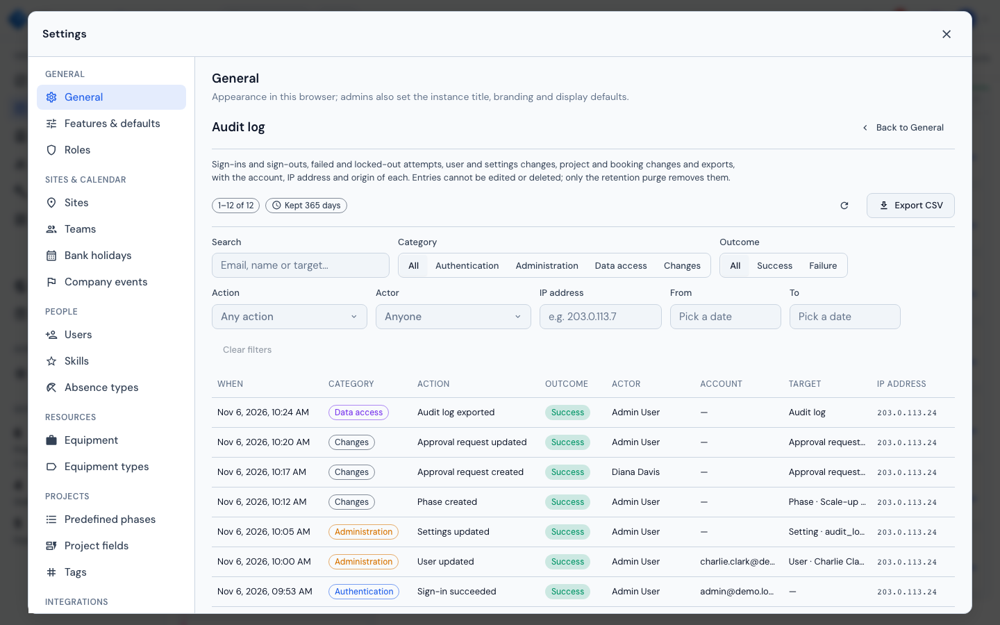
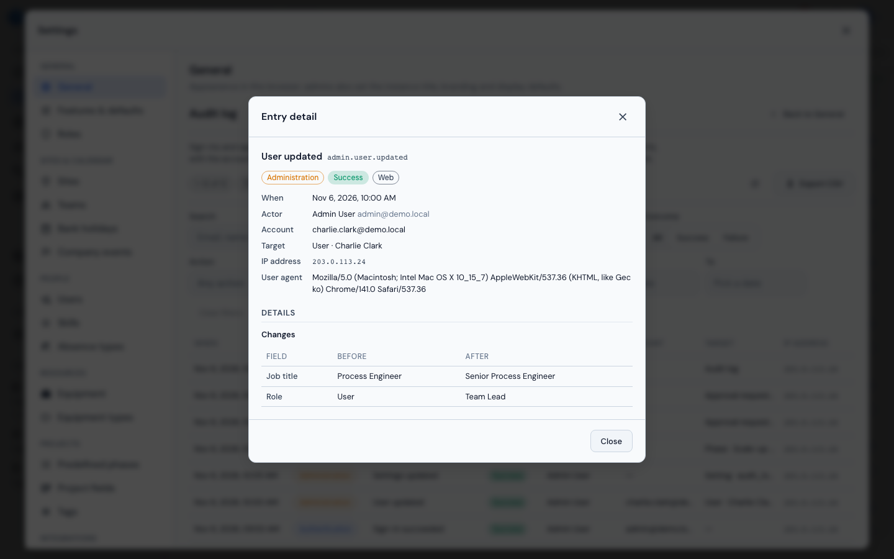

# Audit Log

The **Audit log** in **Settings → General → Audit log** answers the two questions a security review asks of a planning instance: *what changed in it*, and *who signed in and how*. Every sign-in, failed attempt and lockout, every administrative change, every export and every project, booking or comment change is one entry, newest first, with the account, the IP address and the origin of the request. Entries cannot be edited or deleted; only the [retention](#retention) setting removes them.

{ loading=lazy }

## Who can see it

The section needs the **`system.audit_log`** permission, which only the **Admin** role holds by default. To give a security or compliance officer read access without making them an administrator, create a role that carries `system.audit_log` under **Settings → Roles** (see [Roles & Permissions](../user-guide/settings.md#roles-permissions)) and assign it to them. Superusers do not see the section by default. Without the permission every `/api/audit-log` route answers 403.

## Columns

| Column | Description |
|--------|-------------|
| **When** | Date and time the action happened, in your local time |
| **Category** | **Authentication**, **Administration**, **Data access** or **Changes** |
| **Action** | What happened, for example *User updated*. The raw key (`admin.user.updated`) is the cell's tooltip and is shown in the [entry detail](#reading-an-entry); see the [action catalogue](#action-catalogue) |
| **Outcome** | **Success** or **Failure** |
| **Actor** | The user who did it, as named when the entry was written, so the entry still names them after the account is deleted. A failed sign-in for an existing account names that account; the Actor is empty only when the e-mail matched no account (or for an entry raised by the platform itself) |
| **Account** | The account the action was about: the e-mail typed into a failed sign-in, or the user whose password was set |
| **Target** | The object acted on, as *Type · name*, for example *Site · Basel* |
| **IP address** | The client's address (see [Client IP address](#client-ip-address)) |

An empty value shows "—". The **Origin** (**Web** for a request from a browser, **System** for one raised by the platform itself) is shown in the [entry detail](#reading-an-entry) and the export, not in the table.

## Filters

The toolbar above the table narrows the list by:

- **Search**: a case-insensitive match over the actor's e-mail and name, the account's e-mail and the target's name, so one address finds both what that person did and what was attempted against their account.
- **Category** and **Outcome** chips.
- **Action**: pick one action from those recorded so far.
- **Actor**: pick one person.
- **IP address**: an exact address.
- **From** and **To**: a date range, both days included.

**Clear filters** resets them all. Any change of filter, and of the **Per page** size (25, 50, 100 or 200), returns to the first page. **Refresh** reloads the list.

## Reading an entry

Click a row (or, from the keyboard, tab to its time and press Enter or Space) to open the **Entry detail** dialog. It shows when, who, the account, the target, the project when there is one, the IP address, the origin, the browser (user agent) and, for a failure, the **reason**, written out ("Wrong password (`bad_password`)"). Under **Details**:

- **Changes**: a Field / Before / After table, one row per changed field. A credential is never stored: a password, token or client secret is replaced before the entry is written and shown as **Secret value**. A very long value shows as "changed (n characters)".
- **Context**: facts that frame the action without being part of it, such as how many rows an export held or how many sessions a password change ended.

An entry without any of these reads "No further details recorded." The dialog has no actions.

{ loading=lazy }

## Export CSV

**Export CSV** downloads the entries matching the current filters, newest first, up to **50 000 rows**, as `audit-log.csv`. The columns are `id`, `created_at` (UTC), `category`, `action`, `outcome`, `actor_user_id`, `actor_email`, `actor_name`, `subject_email`, `target_type`, `target_id`, `target_label`, `project_id`, `project_name`, `ip`, `user_agent`, `origin` and `details` (compact JSON). A cell that starts with `=`, `+`, `-`, `@`, a tab or a carriage return gets a leading `'`, so a spreadsheet never runs it as a formula. The export is itself recorded, as `access.audit_log.exported`, before the file is built, so an export of the log always leaves a trace in it.

## Action catalogue

Action keys are past tense and built as `category.entity.verb`.

### Authentication

| Action | Recorded when |
|--------|---------------|
| `auth.login.succeeded` | A user signs in with e-mail and password |
| `auth.login.failed` | A password sign-in is refused. The reason says why (below). After 100 failed attempts from one address within 15 minutes, one more entry is written with `suppressed: true` in its details (at most one such entry every 15 minutes) and further failures from that address are not recorded until fewer than 100 fall within 15 minutes; the sign-in lockout itself is unchanged |
| `auth.login.locked` | A failure reaches the [login throttle](../developer-guide/auth-and-tenancy.md) limit. Written once, together with that attempt's `auth.login.failed`; the details carry `retry_after` and `locked_until`, and it names the account when it exists. Further refused attempts while locked record nothing |
| `auth.logout` | A signed-in user signs out |
| `auth.password.changed` | A user changes their own password; the details carry the number of sessions ended |
| `auth.sso.succeeded` | A user signs in through Microsoft Entra; the details say whether the account was created by this sign-in |
| `auth.sso.failed` | An SSO sign-in is refused once the workspace is known. The reason says why |

Reasons on `auth.login.failed`:

| Reason | Meaning |
|--------|---------|
| `unknown_user` | No account has that e-mail address |
| `bad_password` | The password is wrong |
| `inactive` | The account is deactivated |
| `throttled` | The attempt locked the account (`auth.login.locked`) |

Reasons on `auth.sso.failed`:

| Reason | Meaning |
|--------|---------|
| `config_missing` | SSO is disabled or not fully configured (no client secret, organization lookup failed) |
| `exchange_failed` | The identity provider refused the token exchange or could not be reached |
| `graph_failed` | The Microsoft Graph profile or group lookup failed |
| `group_denied` | The user is not a member of an allowed group |
| `no_email` | The identity provider returned no e-mail address |
| `no_account` | No account matches and automatic creation is off |
| `inactive` | The account is deactivated |

Only our own fixed reason codes are recorded; text from Entra is never stored.

### Administration

Every update records its **Changes** (old and new value of the fields that moved) and writes nothing when nothing changed. A setting saved for the first time shows its default as the old value; saving the value it already has (or its default) records nothing.

| Action | Recorded when |
|--------|---------------|
| `admin.user.created`, `.updated`, `.deleted` | A user is created, edited (name, e-mail, job title, role, capacity, resource flag, sites, teams, skills) or deleted. A role change shows the roles' names as they were at that moment. The details note the sessions ended by a role change. The **Account** column holds the user's e-mail on every `admin.user` entry |
| `admin.user.activated`, `.deactivated` | A user is switched on or off, through the switch in the user list or by changing **Active** in the user dialog; a deactivation notes the sessions it ended. An edit that also changes other fields records `admin.user.updated` for those as well |
| `admin.user.password_set` | An administrator sets a user's password. No password is recorded |
| `admin.role.created`, `.updated`, `.deleted` | A role is created, renamed or deleted |
| `admin.role.permissions_updated` | A role's permissions are saved; each moved key shows its old and new mode (allow, approval or not granted) |
| `admin.approval_policy.updated` | Who approves a kind of own booking changes |
| `admin.settings.updated` | An instance setting is saved, one entry per setting. A value over 200 characters records only that it changed and its length |
| `admin.sso.updated` | The tenant SSO configuration is saved; the client secret shows as **Secret value** |
| `admin.sso.tested` | **Test configuration** runs. The outcome is whether the credentials worked; the reason names the first failed check by a fixed code (`tenant_id`, `client_id`, `client_secret`, `redirect_uri`, `outbound_network`, `microsoft_directory`, `client_credentials`, `microsoft_sign_in`) or `rejected` |
| `admin.site.created`, `.updated`, `.deleted` | A site is changed |
| `admin.team.created`, `.updated`, `.deleted` | A team is changed, members included |
| `admin.<entity>.created`, `.updated`, `.deleted` | The same three verbs for skills, absence types, equipment (and equipment types), bank holidays (including a calendar import and a refresh), company events (including an import), predefined phases, project fields and tags. The target is the entity and its id when the request path has one; these entries carry no Changes table |

### Data access

| Action | Recorded when |
|--------|---------------|
| `access.export.msproject` | A project is exported as MS Project XML; the details carry the task count |
| `access.export.csv` | A project is exported as CSV; the details carry the row count |
| `access.export.site` | A site's Excel export is downloaded |
| `access.audit_log.exported` | The audit log itself is exported to CSV |

### Changes

Changes to the planning data are recorded from the **same event that drives the live update** (see [Real-Time Collaboration](../user-guide/collaboration.md)), so what appears here is what other users saw happen. The entity is one of:

| Entity | Actions |
|--------|---------|
| Project | `project.created` (also an MS Project import), `.updated`, `.deleted` |
| Phase, subphase | `phase.*`, `subphase.*`: `.created`, `.updated`, `.deleted`. A Kanban status move is an update |
| Staff booking | `staff_assignment.created`, `.updated`, `.deleted`. Approving, rejecting or withdrawing an own booking publishes the matching change |
| Equipment booking | `equipment_assignment.created`, `.updated`, `.deleted` |
| Comment | `card_comment.created`, `.updated`, `.deleted` |
| Approval request | `approval_request.created`, `.updated` |
| Absence, equipment block, staff note, custom column, dashboard | `vacation.*`, `equipment_block.*`, `note.*`, `custom_column.*`, `dashboard.*`: `.created`, `.updated`, `.deleted` |

A change entry names the project when it has one. Entries for absences, notes and blocks carry no project, and a create or import under a site has no target id.

## What is not recorded

- SSO failures that happen before the workspace is known: a bad or missing state, a missing code, an error from Entra. They never reach a tenant, so there is no log to write to.
- Session expiry, and sign-outs without a valid session.
- Read-only requests, other than the exports above.
- The admin portal: its own sessions and actions are outside the tenant log (see [Monitoring](monitoring.md#tenant-audit-logging) for the tenant activity kept in the master database).
- A change whose request crashed between the change and its entry. Change entries are written just after the change commits, on their own session, so a crash in that gap loses the entry while the change stays.

## Retention

Entries are kept for **365 days** by default. Change it in **Settings → General → Audit log retention**: any whole number of days up to **3 650**, or **0** (the "Keep audit entries indefinitely" switch) to keep them forever. Entries past the window are purged when the log is opened or exported, and the setting is re-read each time, so a change applies without a restart. Purging is the only thing that ever deletes an entry. There is no edit or delete action in the interface or the API, for any role.

## The JSON audit stream

Every entry is also written as **one JSON line** on the logger **`milestone.audit`**, at the moment it is stored, with the same fields as the entry. Secrets are masked exactly as in the table. The application logs to standard output, so the stream reaches whatever already collects your container logs, with no configuration in Milestone:

```bash
docker logs -f milestone 2>&1 | grep milestone.audit
```

Shipping the stream to a central log store keeps a copy outside the instance, out of reach of anyone who can administer it. The line is written when the entry is recorded; if the transaction fails afterwards, the line can exist without a row, so the table is the record and the stream is the live feed.

## Client IP address

The **IP address** column is `request.client.host`, as resolved by uvicorn. The container starts uvicorn with `--proxy-headers`, so behind a reverse proxy the address is the one in `X-Forwarded-For`, but only when the proxy is listed in **`FORWARDED_ALLOW_IPS`**. Otherwise every row shows the proxy's address, and the login lockout applies to everyone at once. The per-address cap on failed sign-in entries and the per-address lock work only when `FORWARDED_ALLOW_IPS` names the proxy: without it, every client shares the proxy's address, so one client's failed attempts can stop the failed sign-ins of all the others from being recorded. See [Trust the proxy's X-Forwarded-For](installation.md#trust-the-proxys-x-forwarded-for-forwarded_allow_ips).
