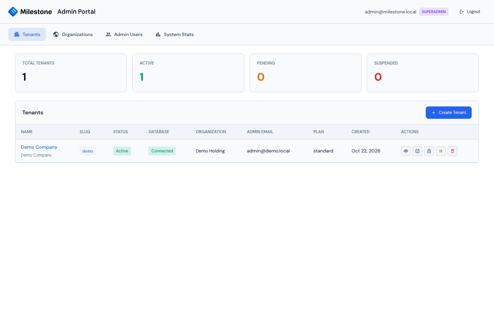
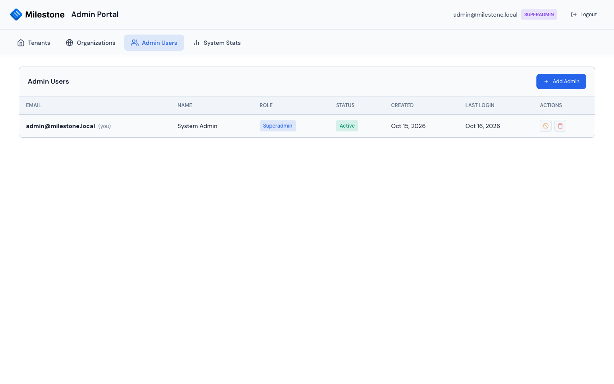
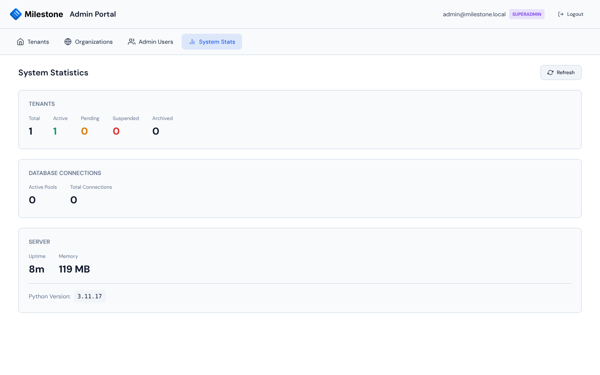
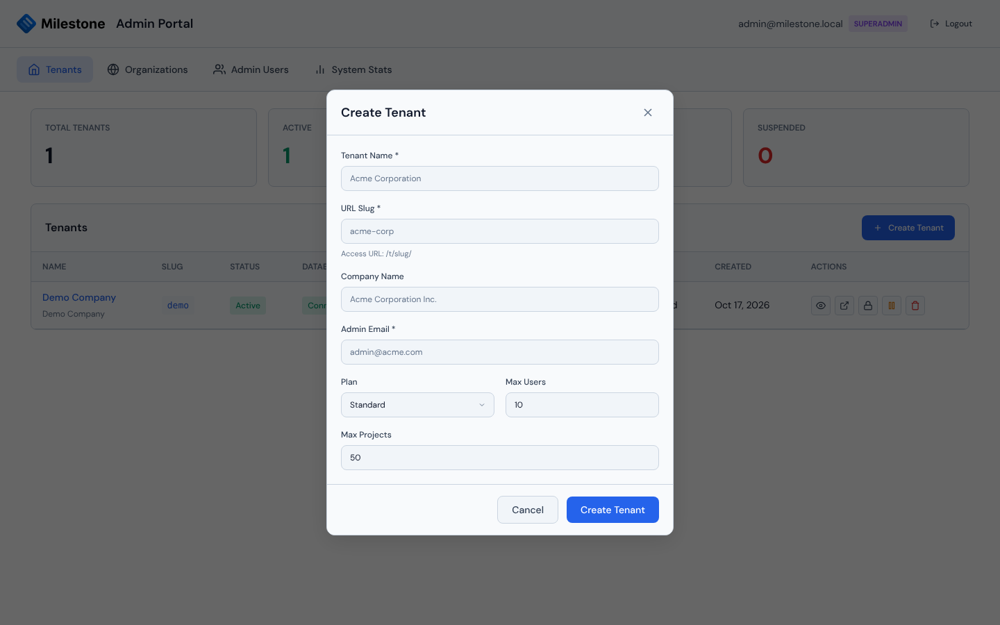

# Multi-Tenant Management

Multi-tenant mode enables SaaS deployment where each organization gets an isolated database. A centralized admin portal at `/admin/` manages the entire platform.

{ loading=lazy }

## Enabling Multi-Tenant Mode

Add these settings to your `.env`:

```bash
# Enable multi-tenant
MULTI_TENANT=true

# Master database (stores tenant registry, admin users, organizations)
MASTER_DB_HOST=localhost
MASTER_DB_PORT=5432
MASTER_DB_NAME=milestone_admin
MASTER_DB_USER=postgres
MASTER_DB_PASSWORD=<master-db-password>

# PostgreSQL admin credentials (for auto-provisioning tenant databases)
# Needs CREATEDB and CREATEROLE privileges
PG_ADMIN_USER=postgres
PG_ADMIN_PASSWORD=<postgres-admin-password>

# Encryption key for tenant database credentials (required!)
# Generate: python -c "import secrets; print(secrets.token_hex(32))"
TENANT_ENCRYPTION_KEY=<64-char-hex-string>
```

The master database schema is auto-applied on startup by `master_db.init_db()`.

## Admin Portal

Access the admin portal at `/admin/`. It has four tabs:

### Tenants

Each tenant represents a separate organization with its own isolated database.

| Action | Description |
|--------|-------------|
| **Create Tenant** | Provision a new tenant database, create initial admin user, generate credentials |
| **View Details** | See tenant metadata, database info, connection status |
| **Show Credentials** | Display generated email/password with copy-to-clipboard |
| **Edit** | Update tenant name, slug, or status |
| **Delete** | Remove a tenant and its database (with confirmation) |
| **Test Connection** | Verify the tenant's database is accessible |

When you create a tenant, the system:

1. Creates a new PostgreSQL database (`milestone_<slug>`)
2. Creates a dedicated database user with restricted permissions
3. Applies the full tenant schema
4. Seeds the database with default settings and an initial admin user
5. Encrypts database credentials using AES-256-GCM
6. Stores the tenant record in the master database

Tenants are accessed via URL pattern: `/t/{slug}/`

### Organizations

Organizations group related tenants and share SSO configuration.

| Action | Description |
|--------|-------------|
| **Create Organization** | Set up with name and admin email |
| **Assign Tenants** | Link tenants to the organization |
| **Configure SSO** | Set up Microsoft Entra ID for the organization |
| **Delete** | Remove organization (tenants are unlinked, not deleted) |

### Admin Users

Admin users have access to the admin portal (separate from tenant application users).

{ loading=lazy }

| Capability | Admin | Superadmin |
|-----------|-------|------------|
| View tenant list | Yes | Yes |
| Create/edit/delete tenants | Yes | Yes |
| Provision tenant databases | Yes | Yes |
| View tenant audit logs | Yes | Yes |
| View organizations | Yes | Yes |
| Configure organization SSO | Yes | Yes |
| Manage admin users | No | Yes |
| View system statistics | Yes | Yes |

- The **Admin Users** tab is only visible to superadmins
- Regular admins can manage tenants and organizations but cannot create or modify other admin accounts
- Admin roles are validated: only `admin` and `superadmin` are accepted

#### Admin-portal sign-in and passwords

- **Forced password change.** An admin flagged *must change password* (for example the
  auto-created `admin@milestone.local`) can
  sign in and change their password, but every other admin-portal request is refused (403)
  until they have. This is enforced by the server, not only by the login screen.
- **Password rules.** New and changed admin passwords must be at least 8 characters.
- **Password hashing.** Admin passwords are stored as PBKDF2-SHA512 with 600 000 iterations
  in a self-describing format (`pbkdf2_sha512$600000$<salt>$<hash>`). Hashes created by
  earlier versions (`salt:hash`, 10 000 iterations) keep working and are upgraded
  automatically at the admin's next successful sign-in.
- **Failed-login throttle.** After 10 failed sign-ins for the same e-mail from the same IP
  address within 15 minutes, further attempts are refused with *"Too many failed sign-in
  attempts"* (HTTP 429) until the oldest failure is 15 minutes old. A successful sign-in
  resets the counter, and sign-in takes the same time whether or not the e-mail exists.
  The lockout is per *IP + e-mail*, not per account, so behind a reverse proxy set
  `FORWARDED_ALLOW_IPS` (see [Installation](installation.md#trust-the-proxys-x-forwarded-for-forwarded_allow_ips)).
  A public IP address is additionally limited to 100 failures per 15 minutes across all
  e-mails.
  Workspace (tenant) sign-in is throttled the same way, separately per workspace. The
  counters live in memory per server process: restarting the app clears them, and with
  several worker processes each keeps its own count.

### System Statistics

Overview of the platform deployment — tenant counts by status, database connection pools, server uptime/memory, and Python version.

{ loading=lazy }

## Tenant Database Architecture

```
┌─────────────────────────────────────────────┐
│             Master Database                 │
│           (milestone_admin)                 │
├─────────────────────────────────────────────┤
│  tenants          → Tenant registry         │
│  admin_users      → Admin portal users      │
│  organizations    → Organization groups     │
│  organization_sso → SSO config per org      │
└─────────────────────────────────────────────┘
         │
         ├──── milestone_acme (tenant DB)
         │     ├── users, projects, phases
         │     ├── staff assignments
         │     ├── equipment, bookings
         │     ├── settings, sites, skills
         │     └── vacations, notes, columns
         │
         ├──── milestone_pharma (tenant DB)
         │     └── (same schema, isolated data)
         │
         └──── milestone_biotech (tenant DB)
               └── (same schema, isolated data)
```

### Key Isolation Guarantees

- Each tenant has a **separate PostgreSQL database** — no shared tables
- Each tenant database has a **dedicated database user** with access only to its own database
- Tenant credentials are encrypted at rest with **AES-256-GCM**
- Tenant resolution is URL-based (`/t/{slug}/api/*`) via `TenantMiddleware`
- Cross-tenant data access is architecturally impossible

## Tenant Lifecycle

### Creating a Tenant

1. Log in to the admin portal at `/admin/`
2. Click **Create Tenant**
3. Fill in the tenant name and slug (URL-safe identifier)
4. The system auto-provisions the database
5. Copy the generated credentials from the "Show Credentials" button

{ loading=lazy }

### Suspending a Tenant

Set the tenant's status to **Suspended** (or **Archived**). The tenant's database remains
intact but its workspace URL answers *"This organization has been suspended"* (or archived)
and users cannot use it. Status values are validated: `pending`, `active`, `suspended`,
`archived`.

Status changes, edits and deletion take effect **immediately** on the server process that
handled them — the tenant lookup cache entry is dropped and the tenant's connection pool is
closed. Other worker processes pick the change up within the 60-second cache window.

### Deleting a Tenant

!!! danger
    Deleting a tenant drops the entire database. This action is irreversible.

1. Click the delete button on the tenant row
2. Confirm the deletion
3. The system drops the tenant database and removes the record from the master database

### Running Migrations Across Tenants

When schema changes are needed across all tenant databases:

```bash
# Run a migration on all tenant databases
python migrations/run_migration.py <migration_name>

# Run a migration on the master database only
python migrations/run_migration_master.py <migration_name>
```

See [Database & Migrations](database.md) for details.

## Connection Pool Management

The `TenantManager` service manages database connection pools for each active tenant:

- Connection pools are created on-demand when a tenant is first accessed (one at a time per
  tenant, so a burst of first requests opens a single pool)
- Pools are cached and reused for subsequent requests
- If a workspace's pool cannot be created (credentials missing or unreadable, database
  down), its requests get a **503 "Organization database is unavailable"** — the server never
  falls back to the default `DB_*` database
- Unknown workspace slugs are cached as misses for 60 seconds, so requests for a
  non-existent slug do not query the master database each time
- Pool size is configurable via `DB_POOL_SIZE` and `DB_POOL_MAX_OVERFLOW` environment variables
- Idle connections are reclaimed automatically

## Security Considerations

| Area | Implementation |
|------|---------------|
| **Data isolation** | Separate PostgreSQL databases per tenant |
| **Credential storage** | AES-256-GCM encryption for tenant DB credentials and for SSO client secrets (organization and tenant level) |
| **Authentication** | Session-based with secure cookies; per-tenant user stores; failed-login throttle (10 per 15 min per IP + e-mail); deactivating, deleting or demoting a user ends their sessions and live connections at once |
| **Error messages** | Health checks and tenant errors never reveal database hosts, users or SQL — details go to the server log |
| **Authorization** | Role-based (Admin, Superuser, User) within each tenant |
| **SSO** | Microsoft Entra ID configured per organization, shared across org's tenants |
| **Admin access** | Separate admin user store in master database |
