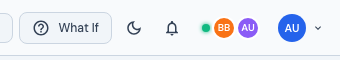
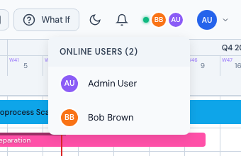
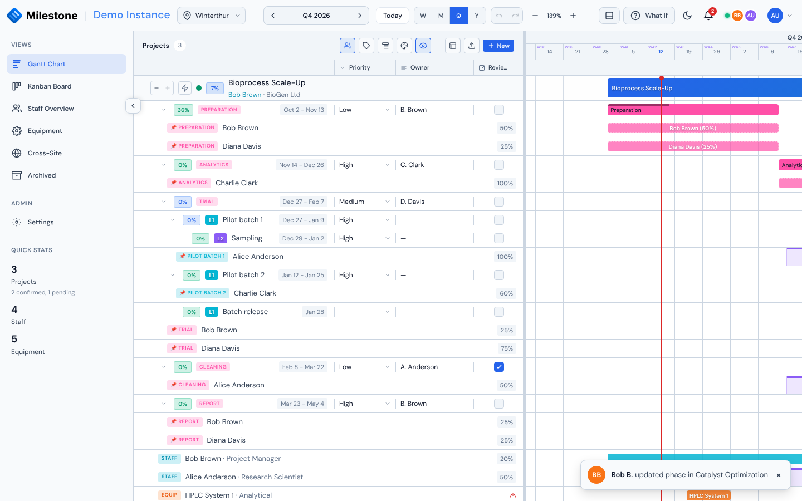

# Real-Time Collaboration

Milestone Planner includes real-time collaboration features so teams can see who else is active, receive live change notifications, and avoid conflicting edits.

## Online Users

The **Online Users** indicator in the header shows how many users are currently connected, as a stack of colored avatars next to a green status dot. This uses a WebSocket connection that updates automatically — when someone opens or closes Milestone, the list refreshes in real-time.

{ loading=lazy }

Hover the avatar stack to open a dropdown listing every connected user by name:

{ loading=lazy }

## Presence Tracking

Presence is tracked over your WebSocket connection: joining and leaving is announced the moment you connect or disconnect, with a periodic keepalive ping in between. The Online Users dropdown reflects who is currently connected in your workspace.

Presence is tracked per project, so multiple users can work on different projects simultaneously without interference.

## Conflict Detection

Before saving changes (such as moving a phase or updating assignments), Milestone checks for potential conflicts:

- **Active editors** — If another user is currently editing the same project, you'll see a warning listing who else is editing
- **Recent modifications** — If the project was modified since you last loaded it, a warning shows who made the last change and when

This prevents two users from unknowingly overwriting each other's work.

## Live Change Notifications

When another user modifies a phase, subphase, or assignment, a toast appears in the bottom-right corner via WebSocket. Cascaded changes from the same user are coalesced into a single toast within a short window (e.g. *"Bob B. made 2 changes in Bioprocess Scale-Up"*).

{ loading=lazy }

Toasts appear for about 6 seconds before fading. The notification includes the user's avatar, name, and a summary of what changed.

## Notifications

The activity feed above is transient and shows what *everyone* is doing. The **notification bell** in the header is the opposite: it is personal, it persists, and it keeps an unread count until you read it.

You are notified when someone:

| Notification | Clicking it opens |
|--------------|-------------------|
| Assigns you to a Kanban card, comments on a card you are assigned to, mentions you with `@`, or moves one of your cards to another column | The card on the Kanban board |
| Asks for your approval to book themselves, change or remove their booking | [My Todos](my-todos.md) → **To decide** |
| Approves, rejects or (as an administrator) cancels your request, or your request expires | My Todos → **My requests**, showing decided requests |
| Gives you a task, or reassigns one to you | My Todos → **My tasks** |
| Books you on a project, phase or subphase, changes your allocation or dates, removes you, moves the dates of a phase or subphase you are booked on, deletes one, or deletes the project | The project on the Gantt chart (or, for a phase or subphase, its card on the Kanban board; a deleted project: marked as read) |
| *(project managers)* Changes your project: books, changes or removes someone's time or an equipment booking, edits the name, dates, customer, confirmed status or volume, archives or restores it, hands it over to you or from you, adds, moves or deletes a phase or subphase, deletes the project, or approves a request on it | The project on the Gantt chart (or the card on the Kanban board; a deleted project: marked as read) |

You are never notified about your own actions. If one event concerns you twice, you get the most specific notification only — a mention before an approval request, then a decision, an assignment, a task, a change to your booking, a change to your project, a card move and a comment.

**Changes to your plan merge into one line.** Booking and project-change notifications go only to the person whose booking changed and to the project's manager — never to the person who made the change, and never to other administrators or superusers. Several changes by the same person on the same project update one unread line (*"3 changes by Alice Anderson on Bioprocess Scale-Up"*, showing the latest change) instead of adding a new one, as long as each change comes within ten minutes of the *previous* one — the window restarts with every change, so one line can cover a long editing session. Once you have read it, or after ten quiet minutes, the next change starts a new line. Dragging a phase on the Gantt chart, which also moves its subphases and bookings, therefore gives each person one line. Changes waiting for [approval](my-todos.md) notify nobody until they are approved.

Clicking a notification about a project on another site switches to that site first. A project that no longer exists, or that you can no longer see, shows a short message instead; the notification of a deleted project is only marked as read.

!!! note "When the Kanban board is turned off"
    An administrator can turn the Kanban board off for everyone ([Features & defaults](settings.md#features-defaults)). Card notifications then open the project on the Gantt chart instead of the board.

Notifications are stored per user, so they survive a reload or a restart — you will not miss one because a browser tab was closed. See the [Kanban Board guide](kanban-board.md#notifications) for the full list of triggers.

!!! info "Due and overdue reminders are worked out in your browser"
    Reminders for cards due soon or already overdue are derived from the plan you have loaded, rather than being generated on the server. They need no setup, but they only appear while the application is open — there is no email or push notification, and nothing arrives overnight.

## WebSocket Connection

The real-time features use a WebSocket connection that:

- **Auto-connects** when you log in
- **Reconnects automatically** if the connection drops (with exponential backoff, up to 5 attempts), and tries again straight away when your network comes back or you switch back to the browser tab
- **Maintains a keepalive** ping every 25 seconds to prevent timeouts
- **Gracefully degrades** — if WebSocket is unavailable (e.g., behind a restrictive proxy), the app continues to work normally; you just won't see live updates from other users

The connection status is visible in the Online Users indicator: a connected state shows the user count, while a disconnected state shows a fallback icon. While live updates are disconnected, an **Offline** badge also appears in the header; your own edits keep saving, but colleagues' changes only arrive once the badge is gone.

Live updates now also cover custom-column values and definitions, instance settings (title, weekends) and changes to your own account: if an admin changes your role or sites, or the permissions of your role, it applies without a reload — buttons and views appear or disappear accordingly. Approval requests and decisions update the affected bookings and everyone's [My Todos](my-todos.md) live; your own tasks and requests reach only you. If your account is deactivated, deleted or demoted, or your password is reset, your session ends at once and you are returned to the login screen.

For security, the server refuses live-update connections opened from other websites.

!!! note
    WebSocket connections require proper proxy configuration. If you're behind nginx or a load balancer, ensure WebSocket upgrade headers are passed through. See the [Installation guide](../admin-guide/installation.md) for reverse proxy configuration examples.

## Best Practices

- **Check online users** before making major changes — if someone else is editing the same project, coordinate with them
- **Pay attention to conflict warnings** — they appear before you save and help prevent lost work
- **Refresh if needed** — if you've been idle for a long time, refresh the page to get the latest data before editing
