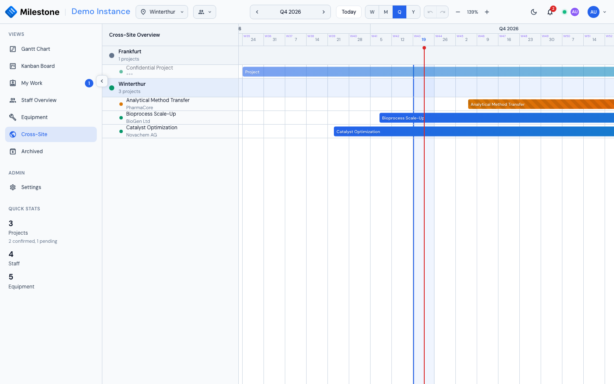

# Cross-Site View

The **Cross-Site View** provides a high-level overview of projects across the sites you can see, designed for company-wide capacity planning. It needs the *Cross-site view* permission (every built-in role has it) and at least **two** visible sites — with only one, the sidebar entry is disabled and says why. Administrators see every site; other roles see the sites they belong to, unless the role has *See all sites* (see [Who Sees Which Sites](settings.md#who-sees-which-sites)).

{ loading=lazy }

## How It Works

- **Your site's projects** are fully visible with names and details
- **Other visible sites' projects** appear as "Confidential Project" with masked customer info for data privacy; sites you cannot see are not shown at all
- All sites share the same timeline for side-by-side comparison
- Your current site is highlighted with a special indicator
- The header [team filter](settings.md#team-filter) narrows only your current site's lane; the other sites always show all their projects

## Use Cases

- **Resource planning** — Identify capacity across the organization without exposing sensitive project details
- **Timeline alignment** — See how projects at different locations overlap
- **Executive overview** — Quick snapshot of all active work across the company

This view respects organizational boundaries by design — detailed project information is only visible for your own site.
