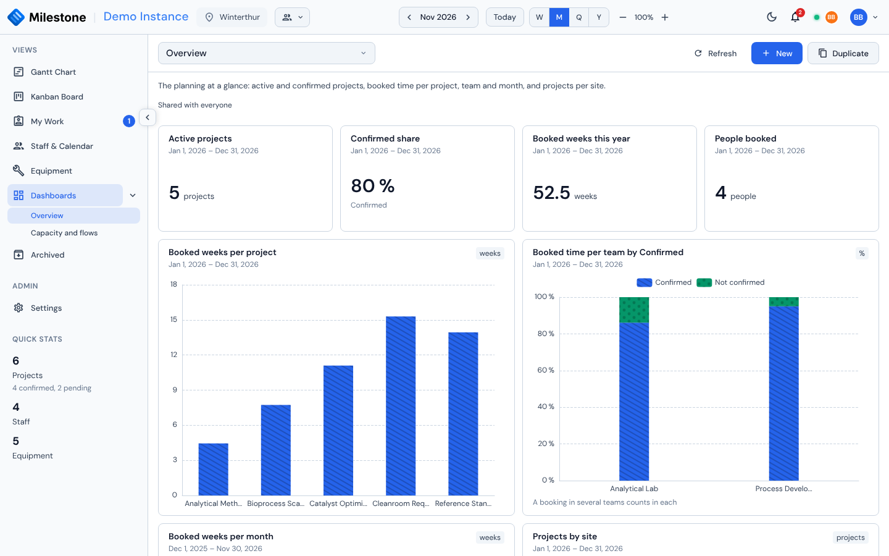
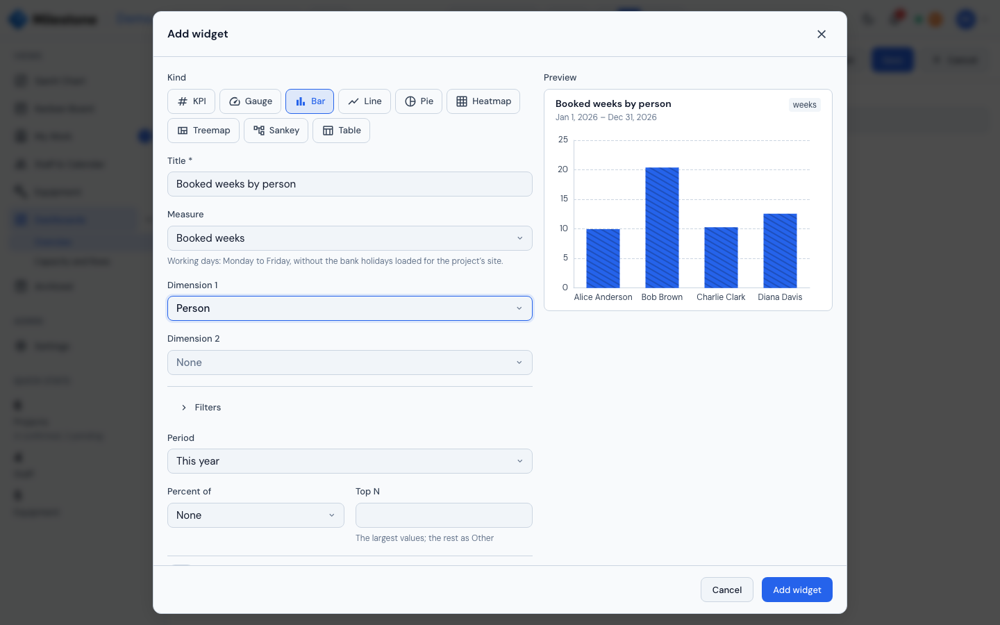
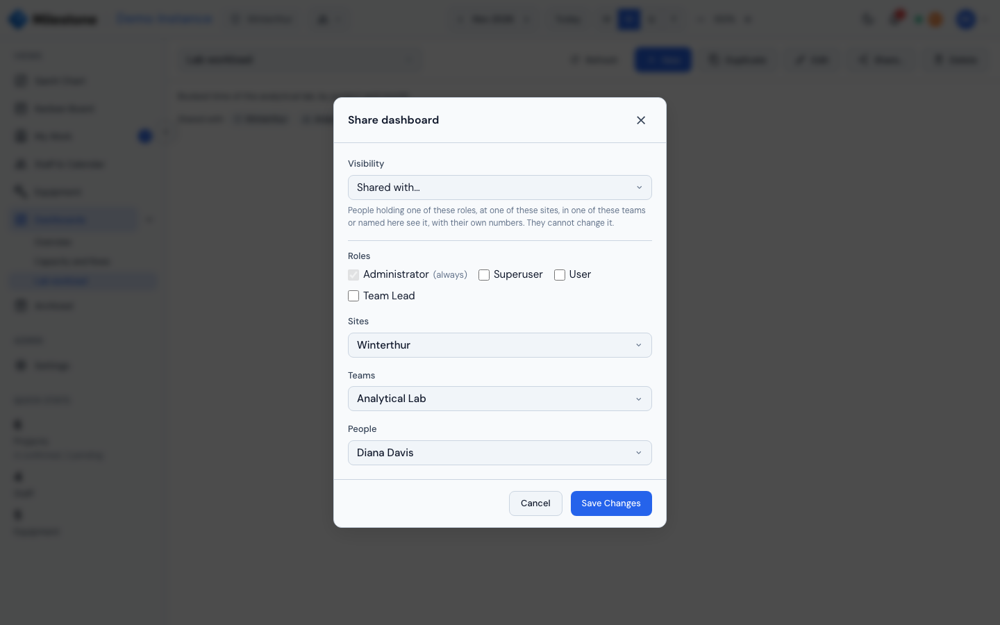

# Dashboards

**Dashboards** turn the plan into numbers and charts: how many weeks people are booked on each project, how a team's time splits between confirmed and unconfirmed work, how full each team and each instrument is, which phases are late, how many projects run at each site. A dashboard is a page of **widgets** — KPI tiles, bar, line and pie charts and tables — that anyone allowed can open, and that people who build dashboards can arrange, duplicate and share.

Open it from **Dashboards** in the sidebar, just below My Work. The entry needs the **Dashboards** permission (Superuser and User by default, see [Roles & Permissions](settings.md#roles-permissions)).

{ loading=lazy }

## Opening a Dashboard

The **Dashboard** picker at the top lists every dashboard you may open, in this order:

| Label | Which dashboards |
|-------|------------------|
| **Default** | The **Overview**, shared with everyone |
| **Mine** | The dashboards you built, whoever you shared them with |
| **Shared by** *name* | Dashboards someone shared with you — with your role, one of your sites, one of your teams or you by name (*Shared with me* when the owner's account is gone) |
| **Shared with no one left** | Your own dashboards (and, for administrators, anyone's) shared with roles, sites, teams or people that have all been deleted since |
| **Everyone** | Dashboards shared with everyone who can open the view |

Type in the picker's search box to find one by name. Milestone remembers the last dashboard you opened and shows it next time.

**Refresh** recomputes every widget. You rarely need it: when someone changes a project, a booking, a team, a project field, an absence, a bank holiday or site closure, an equipment booking or block, the open dashboard updates by itself within a couple of seconds.

### Everyone Sees Their Own Numbers

A dashboard is a set of questions, not a copy of the answers. Each viewer gets the answers for the **sites they can see**: a colleague who works only at Frankfurt sees Frankfurt figures on the same Overview where an administrator sees every site. Archived projects are left out unless a widget asks for them.

A widget can need a permission you do not hold — the **capacity** measures, a breakdown by **person** and the **People** filter need the **Staff overview** permission — a capacity measure broken down by **person** or filtered to **People** also needs **See colleagues' absences**, since its days off are their absences; the **equipment** measures, a breakdown by **equipment** or **equipment type** and the **Equipment** filters need the **Equipment view** permission; a widget that includes **archived projects** needs **Archived projects**. Such a widget shows *This widget needs the Staff view permission* (or *the Equipment view permission*, *the Archived view permission*, *the Absences permission*) in place of its chart; the rest of the dashboard works as usual.

## The Overview

Every Milestone instance starts with the **Overview**, shared with everyone:

| Widget | What it shows |
|--------|---------------|
| **Active projects** | Projects whose dates touch this year |
| **Confirmed share** | The share of those projects that are confirmed |
| **Booked weeks this year** | Planned person-weeks on all projects this year |
| **People booked** | How many different people have a booking this year |
| **Booked weeks per project** | The ten projects with the most booked weeks this year |
| **Booked time per team by Confirmed** | Each team's booked time this year, split 100 % between confirmed and unconfirmed projects |
| **Booked weeks per month** | Booked weeks in each of the last 12 months |
| **Projects by site** | This year's projects per site |

People who build dashboards can **Duplicate** it and adapt the copy. Only an administrator can change or delete the Overview itself; once deleted, it does not come back.

## What the Numbers Mean

Booked time is **planned** time — what the bookings in the Gantt chart say, not hours recorded afterwards. The [Measures](#measures) below say what each measure counts; these rules hold for all of them.

- A **working day** is Monday to Friday, except the [bank holidays](settings.md#bank-holidays) of a site. Booked time counts the working days of the **project's site**; capacity counts those of the **person's** sites and equipment availability those of the **equipment's** sites
- A booking on a phase or subphase counts only inside its card's dates; a booking on the whole project counts over its own dates. Someone booked both on the project and on one of its phases counts twice, as on the [Staff overview](staff-management.md)
- **Bookings waiting for approval are not counted** until they are approved
- Counts of projects and phases take those whose dates touch the period (in every month, quarter or year they touch, when broken down by period)
- A breakdown by **Team** uses the teams of the booked person at the project's site (someone in two teams counts in both; *No team* otherwise). **Project team** uses the teams the project belongs to
- A project with two tags, or two items of a multi-select field, appears under each of them; the total counts it once. The widget then says so under its chart. The same goes for a person or an instrument at two sites in a breakdown by **Site**
- Empty values have their own bucket: *No customer*, *No manager*, *No tag*, *No team*, *No site*, *No phase* (a booking on the whole project), *No type* (equipment), *Not set* (a project field)
- A value that cannot be computed — a utilisation with booked time but no capacity in that bucket — shows **–**, never 0

## Measures

The **Measure** list of the widget editor is grouped by family. Each family has its own filters and breakdowns: the editor offers only those that apply.

### Bookings

| Measure | What it counts |
|---------|----------------|
| **Booked days** | For each booking, its allocation times the working days it covers inside the period. A booking at 50 % over two working weeks counts 5 days |
| **Booked weeks** | Booked days divided by 5 |
| **Bookings** | Booking rows |
| **People booked** | Different people with a booking |

### Capacity

Needs the **Staff overview** permission. A breakdown by **Person** and the **People** filter also need **See colleagues' absences** (a person's capacity shows the days they are absent); by site, team or period the figures add people up and need the Staff overview alone.

| Measure | What it counts |
|---------|----------------|
| **Capacity (days)** | The days the bookable people can work, at their **max capacity**: a person at 60 % has 3 days in a full week |
| **Available days** | Capacity minus booked days. Negative when someone is booked beyond their capacity |
| **Utilisation** | Booked days over capacity, in %. Over 100 % means booked beyond capacity |
| **People over capacity** | Different people whose booked days in the period (or in the bar, line point or cell) are more than their capacity |

- **Who counts**: every active person marked *Bookable as a resource* who is a member of one of your sites. Bookings of people no longer bookable, or deactivated, are left out on both sides
- **Capacity** is the weekdays at **their** sites minus the bank holidays of those sites, their absences of a type that counts as unavailable (a recurring absence only on its weekdays; Home Office leaves them plannable) and the site closures that apply to them — the same closures the Staff overview shows
- **Sites and teams are the person's**: a breakdown by Site or Team, and the Sites, Teams and People filters, use the person's sites and teams on both sides of the ratio, not the project's. A person at two sites appears under each and once in the total
- **The team figure is weighted**: a team's utilisation is the team's booked days over the team's capacity, not the average of its members' percentages. A KPI without a breakdown is the weighted figure of everyone in scope
- A bar, line point or cell with booked time and no capacity (everyone off that week) shows **–**; with neither, 0 %
- **Archived projects**: bookings on archived projects are left out unless the widget includes them
- **Booked time is counted only on projects at your sites**: a person you see whose bookings are on a project at a site you cannot see shows less booked time than they have
- **Not the same as the Staff overview**: the Staff overview's heatmap shows each day and does not take bank holidays off, while capacity does, and booked days follow the project's site while capacity follows the person's. A person booked on a project at a site with other bank holidays can read slightly over or under 100 %

### Projects

| Measure | What it counts |
|---------|----------------|
| **Projects** | Projects whose dates touch the period |
| **Project weeks** | The working weeks a project lasts inside the period, whoever is booked |
| **Project volume** | The projects' *Volume* field, added up |

### Phases

| Measure | What it counts |
|---------|----------------|
| **Phases** | Phases whose dates touch the period |
| **Phase weeks** | The working weeks a phase lasts inside the period |
| **Phases due** | Phases whose **end date** lies in the period (a milestone: its date), each filed once, in the month, quarter or year it is due — and the **milestones below a phase**, at any depth |
| **Phases overdue** | Phases and milestones due **before today** that are not **Done**, filed by their end date |

- **Phases** and **Phase weeks** count top-level phases; **Phases due** and **Phases overdue** also count milestones below a phase (a milestone subphase of any depth, on its date, under the type of the phase it sits in)
- Break them down by **Status** (To do, In progress, Blocked, Done — the Kanban columns) or by **Phase**
- The **Milestones** filter includes milestones (the default), shows **only** milestones, or leaves them out. On Phases due and Phases overdue, *only* counts the milestones at every level; on Phases and Phase weeks, the milestone phases

### Equipment

Needs the **Equipment view** permission.

| Measure | What it counts |
|---------|----------------|
| **Equipment booked days** | The working days of each equipment booking inside the period, at the **project's site** (a booking is a whole day, there is no allocation) |
| **Equipment bookings** | Equipment booking rows |
| **Equipment booked** | Different instruments with a booking |
| **Equipment utilisation** | Booked days over the instrument's availability, in % |

- **Availability** is the weekdays at the **equipment's** sites minus the bank holidays of those sites and its blocks, for every active instrument at one of your sites
- **Overlapping bookings add up**: two projects booking the same instrument the same week count twice, so utilisation **over 100 % flags a conflict**. A booking inside a block counts in full too — it is the same conflict
- Equipment utilisation is broken down by Equipment, Equipment type, Site (the **equipment's** sites, like its Sites filter) or Period; the other equipment measures take the project breakdowns and filters as well
- Booked days follow the project's site and availability the equipment's: a booking from a site with other bank holidays can read slightly over or under 100 %
- Inactive equipment counts in booked days and bookings, not in utilisation
- **Booked time is counted only on projects at your sites**, like capacity: an instrument at your site that a project at a site you cannot see has booked reads lower utilisation for you than for someone who sees both sites

### Periods

**This year**, **Last year**, **Next year**, **This quarter**, **Last quarter**, **Next quarter**, **This month**, **Last month**, **Next month**, **Last 12 months**, **Next 12 months** and **All time**, or a custom range. Quarters and months are calendar ones. **Last 12 months** and **Next 12 months** both include the **current month**: the last 12 end with it, the next 12 start with it.

## Building a Dashboard

Building dashboards needs the **Manage dashboards** permission (Superuser by default). The buttons beside the picker:

| Button | What it does |
|--------|--------------|
| **New** | Asks for a name, an optional description and who sees it, then opens the empty dashboard for editing |
| **Duplicate** | Copies the open dashboard as a private *Copy of …* and opens it for editing |
| **Edit** | Lets you rename the dashboard, change its description and move, resize, add, change and remove widgets (your own dashboards; administrators: any) |
| **Share…** | Changes who sees it |
| **Delete** | Deletes the dashboard and its widgets, after a confirmation |

### Editing the Layout

While you edit, the toolbar shows **Undo**, **Redo**, **Add widget**, **Save** and **Cancel**, and the status beside the picker reads *Editing* — *Editing — unsaved changes* once you change something.

- **Rename** the dashboard and change its **description** in the two fields above the widgets (*Name* is required, up to 100 characters; the description up to 2000). Clearing the name and clicking **Save** shows *Enter a name* and saves nothing
- **Move** a widget by dragging its header
- **Resize** it from its bottom-right corner: making it wider or narrower trades width with the widgets beside it in its row, so the row stays full (no widget gets narrower than two columns); making it taller pushes the rows below down
- The **edit** and **remove** icons in a widget's header open it in the widget editor or take it off the dashboard

**Undo** and **Redo** (or **Ctrl/Cmd + Z** and **Ctrl/Cmd + Y** / **Ctrl/Cmd + Shift + Z**, outside the Name and Description fields) step back and forth through your moves, resizes, added, changed and removed widgets and renames — up to 50 steps — until you save or cancel; the header's Undo and Redo belong to the Gantt chart and are not shown on this view.

Nothing is saved until you click **Save**. **Cancel**, choosing another dashboard or leaving the view asks before discarding your changes. A dashboard holds up to 50 widgets.

On a phone (640 px wide or less) dashboards are view-only.

### The Widget Editor

**Add widget** (or a widget's edit icon) opens the editor. A **live preview** on the right shows the real result as you change the settings.

{ loading=lazy }

1. **Kind** — KPI, Bar, Line, Pie or Table
2. **Title**
3. **Measure** — grouped by family: Bookings, Projects, Phases, Capacity and Equipment (see [Measures](#measures)). The capacity measures are listed only with the **Staff overview** permission, the equipment measures only with the **Equipment view** permission. A hint under the list says how the measure counts its days
4. **Dimension 1** and **Dimension 2** — how to break the measure down: Site, Team, Project team, Person, Project, Project manager, Customer, Confirmed, Tag, Phase, Status, Equipment, Equipment type, any dropdown or toggle **project field**, or Period (by year, quarter, month or week). Only the dimensions that make sense for the measure are offered; a pie takes one dimension, a KPI at most one
5. **Filters** — only those of the measure's family: sites, teams, project teams, people, projects, tags, field items, confirmed or unconfirmed projects, archived projects for bookings; the same without teams and people for projects, plus **Milestones** for phases; **Sites**, **Teams** and **People** (the person's) for capacity; the project filters plus **Equipment** and **Equipment types** for the equipment measures (Sites, Equipment and Equipment types only for equipment utilisation). Changing the measure drops the filters the new one does not take
6. **Period** — one of the [twelve periods](#periods) or a custom range
7. **Percent of** — show shares instead of amounts: of the **total**, or within each value of the **first dimension** (each bar adds up to 100 %). Not offered for **Utilisation**, **Equipment utilisation** (already percentages), **Available days** (which can be negative) and **People over capacity** (counted again in each bar, so the bars are not parts of the total); a KPI of these four shows its figure for the whole period, with no dimension
8. **Top N** — keep the largest values and group the rest as *Other*
9. **Options** — stacked or 100 % bars and their orientation (no stacked or 100 % bars of the four measures without a percentage: a stack of percentages or of negative days adds up to nothing), a legend for lines and pies, the number format. A KPI showing a share needs a **Bucket**: the value whose share it shows (for example *Confirmed*)

A pie of **Available days** is refused (negative days cannot be slices). If the combination cannot be answered, the preview says why in plain words, and **Add widget** / **Save Changes** waits until you fix it. A new widget is placed below the others; arrange it on the grid afterwards.

### Sharing

**Share…** (and **New**) set who sees a dashboard:

| Visibility | Who sees it |
|------------|-------------|
| **Private** | You (and administrators) |
| **Shared with…** | The people you choose below — anyone who matches **one** of them sees it |
| **Everyone** | Everyone who can open the Dashboards view |

With **Shared with…**, the dialog lists four kinds of target, and you can mix them freely:

| Target | Who it reaches |
|--------|----------------|
| **Roles** | Everyone holding one of the roles you tick |
| **Sites** | The **members** of the site — the people whose user account lists it. Someone who sees every site (an administrator, or a role allowed to see all sites) but is not a member of that site is not reached this way |
| **Teams** | The members of the team (the team's site is shown beside its name; an inactive team is marked *(inactive)*) |
| **People** | The people you name — any active person at your sites, and anyone who sees every site |

{ loading=lazy }

Choose at least one target; with none, the dialog shows *Choose at least one role, site, team or person*. Sharing is **view only**: the people you share with open the dashboard and see their own numbers, but only you (and administrators) can edit, share or delete it.

Under the dashboard's title, the **Shared with** line names who sees it — one chip per role, site, team (*Team · Site*) and person — or reads *Shared with everyone*, or *Only you (and administrators)* for a private one. Everyone who can open the dashboard sees that line, with every name on it — including sites, teams and people outside their own sites: the owner chose to share with them, and the line shows names only, never planning data.

A role, site, team or person you shared with that is **deleted** drops off the dashboard by itself. When every target is gone, the dashboard reads *Shared with no one left* and only you and the administrators see it. A target you **can no longer pick** — a person who was deactivated, a site you no longer belong to, a team at such a site — stays on the dashboard, and keeps its access, until you remove it in **Share…**, where it is marked *No longer among your choices*.

The sharing changes **only through Share…**: saving widgets, the name or the description in edit mode never touches it, so a change someone else made in **Share…** meanwhile is kept, and a target deleted while you were editing never blocks your save.

People reached through a role, site, team or name still need the **Dashboards** permission to open the view. A custom role does not get it automatically: an administrator allows it in [Settings → Roles](settings.md#roles-permissions).

When two people edit the same dashboard at once, the last one to save wins.

## Limits

- A period covers at most **five years**. **All time** runs from the first to the last project in scope; when that is longer than five years it ends at most a year from today and the widget says *Period cut to five years*. All time spans the projects' dates at your sites: a booking placed outside its project's dates is counted only by a period that covers it
- Bank holidays count only for the years an administrator **loaded** for the site (see [Bank Holidays](settings.md#bank-holidays)); in a year without holidays every weekday is a working day
- Bookings waiting for approval are never counted
- "Today" and "this year" follow the server's date (UTC)
- The **People** filter lists the people of the site selected in the header, although a dashboard covers every site you can see

## What-If Mode

The Dashboards entry is disabled while a [What-If plan](what-if-planning.md) is open: dashboards always show the saved plan. Apply or discard the plan first.
