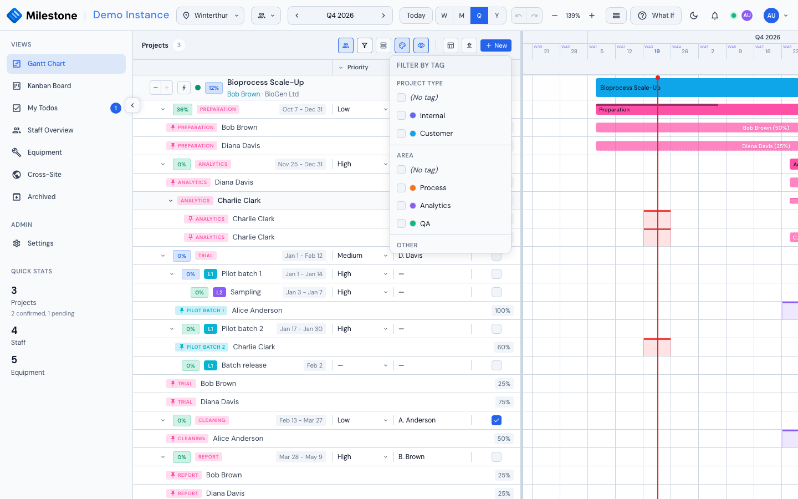

# Gantt Charts

The Gantt Chart is the primary view and the default when you log in. It combines a hierarchical project list with an interactive timeline.

{ loading=lazy }

## Project Panel

The left panel displays your projects in a tree structure. The header buttons sit at the right edge of the panel, after any custom columns:

- **Staff & Equipment** — Show or hide the assignment rows
- **Tags** — [Filter projects by tag](#filtering-projects-by-tag)
- **Group by** — [Group projects by a tag group](#grouping-projects-by-tag-group) (shown once tag groups exist)
- **Colour by** — [Colour the project bars by a tag group](#project-colours) (shown once tag groups exist)
- **Column Visibility** — Show or hide custom columns
- **+ New Project** — Create a new project
- **Import** — Import from CSV, XML, or MPP
- **Manage Columns** — Configure custom data columns
- Expand/collapse projects to see phases, subphases, and assignments
- Status indicators: confirmed (green) or unconfirmed (gray)

The panel is resizable — drag the divider between the panel and timeline to adjust width (200px to 600px).

## Timeline

The right side shows horizontal bars representing duration of each project, phase, and subphase:

- **Project bars** span the full project duration
- **Phase bars** are color-coded by phase type
- **Subphase bars** support unlimited nesting depth
- A red vertical line marks today's date, and the current month is highlighted in the header
- Week numbers follow **ISO 8601**: weeks start on Monday and week 1 is the week containing the first Thursday of the year, so 1–3 January 2027 show as week 53 (of 2026)
- The timeline opens centred on today in every view
- Bank holidays and company events are highlighted on the background; a company event marked as a [site closure](settings.md#site-closures) gets a stronger, hatched tint (tooltip *Site closed: &lt;name&gt;*)
- Staff assignment bars are marked on days the person is away — an unavailable absence, or a closure of one of their sites

## Resource Panels

Administrators, superusers and project managers (users who manage at least one project) can dock the **Staff Overview** or **Equipment** view directly below the Gantt chart from the **Panels** button in the header. The two panels are mutually exclusive — you can show one at a time. Drag the divider between the chart and the docked panel to resize each region.

This is the fastest way to see scheduling and capacity together: changes you make in the Gantt are reflected in the panel below in real time.

{ loading=lazy }

{ loading=lazy }

## Who Can Edit a Project

| | Admin / Superuser | Project manager | Everyone else |
|---|---|---|---|
| View the project | Yes | Yes | Yes |
| Create a project, import a project | Yes | No | No |
| Edit details, dates, tags, archive; hand the project to another manager | Yes | Yes | No |
| Add, edit, move, resize, reorder and delete phases and subphases; dependencies; completion | Yes | Yes | No |
| Assign and edit anyone's staff assignments; book equipment | Yes | Yes | No |
| Add themselves, change or remove their own assignment | Yes | Yes | Yes |
| Delete the project | Yes | No | No |

The **project manager** is the person selected in the project's **Project Manager** field. They get these rights on that project only, even with the plain User role — controls they can't use on other projects stay disabled. Changing the Project Manager field hands the rights over to someone else. Moving a Kanban card is also open to the card's assignees (see [Kanban Board](kanban-board.md#moving-cards)).

## Creating a Project

Creating a project needs the Admin or Superuser role.

1. Click **+ New Project** in the panel header
2. Fill in required fields: **Project Name**, **Start Date**, **End Date**
3. Optionally set: Project Manager, Customer, Sales PM, Project Volume
4. Select which **predefined phases** to include (all active phases are pre-selected)
5. Check **Project Confirmed** if the project is approved
6. Click **Create Project**

## Editing Projects, Phases & Subphases

- **Edit a project**: Click the **Edit** button or right-click and select "Edit"
- **Add a phase**: Right-click on a project and select "Add Phase"
- **Add a subphase**: Right-click on a phase and select "Add Subphase" (supports unlimited nesting)
- **Delete**: Right-click on any item and select "Delete" (with confirmation). A project manager can delete phases and subphases, but deleting the project itself needs a superuser

When editing a project, export buttons (CSV and XML) are available in the modal footer.

{ loading=lazy }

## Tags

Tags are coloured labels attached to projects to classify and filter them (e.g. *Critical*, *Internal*, *Customer*). The tag library is shared by the whole workspace: admins define the tags in **Settings → Tags** (see [Tags in Settings](settings.md#tags)), and anyone who can edit a project attaches them.

Tags can be organised into **groups** such as *Project type* → Internal / Customer. A **single-select** group allows one of its tags per project. Each tag applies to **all sites** or only to the sites an admin picked, so the picker and the filter only offer the tags that apply to the project's site.

{ loading=lazy }

### Attaching a tag

1. Open the project (Edit, or while creating a new one).
2. Click the **Tags** field. The dropdown lists the available tags by group, with ungrouped tags under *Other*.
3. Start typing to filter, then click a tag (or press Enter on a unique match) to attach it. It appears as a coloured pill above the field. In a single-select group, choosing a tag replaces the one already selected from that group.
4. Click the **×** on a pill to detach the tag.

Admins see a **Manage tags…** link in the picker that opens Settings → Tags.

### Project colours

Each user can colour the project bars by a tag group:

1. Click the **Colour by** button in the project panel header (next to **Group by**).
2. Pick a tag group — any group, single-select or not. **Default** returns to the standard bar colour.

The project bar on the timeline then takes the colour of the project's tag from that group — for example blue for internal projects and green for customer projects. A project carrying several tags of the group takes the colour of the first of them in the group's order (the same tag *Group by* files it under); a project without a tag from the group keeps the default colour. Unconfirmed projects keep their striped look on top of the colour.

{ loading=lazy }

The choice is yours alone: it is remembered per site in your browser, like the tag filter, and does not change what other users see. It is independent of **Group by** — you can group by one group and colour by another.

### Filtering projects by tag

The **Tags** button in the project panel header (and in the Kanban toolbar) opens a filter listed by group:

- Tick one or more tags of a group to show projects carrying **any** of them.
- Tick tags in several groups to show only projects matching **every** group.
- **(No tag)** in a group matches projects without a tag from that group, and combines with the group's tags.
- **Clear** removes the whole filter.

{ loading=lazy }

The button shows how many tags are selected, and the panel header shows *x of y* projects while a filter is active. The selection is remembered per site, so switching site or reloading brings it back. Tags that are deleted later are simply ignored.

### Grouping projects by tag group

To see the portfolio at a glance, split the project list into sections, one per tag of a group — for example *Project type* → Internal / Customer:

1. Click the **Group by** button in the project panel header (next to **Tags**).
2. Pick a tag group. **No grouping** returns to the plain list.

Each section starts with a header showing the tag as a coloured pill and the number of projects in it; the timeline shows a matching band across the chart. Projects without a tag of that group are listed last under **No *group name***. Sections without projects are left out, and a project carrying several tags of the same group is listed once, under the first of them in the group's order.

{ loading=lazy }

- Click a section header (or its arrow) to collapse or expand it. **Collapse all** / **Expand all** in the Group by panel act on every section at once.
- The tag filter applies first, then the grouping: sections only hold the projects that pass the filter. The header count still counts projects.
- Projects cannot be reordered by dragging while the list is grouped; choose **No grouping** to change the order.
- A project you create, or re-tag, into a collapsed section stays hidden until you expand that section.
- The grouping and the collapsed sections are remembered per site in your browser, like the tag filter.

### Permissions

| Action                              | Who can do it                                  |
| ----------------------------------- | ---------------------------------------------- |
| Attach / detach a tag               | Anyone who can edit the project                |
| Filter by tag                       | Everyone                                       |
| Group by a tag group                | Everyone                                       |
| Colour by a tag group               | Everyone                                       |
| Create, edit, group, delete tags    | Admins (Settings → Tags)                       |

## Drag & Drop

The timeline supports direct manipulation (on projects you can edit; your own assignment bars on any project):

- **Move a bar** — Drag left/right to change dates (phantom preview shows target position)
- **Resize a bar** — Drag left/right edge to extend or shorten duration
- **Reorder phases** — Drag within the project panel to reorder

### Touch screens

On a tablet or phone, the same gestures work with a finger: press a bar and move it to change its dates, or press one of its edges to resize it (the edge handles are wider on touch screens). A tap opens the item's dialog. A swipe that starts **on a bar** moves the bar, so swipe on empty row space, the project panel or the header to scroll the chart. If the system interrupts a drag (an incoming call, a gesture the browser takes over), the bar returns to where it was and nothing is saved.

## Completion Tracking

Each project and phase has a completion slider (0–100%):

- The filled portion of the bar represents progress
- Click on the completion area to adjust
- Purely informational — does not affect scheduling

The slider also drives the item's column on the [Kanban board](kanban-board.md): 0% is To Do, 100% is Done, and anything in between is In Progress. Moving a card on the board changes the percentage here in the same way. A card you have marked **Blocked** keeps that status when you edit its percentage, since a number cannot express why work has stalled.

## Custom Columns

Add custom data fields to the project panel to track metadata like priority, status codes, budget, or risk levels. Up to **10 columns** can be active per site (including global columns).

{ loading=lazy }

### Creating a Column

1. Click **Manage Columns** in the panel header
2. Click **Add Column**
3. Configure:
   - **Column Name** (required, e.g., "Priority", "Status", "Owner")
   - **Column Type** — cannot be changed after creation:
     - **Text** — Free-text field
     - **Checkbox** — Boolean toggle (checked/unchecked)
     - **Dropdown List** — Choose from predefined options
   - **Scope** — **Global** (all sites) or **Local** (current site only)
   - **Column Width** — 60px to 300px (default 120px), adjustable via slider
4. For Dropdown type: add option values using the **Add Option** button (at least one required)
5. Click **Create**

### Editing Values

Custom column values appear as editable cells in the project panel, next to each project, phase, and subphase:

- **Text columns**: Click the cell to edit, press Enter or click away to save, Escape to cancel
- **Checkbox columns**: Click to toggle between checked and unchecked
- **Dropdown columns**: Click to open the options list, select a value or click "Clear selection" to reset

Values are saved automatically as you edit. Changes cascade — editing a phase's value also updates its child subphases. A cascade is saved as one request, so it either succeeds for the whole branch or, if saving fails, every cell it touched returns to its previous value.

**Anyone signed in can edit custom-column values**, including users with the plain User role. Creating, editing, reordering and deleting the **columns themselves** stays admin-only. Values and column changes appear for other signed-in users straight away.

### Managing Columns

Open **Manage Columns** to see all active columns:

{ loading=lazy }

- **Reorder**: Drag columns by the handle icon to change display order
- **Edit**: Click the edit icon to change name, dropdown options, or width (type cannot be changed)
- **Delete**: Click the delete icon. A confirmation warns that **all values will be lost**

### Column Filtering

Click the **filter icon** on any column header to filter the project list:

1. The dropdown shows all unique values in that column
2. Check values to show only matching rows
3. Use **Select All** / **Clear All** for quick selection
4. Filter by **(Empty)** to find rows with no value set
5. Multiple column filters combine with AND logic

An active filter turns the column header's filter icon blue.

{ loading=lazy }

### Resizing Column Widths

Drag the **right edge** of any column header to resize its width (60px–400px). The new width is saved automatically.

### Show/Hide Columns

Toggle individual column visibility from the column manager without deleting them.

## Dependencies

Link phases and subphases with dependency relationships to enforce scheduling logic. Dependency arrows are drawn on the timeline to visualize the relationships.

{ loading=lazy }

### Dependency Types

| Type | Name | Meaning |
|------|------|---------|
| **FS** | Finish-to-Start | Target starts after source finishes (most common) |
| **SS** | Start-to-Start | Target starts when source starts |
| **FF** | Finish-to-Finish | Target finishes when source finishes |
| **SF** | Start-to-Finish | Target finishes when source starts (rare) |

### Creating a Dependency

Dependencies use a **two-click flow**:

1. Hover over a phase or subphase bar — **link zones** appear at the start (left) and end (right) edges
2. Click a link zone on the **source** item (e.g., the end zone for a Finish-to-Start link)
3. Click a link zone on the **target** item (e.g., the start zone)
4. The dependency type is determined automatically based on which zones you clicked:
   - End → Start = **FS**, Start → Start = **SS**, End → End = **FF**, Start → End = **SF**

After linking, the target item's dates are automatically adjusted:

- **FS**: Target start moves to the day after the source ends
- **SS**: Target start aligns with the source start
- **FF** and **SF**: No automatic date adjustment

Child phases/subphases move along with their parent when dates are adjusted. Parent dates cascade upward to accommodate children.

### Deleting a Dependency

Click the dependency arrow on the timeline and choose **Delete Dependency** in the popup, or edit the target phase or subphase and remove the dependency from its list. This also works for links created by older versions.

### Visual Arrows

Each dependency type has a distinct visual style on the timeline:

- **FS** — Solid arrow from source end to target start
- **SS** — Dashed arrow connecting start edges
- **FF** — Dotted arrow connecting end edges
- **SF** — Dash-dot arrow from source start to target end

### Constraints

- Dependencies can only be created between items **within the same project**
- **Circular dependencies** are detected and blocked — you'll see an alert if a link would create a cycle. The check follows links through phases and subphases alike, and a "shortcut" link that skips an intermediate step (A → C alongside A → B → C) is allowed, because it closes no loop
- Duplicate dependencies (same source, same type) are silently ignored
- Each link remembers whether its source is a phase or a subphase, so arrows and the critical path always attach to the right item even when a phase and a subphase happen to share the same internal id. Links created before this was recorded are read as pointing to a phase first
- **Undo** and **Redo** restore dependency links too, and save them to the server like any other change

## Critical Path

The **Critical Path** highlights the longest sequence of dependent phases through a project, showing the minimum time needed to complete it. Items on the critical path have zero slack — any delay to them delays the entire project.

### How to Use

1. Click the **lightning-bolt button** on the project's row in the project panel (tooltip: *Show Critical Path*)
2. Critical path items are visually highlighted on the timeline
3. Click the button again to return to normal view

{ loading=lazy }

The critical path is calculated using the **Critical Path Method (CPM)** algorithm:

- Forward pass: calculates the earliest possible start and finish for each item
- Backward pass: calculates the latest allowable start and finish
- Items where early start equals late start (zero float) are on the critical path
- Chains in which a successor starts before its predecessor finishes (a lead or overlap) are followed to their end instead of being cut short

!!! tip
    The critical path requires dependencies to be set up between phases. Without dependencies, all items have independent float and no critical path exists.

## Context Menu

Right-click on any item for context-appropriate actions:

{ loading=lazy }

| Target | Actions |
|--------|---------|
| Project | Edit, Delete, Add Phase, Assign Staff, Assign me, Assign Equipment, View Details |
| Phase | Edit, Delete, Add Subphase, Assign Staff, Assign me, Assign Equipment |
| Subphase | Edit, Delete, Add Subphase, Assign Staff, Assign me, Assign Equipment |
| Staff Assignment | Edit Assignment, Remove Assignment |
| Equipment Assignment | Edit Assignment, Remove Assignment |

Actions you are not allowed to perform on that project are shown disabled. **Assign me** only appears for people who can't edit the project: it books your own time on the item at your maximum capacity (see [Adding Yourself to a Project](staff-management.md#adding-yourself-to-a-project)) and reads **Assigned to me** once you are on it. On your own staff assignment, **Edit Assignment** and **Remove Assignment** are available to you on any project.

## Archived Projects

Completed or dormant projects can be archived so they no longer clutter the Gantt chart, without deleting their data:

1. Edit the project and tick the **Archived** checkbox, then save.
2. The project disappears from the Gantt and moves to the **Archived** view (sidebar).
3. To restore it, open the Archived view, click the project's edit button, untick **Archived**, and save — it reappears on the Gantt with all phases, assignments, and history intact.

{ loading=lazy }

Archived projects are excluded from the Gantt chart and the cross-site overview, but they remain in the database and are included in the full site Excel export (with an *Archived* column).

## Live Updates and the Offline Badge

Changes made by colleagues appear in your chart automatically, a moment after they save. While
that live connection is down — your network dropped, the server restarted, or a proxy blocks
WebSockets — an **Offline** badge appears in the header. Your own edits still save normally;
only other people's changes stop arriving. The connection is retried automatically, and
immediately when your network comes back or you switch back to the browser tab.

A drag or resize in progress is no longer interrupted when a colleague's change arrives, and
text you are typing in the phase, subphase and assignment dialogs is kept.

## What-If Mode on the Gantt

[What-If mode](what-if-planning.md) is entered from the Gantt chart and stays there: while a plan is
open, the other views and Settings wait until you apply or discard. In it you can move, resize, edit
and delete freely; nothing is saved until you **Apply**. Creating new projects, phases, subphases, assignments, absences and
equipment blocks is unavailable in What-If mode (the controls are disabled with an explanation).
If Apply fails part-way, a banner in the header shows how many changes were applied and offers
**Retry**, **Discard** and **Dismiss** — see
[What-If Planning](what-if-planning.md#if-apply-fails).
