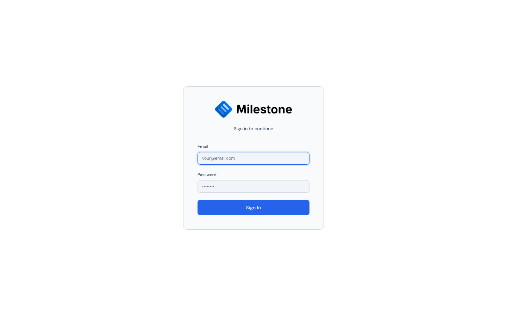

# Getting Started

## Logging In

When you navigate to the application URL, you are presented with the login screen.

{ loading=lazy }

- Enter your **email** and **password**, then click **Sign In**.
- If your organization uses **Microsoft Entra ID (SSO)**, click **Sign in with Microsoft** to authenticate through your corporate identity provider. The SSO button only appears if configured by your administrator. Finish the Microsoft sign-in in the same browser window within 10 minutes; otherwise you are asked to start again.
- After 10 failed sign-in attempts for the same e-mail within 15 minutes, further attempts are refused for a while (*"Too many failed sign-in attempts"*). Wait a few minutes or ask an admin to reset your password.
- If your session expires or an admin deactivates your account or changes your role, you are returned to the login screen; anything you were doing in What-If mode is discarded.
- If loading the workspace after sign-in fails, an error screen with a **Retry** button appears instead of an empty workspace.

## The Main Interface

The application is organized into several areas:

- **Sidebar** (far left) — Switch between the five main views: Gantt Chart, Staff Overview, Equipment, Cross-Site, and Archived
- **Header** (top) — Branding, site selector, date navigation, zoom controls, theme toggle, and user menu
- **Project Panel** (left-center) — Hierarchical list of projects, phases, and subphases
- **Timeline** (right) — Visual Gantt bars aligned to a calendar

## Navigation

### Sidebar Views

| Icon | View | Description |
|------|------|-------------|
| Gantt | **Gantt Chart** | Project timeline with phases and resource assignments (default) |
| Staff | **Staff Overview** | Staff members with assignments and availability |
| Equipment | **Equipment** | Equipment items with booking timelines |
| Cross-Site | **Cross-Site** | Overview of projects across all sites |
| Archive | **Archived** | Completed/archived projects |

The sidebar can be collapsed to icon-only mode for more screen space. Admins and superusers also see a **Settings** entry in the **Admin** section, which opens the [Settings window](settings.md) — users, sites, calendars, equipment, phases and SSO, limited to what your role can change. Your own time off is under **My absences** in the user menu (see [Vacations & Time Off](vacations.md#my-absences)).

### Header Controls

**Left — Branding & Context:**

- Logo and instance title (customizable by admin)
- Site selector dropdown to switch between locations

**Center — Timeline Navigation:**

- Arrow buttons to scroll the timeline backward/forward
- **Today** button to jump to the current date
- View mode: **W** (Week), **M** (Month), **Q** (Quarter), **Y** (Year)
- Zoom controls (**−**, the current percentage, **+**) to adjust timeline cell width (12px to 120px)

**Right — Actions & User Menu:**

- **Panels** toggle — Show/hide Staff and Equipment panels below the Gantt chart
- **What-If** toggle — Enter/exit scenario planning mode (Gantt chart only)
- Theme toggle (light/dark)
- Online users indicator
- **Offline** badge — appears only while live updates are disconnected. Your edits still save; you just don't see colleagues' changes until the connection is back. It reconnects by itself when the network returns or you switch back to the tab
- User menu (profile, logout, and the version this instance is running)

!!! note "The header adapts to the window width"
    On a narrower window the bar collapses in stages rather than crowding. Button labels shorten to icons first; below roughly 1280px the zoom and undo/redo controls move into a **⋯** menu beside the notification bell, and below about 1024px the view switcher and the theme and What-If toggles join them. Nothing is removed — everything stays reachable in that menu, and zoom and undo/redo also have [keyboard shortcuts](keyboard-shortcuts.md).

### Checking your version

The bottom of the user menu shows the version this instance is running, for example `v1.4.0`. It is read from the server each time you open the menu, so if your administrator upgrades the instance while you have the application open, the number changes here — reload the page to pick up the new version.

## User Roles

| Role | Permissions |
|------|-------------|
| **Admin** | Full access: manage users, sites, settings, projects, assignments |
| **Superuser** | Manage projects and assignments, use What-If mode; cannot manage users or settings |
| **User** | View projects and timelines; book their own absences; add themselves to projects and Kanban cards and manage their own assignments. The **project manager** of a project can also edit that project, its phases, assignments, equipment bookings and cards (but not delete it) |

Sites decide what you **see** (the site selector), not what a superuser may **edit**: superusers can change projects, phases, assignments and absences at every site. Only bank holidays, company events, equipment, equipment blocks and equipment types are limited to the superuser's own sites.

See [Who Can Edit a Project](gantt-charts.md#who-can-edit-a-project) for the details.
