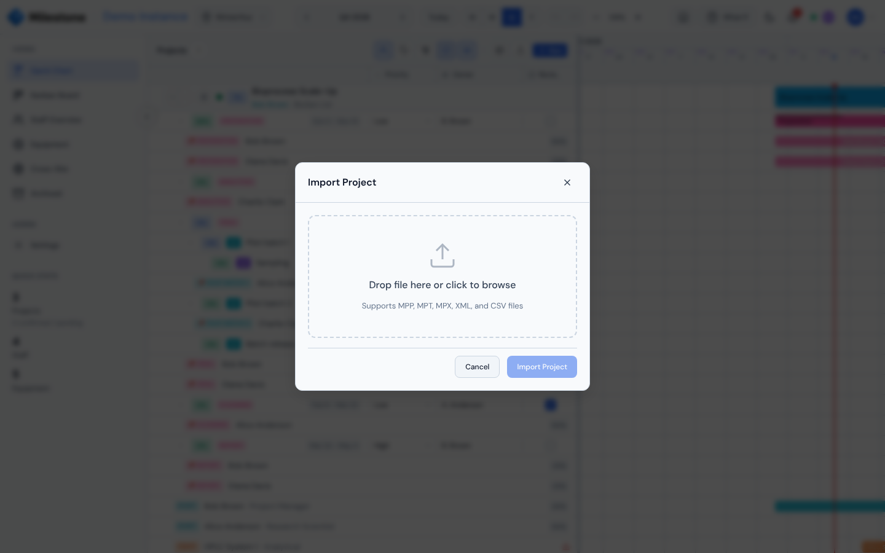
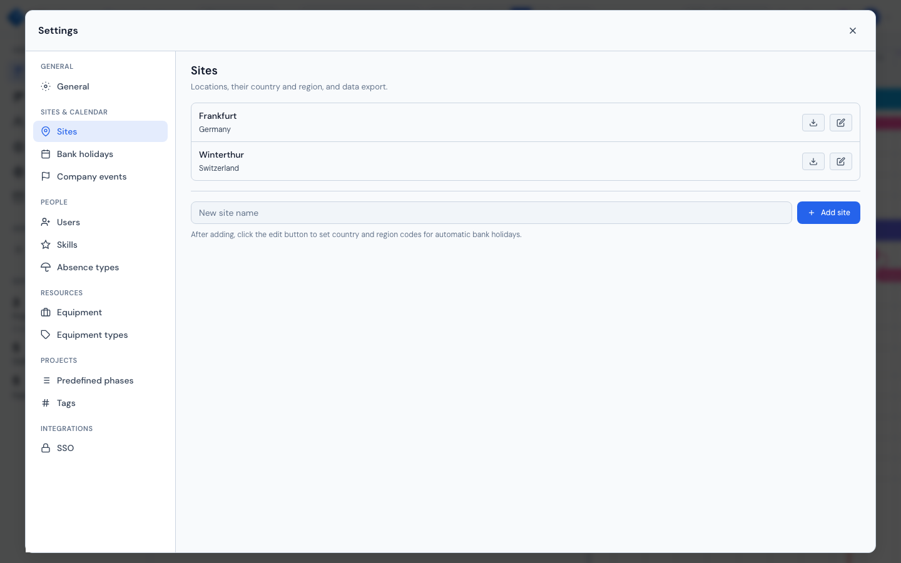

# Import & Export

## Importing Projects

{ loading=lazy }

Milestone can import project data from external tools:

1. Click **Import** in the project panel header
2. Drag-and-drop or browse to select a file:
   - **CSV** — Comma-separated values with columns for project name, phases, dates
   - **XML** — Microsoft Project XML format (`.xml`)
   - **MPP/MPT/MPX** — Microsoft Project native format (requires Java on the server)
3. Milestone parses the file and shows a preview
4. Click **Import Project** to create the project with all phases and subphases

After import, a summary shows the created project, phase count, and subphase count.

### Supported Formats

| Format | Extension | Requirements | Notes |
|--------|-----------|-------------|-------|
| **CSV** | `.csv` | None | Simple comma-separated values with project name, phase names, start/end dates |
| **XML** | `.xml` | None | Microsoft Project XML format — preserves full hierarchy and metadata |
| **MPP** | `.mpp` | Java (JRE 11+) | Microsoft Project native binary format — richest data preservation |
| **MPT** | `.mpt` | Java (JRE 11+) | Microsoft Project template format |
| **MPX** | `.mpx` | Java (JRE 11+) | Older Microsoft Project exchange format |

!!! note
    MPP/MPT/MPX file import requires Java to be installed on the server (included in the Docker image). CSV and XML imports work without Java.

!!! note
    Importing is blocked while [What-If mode](what-if-planning.md) is active — imports create the project immediately on the server and cannot be sandboxed. Exit What-If mode first.

### What Gets Imported

- **Project name** and metadata (start date, end date)
- **Phase hierarchy** — top-level tasks become phases, nested tasks become subphases (unlimited nesting depth preserved)
- **Dates** — start and end dates for all phases and subphases
- **Task names** — preserved as phase/subphase names

- **Completion** — the task's % complete, kept between 0 and 100; tasks at 100 % land in the Kanban **Done** column, partly done ones in **In Progress**

Staff assignments, resource allocations, and custom fields from the source file are not imported — these are configured within Milestone after import.

Import files are limited to **20 MB**; a larger upload is refused (*file too large*). Parsing runs in the background on the server, so a large file no longer slows down other users while it is processed.

### Troubleshooting Import Issues

| Problem | Solution |
|---------|----------|
| MPP import fails with "Java not found" | Java (JRE 11+) must be installed on the server. The Docker image includes it, but local development may not. |
| Phases appear flat (no nesting) | The source file may not have task hierarchy. Check the WBS structure in Microsoft Project before exporting. |
| Dates look wrong | Ensure the source file uses date formats that can be parsed (ISO 8601 or standard regional formats). |
| Large file takes too long | Very large project files (hundreds of tasks) may take several seconds to parse. Be patient during the preview step. |
| "File too large" | The upload exceeds 20 MB. Remove attachments or unused views in Microsoft Project, or export to XML/CSV. |

## Exporting Projects

To export a project:

1. Open the project edit modal (click Edit or right-click then Edit)
2. At the bottom of the modal, two export buttons are available:
   - **CSV Export** — Compatible with Microsoft Project and spreadsheet tools
   - **XML Export** — Microsoft Project XML format

The exported file includes the project hierarchy (phases, subphases), dates, assignments, and custom column values.

## Site Excel Export

The **Site Excel Export** is a complete snapshot of everything that lives under one site — projects, users, equipment, skills, absence types, vacations, assignments, custom columns, bank holidays, and company events — bundled into a single multi-sheet `.xlsx` file. It is the canonical "everything for this site" backup format, useful for archiving, audit, or migration.

### How to Export

1. Open **Settings → Sites** from the sidebar's **Settings** entry.
2. Locate the site you want to export.
3. Click the **download icon** (↓) next to the edit/pencil icon. Hover tooltip: *"Export site data as Excel"*.
4. The browser downloads `site_<name>_<YYYY-MM-DD>.xlsx`. Large sites may take several seconds to generate — the icon shows a spinner while the export is being built server-side.

{ loading=lazy }

### What's in the File

Each kind of data lives on its own sheet, so the file opens cleanly in Excel, LibreOffice, or any spreadsheet tool:

| Sheet | Contents |
|---|---|
| **Site** | Site metadata: name, city, country, region code, active flag |
| **Projects** | All projects on the site with their phases and subphases (full hierarchy, dates, project manager, customer, completion %) |
| **Users** | Users assigned to this site (name, email, role, job title, active flag, **Bookable** — whether they can be booked as a resource) |
| **Equipment** | Equipment items linked to the site, with type, active status and a **Sites** column listing every site each item belongs to |
| **Skills** | Skills defined on the instance (name, color, description) |
| **User skills** | User → Skill associations |
| **Tag groups** | Tag group definitions (name, single select, order) |
| **Tags** | Project tags that apply to this site (name, color, group, all sites / sites, order) |
| **Project tags** | Project → Tag associations, with the tag's group |
| **Absence types** | Absence type definitions (name, color, counts as unavailable, active, order) |
| **Vacations** | All absence entries for users on this site, including recurring patterns, with their **Type** and **Type ID** |
| **Project assignments** | Staff assigned at the project level |
| **Phase assignments** | Staff assigned at the phase level (with allocation %, **Start** / **End** — the booking's own dates, or the phase's — and **Linked**: yes when the booking follows the phase dates) |
| **Subphase assignments** | Staff assigned at the subphase level (same Start / End / Linked columns). The three assignment sheets carry an **Approval status** (approved or pending) and a **Pending change** column |
| **Approval requests** | Own-booking requests of the site's projects: requester, action, target, requested and previous values, status, decision and reason |
| **Equipment assignments** | Equipment booked against projects/phases/subphases |
| **Custom columns** | Custom column definitions for this site (name, type, scope, options) |
| **Custom column values** | Custom column values for every project/phase/subphase |
| **Bank holidays** | Public and custom holidays on the site (with year) |
| **Company events** | Company events linked to the site, with a **Sites** column listing every site each event applies to and a **Staff unavailable** column marking site closures |
| **Equipment blocks** | Maintenance/unavailability windows on the site's equipment |
| **Staff notes** | Notes pinned to the site's staff timeline |
| **Card comments** | Kanban card comments on the site's phases and subphases |

!!! note
    The Site Excel Export needs the *Export site data (Excel)* permission — **Admins and Superusers** by default — and works for the sites you can see: superusers export the sites they belong to, admins any site. Superusers find it in **Settings → Sites**, which shows them the export only (editing sites stays admin-only).

!!! tip
    Use this export before doing destructive operations (e.g. deleting a site, large bulk edits). The file is small enough to keep alongside regular database backups and is human-readable without needing to restore.

## Spreadsheet Safety

CSV exports and the site Excel workbook escape any cell text that starts with a formula
character (`=`, `+`, `-`, `@`, tab or carriage return), so a malicious project name or comment
cannot run as a formula when the file is opened in Excel or another spreadsheet program. Such
cells start with an apostrophe in the exported file. The project manager is included in CSV and
XML project exports.
