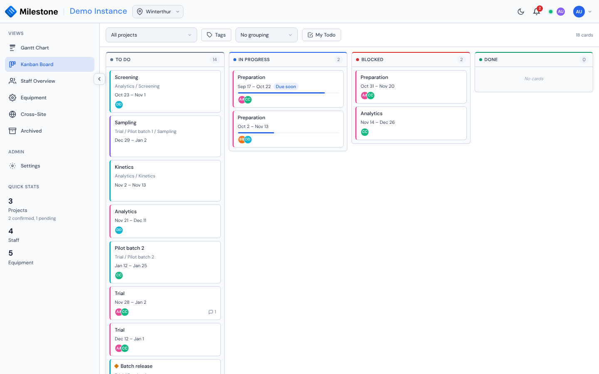

# Kanban Board

The Kanban board shows a project's work as cards moving through four columns. It is not a separate plan — it is the **same data as the Gantt chart, seen differently**. Move a card and the Gantt chart updates; change a percentage in the Gantt chart and the card moves. There is nothing to keep in sync by hand.

{ loading=lazy }

Open it from **Kanban Board** in the sidebar (shown when your role has the **Kanban board** permission — every built-in role does).

## What becomes a card

A card is a piece of work with nothing nested inside it:

| In the Gantt chart | On the board |
|---|---|
| A subphase with no children | A **card** |
| A phase with no subphases | A **card** |
| A phase that contains subphases | A **swimlane**, not a card |
| A subphase that contains other subphases | Neither — it appears in the card's breadcrumb |

Milestones are cards too, marked with a small diamond.

!!! note "Parent phases have their own percentage"
    A phase that contains subphases is a lane on the board, so its own completion percentage is not shown there. If you set such a phase to 80% in the Gantt chart, the board will not appear to change — the cards inside it are what the board tracks.

## The four columns

| Column | What it means | Effect on % complete |
|---|---|---|
| **To Do** | Not started | Sets it to 0% |
| **In Progress** | Under way | Keeps a percentage between 1 and 99; otherwise starts it at 50% |
| **Blocked** | Stalled on something | **Leaves the percentage alone** |
| **Done** | Finished | Sets it to 100% |

It works the other way too. Editing the percentage in the Gantt chart moves the card: 0% goes to To Do, 100% to Done, and anything between to In Progress.

**Blocked is deliberately sticky.** A percentage cannot express *why* work has stalled, so editing the percentage of a blocked card leaves it blocked. Move it out of Blocked yourself when the obstacle clears. Setting it to 0% or 100% is unambiguous and will move it.

## Moving cards

Drag a card to another column, or open it and pick a status.

You can move a card if your role may **move any card** (admins and superusers by default), if you are the **project manager** of the card's project, or if you are **assigned to that card** and your role may move the cards you are assigned to (every built-in role). A booking still awaiting approval does not count as being assigned. Cards you cannot move are not draggable. Being assigned lets people report progress on their own work without being able to reschedule the plan.

## Choosing what to show

The project picker chooses the board. **All projects** shows everything active at the site at once, which is the natural companion to grouping by project or filtering to My Todo. The **Tags** button next to the picker narrows the board to projects carrying the selected tags — the same filter as in the Gantt chart, remembered per site (see [Filtering projects by tag](gantt-charts.md#filtering-projects-by-tag)).

Projects appear in the same order as the Gantt chart, including any custom order you have dragged them into there.

## Grouping into swimlanes

The grouping menu in the toolbar splits the board into rows:

- **No grouping** — one set of columns for everything shown.
- **By project** — one lane per project, in Gantt order. Most useful with **All projects**.
- **By phase** — one lane per top-level phase. When several projects are shown, lanes are labelled *Project — Phase* so two phases with the same name stay apart.
- **By assignee** — one lane per person, plus an *Unassigned* lane at the bottom. A card with several assignees appears in each of their lanes.
- **By a custom column** — one lane per option of any list-type custom column, plus *(none)*.

Click a lane heading to collapse it.

## My Todo

The **My Todo** toggle hides every card you are not assigned to. Cards you have asked to join, still awaiting approval, are included. (For tasks and approval requests, see [My Todos](my-todos.md).) Combine it with **All projects** to see everything on your plate across the site at once, or with grouping by phase to see where your own work sits in one plan.

## Assigning people — and booking their time

Open a card and add someone under **Assignees**. This is not just a label:

!!! warning "Assigning books capacity"
    Assigning someone creates a real staff assignment covering the card's dates, at that person's maximum capacity. It shows up immediately in the [Staff workload view](staff-management.md), and it counts towards over-allocation.

    Someone assigned to five overlapping cards is booked at five times their capacity and the workload heatmap will show it. If you want lightweight ownership without booking time, say so in a comment instead.

The dropdown shows what each person will be booked at. Because the booking takes its dates from the card, rescheduling the bar in the Gantt chart moves the booking with it — you never have to adjust it separately. Removing someone from a card releases the booking.

In the Gantt chart a booking can also be given [its own dates inside the phase](gantt-charts.md#bookings-on-phases-and-subphases), and a person can hold several such bookings on one phase. The card still shows that person **once** (hover the avatar to see every allocation), while the card's detail lists **one line per booking**, with the dates of each booking that has its own. Each line has its own **×**, so bookings are removed one at a time; the confirmation names the dates of the booking you are removing.

### Changing how much time is booked

Someone is booked at their full capacity to begin with, which is rarely what you want for a card they are only partly on. Each assignee has a slider beside their name: drag it and the booking changes as soon as you let go, in the Gantt chart and the workload heatmap alike. It is the same control as the allocation slider in the Gantt chart — the same 5% steps, the same range — so a booking means the same thing whichever view you set it from.

A slider shown in red is above that person's own maximum capacity: a part-timer at 60% booked onto a card at 80%. That is allowed; it is the heatmap that tells you what someone's whole workload adds up to.

A single booking is always between **1 and 100 %** — the server rejects 0 or anything above 100, here and on every other assignment. Over-allocation is what several overlapping bookings add up to, never one booking on its own.

Adding, removing and changing other people's bookings requires **Assign and manage anyone** (superusers by default) or being the project's manager. Your **own** booking is yours to manage when your role allows it: you can change your allocation with your slider and remove yourself with the **×** on your row (one **×** per booking when you have several on the card). Removing an assignee asks for confirmation first, because their booking is deleted with them.

Adding assignees and joining a card are unavailable in [What-If mode](what-if-planning.md), like other creates. What-If itself is entered from the Gantt chart; while a plan is open the board waits until it is applied or discarded.

### Joining a card yourself

If you can't manage the project, the card's detail shows a **Join this card** button as long as you are not on it yet (and your role lets you book yourself). Joining books your time exactly like being assigned by a manager — the card's dates, at your maximum capacity — and lets you move the card from then on. Removing yourself releases the booking again.

### Joining and leaving with approval

When your role books your own time [with approval](settings.md#approvals), the button reads **Request to join**:

- Your avatar appears on the card with a dashed ring and *(pending approval)*, and the card shows a **Pending approval** badge for you. The booking does not count in the workload yet, and you cannot move the card until you are approved
- Moving your own slider sends a change request instead — the slider stays put and *requested 60%* appears beside it. Clicking **×** asks *Ask to leave this card?* and sends a removal request
- While your request is open, your row shows **Cancel request** instead of the slider and **×**

People who may decide the request see **Approve** and **Reject** on that row of the card. Every request also appears in their [My Todos](my-todos.md), and you are notified of the decision.

## Comments and mentions

Every card has a comment thread. Anyone whose role may **comment on cards** can comment — every built-in role. You can delete your own comments (after a confirmation); roles that **moderate comments** (admins and superusers by default) can delete any.

When a user account is deleted, their comments stay on the card and are shown as written by **Deleted user**.

A card with comments shows a small speech-bubble count on the board.

### Mentioning someone

Type `@` and the list opens: people already assigned to this card first, then everyone else who works at the card's site — any role, administrators included. Keep typing to filter, then pick with the arrow keys and Enter, or click.

!!! warning "Only names you pick from the list notify anyone"
    A picked mention is **highlighted** in the comment box. A name you simply type out is ordinary text and notifies nobody, however correctly it is spelled — the highlight is what tells you the difference.

    Editing a highlighted mention removes the highlight, and with it the notification. That is deliberate: what you see is always what will happen when you post. Note that undoing the edit brings the text back but not the highlight — retype the `@` to pick the person again.

Who you can reach:

- **Everyone at the card's site**, whatever their role — administrators and project managers included, not just the people booked on the card.
- **Administrators from any site** — and anyone whose role sees every site. They can see every project, so they can always be mentioned.
- **Not people from other sites**, unless they are assigned to this card. Someone who cannot see the project would only be confused by the notification.
- **Not yourself.** You would never be notified anyway, so it is left out rather than showing a mention that does nothing.
- **Not deactivated accounts**, since they cannot sign in to read the notification.

## Notifications

The bell in the header shows unread notifications. You are notified when someone:

- assigns you to a card,
- comments on a card you are assigned to,
- mentions you in any comment,
- moves a card you are assigned to into another column,
- asks for your approval to book themselves, decides your own request, or gives you a task — these lead to [My Todos](my-todos.md#notifications),
- books you, changes or removes your booking, or moves or deletes a card you are booked on,
- changes a project you manage (bookings, equipment, project details, phases and subphases, an approval).

The last two go only to the booked person and the project manager. Several changes by the same person on the same project merge into one unread line while each comes within ten minutes of the previous one (so one line can span a long editing session) — see [Notifications](collaboration.md#notifications) for the full list.

You are never notified about your own actions. If you are both assigned to a card and mentioned in a comment on it, you get the mention only.

Clicking a card notification opens that card's board and detail (if your role has the Kanban board; otherwise the project on the Gantt chart); a project notification opens the project on the Gantt chart; an approval or task notification opens the matching tab of My Todos.

!!! note "Turning the board off"
    An administrator can turn the Kanban board off for the whole workspace in **Settings → [Features & defaults](settings.md#features-defaults)**. Nobody then sees the board or its sidebar entry, whatever their role — administrators included. Comments stay stored and come back when the board is turned on again, My Todos keeps working (its card links become plain text), and card notifications open the Gantt chart instead.

!!! info "Due and overdue reminders work differently"
    Reminders for cards that are due within a week, or already past their end date, are worked out **in your browser** from the plan you already have loaded. They need no configuration and appear alongside the other notifications.

    The trade-off: they only appear while you have the application open. There is no email or push notification, and nothing arrives overnight. Dismissing one is remembered in your browser; if the card is rescheduled and becomes due again, it will remind you afresh.

## What gets exported

The [site export](import-export.md) includes a **Kanban status** column on the Projects sheet and a **Card comments** sheet. Notifications are not exported — they are personal inbox state rather than project data.
