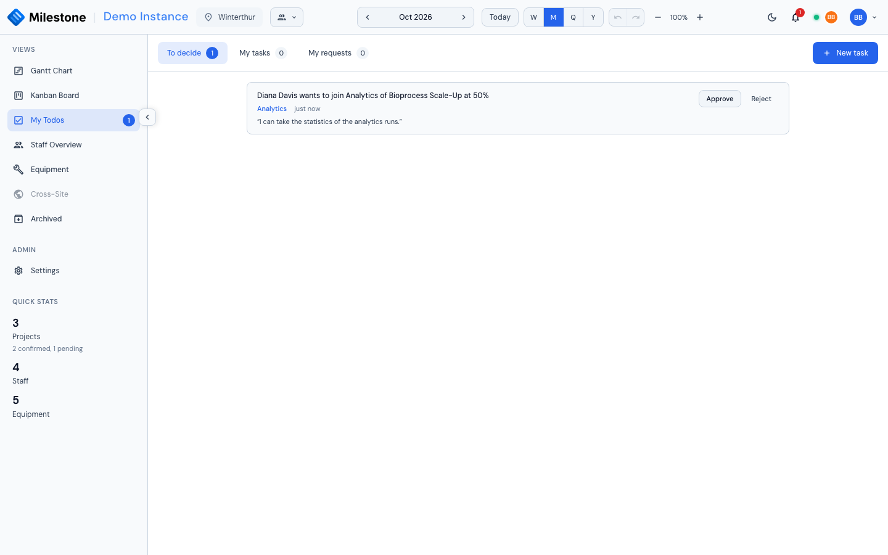

# My Todos

**My Todos** gathers what is waiting for you: booking requests you can decide, your personal tasks and the requests you have sent. Open it from **My Todos** in the sidebar, just below the Kanban Board. Everyone signed in has it.

The sidebar entry carries a badge with the number of open items: requests waiting for your decision plus open tasks assigned to you (up to *99+*). It updates live — when someone sends you a request, gives you a task or decides one of your requests, the badge and the lists change without a reload.

{ loading=lazy }

## The Three Tabs

| Tab | What it lists |
|-----|---------------|
| **To decide** | Booking requests you may approve or reject — see [Approvals](settings.md#approvals) |
| **My tasks** | Tasks assigned to you, and tasks you gave to someone else |
| **My requests** | Requests you sent to book yourself, change your booking or leave a card, with their outcome |

Each tab shows how many items it holds. **My tasks** opens first. Under **My tasks** and **My requests**, the **Open** and **Done** chips switch between what is still open and what is finished or decided.

## To Decide

Each request reads like a sentence — *Diana Davis wants to join Analytics of Bioprocess Scale-Up at 50%*, *… wants to change their booking: allocation 40% → 60%*, *… wants to leave …* — with its card (which opens the Kanban card) and how long ago it was sent.

- **Approve** applies the booking at once: a new booking stops being *pending* and counts towards the person's workload, a change takes the requested values, a removal deletes the booking
- **Reject** opens a small dialog for an optional **reason**, which the requester sees under **My requests**

If the booking can no longer apply — the card was deleted, the person was already booked there, someone changed the booking in the meantime — approving closes the request as *Expired* and says why, instead of applying it.

You only see requests for projects at sites you can see, never your own. Who may decide what is set by an administrator in [Settings → Roles → Approvals](settings.md#approvals); administrators can always decide.

The same requests can be decided where the booking is: from the booking's right-click menu in the Gantt chart (**Approve request**, **Reject request…**) or in the Kanban card's assignee list.

## My Tasks

A task is a short personal to-do with an optional due date, notes and link to a project or Kanban card.

- Tick the **Done** switch to complete a task; untick it to reopen it
- Click the title to edit the task
- An open task due within a week shows **Due**, a late one **Overdue**
- A task you gave to someone shows *For &lt;name&gt;*; a task someone gave you shows *From &lt;name&gt;*
- A linked card opens the [Kanban card](kanban-board.md) in place, if your role has the Kanban board

### Creating a Task

1. Click **New task**
2. Enter a **Title** and, optionally, **Notes** and a **Due date**
3. Choose the **Assignee** — yourself by default
4. Optionally pick a **Project** and, within it, a **Card** (a phase or subphase)
5. Click **Create task**

The due date is picked on the [shared calendar](gantt-charts.md#picking-dates); **Clear date** in the calendar removes it.

With the default roles, everyone can create tasks for themselves. Giving a task to someone else needs **Assign todos to others** (superusers and administrators by default) — or being the project manager of the project the task is linked to. You can only pick people at sites you can see.

The person you give a task to is notified. Reassigning a task notifies the new assignee.

### Editing and Deleting

The assignee and the person who created the task can both edit it. Only the creator can delete it (or the assignee, once the creator's account is gone): open the task and click **Delete**, then confirm.

Tasks are private: only their assignee and their creator see them. They are not part of the site Excel export.

## My Requests

Every request you sent appears here with its outcome:

| Outcome | Meaning |
|---------|---------|
| **Awaiting approval** | Nobody has decided yet. **Cancel request** withdraws it |
| **Approved by** *name* | The booking is applied |
| **Rejected by** *name* | Nothing changed; the approver's reason, if any, is shown under the request |
| **Withdrawn** | You (or an administrator) cancelled it |
| **Replaced by a newer request** | You changed your request before anyone decided; the newer one counts |
| **Expired** | It could no longer apply — the reason is shown, for example *the booking was changed since the request was made* |

Pending and decided requests are under **Open** and **Done** respectively. Your pending bookings also show where they belong — as dashed rows in the [Gantt chart](staff-management.md#booking-yourself-when-approval-is-required) and on the Kanban card.

## Notifications

Three notification types lead to My Todos. Clicking one opens the right tab:

| Notification | Opens |
|--------------|-------|
| Someone asks for your approval | **To decide** |
| Your request was approved, rejected, cancelled by an administrator or expired | **My requests**, showing decided requests |
| Someone gave you a task | **My tasks** |

See [Real-Time Collaboration](collaboration.md#notifications) for the notification bell itself.

!!! note "What-If mode"
    My Todos, like the other views, is not reachable while a [What-If](what-if-planning.md) plan is open, and decisions and new tasks wait until you apply or discard the plan.
