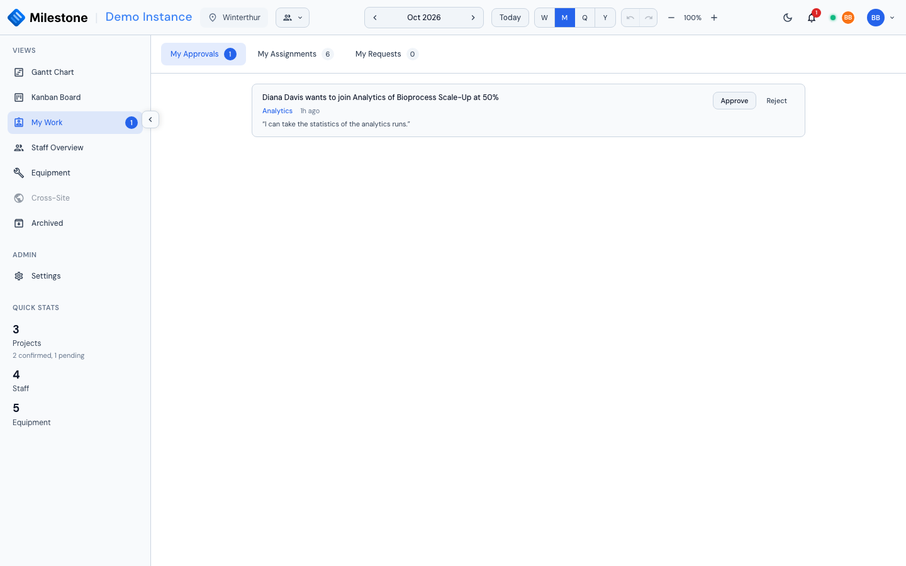
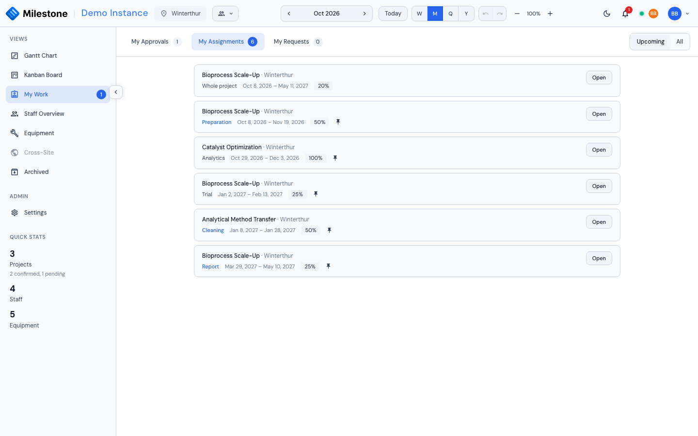

# My Work

**My Work** gathers your own work outside the boards: booking requests you can decide, your bookings, and the requests you have sent. Open it from **My Work** in the sidebar, just below the Kanban Board. Everyone signed in has it.

The sidebar entry carries a badge with the number of requests waiting for your decision (up to *99+*). It updates live — when someone sends you a request, or a request you could decide is decided by someone else, the badge and the lists change without a reload.

{ loading=lazy }

## The Three Tabs

| Tab | What it lists |
|-----|---------------|
| **My Approvals** | Booking requests you may approve or reject — see [Approvals](settings.md#approvals) |
| **My Assignments** | Your bookings: the projects, phases and subphases you are booked on |
| **My Requests** | Requests you sent to book yourself, change your booking or leave a card, with their outcome |

Each tab shows how many items it holds: requests to decide, current and upcoming bookings, and pending requests. **My Assignments** opens first.

## My Approvals

Each request reads like a sentence — *Diana Davis wants to join Analytics of Bioprocess Scale-Up at 50%*, *… wants to change their booking: allocation 40% → 60%*, *… wants to leave …* — with its card (which opens the Kanban card) and how long ago it was sent. When the requester wrote a **message for the approver**, it is shown in quotes under the request, with any `@`-mentions as names; the notification you received carries its beginning.

- **Approve** applies the booking at once: a new booking stops being *pending* and counts towards the person's workload, a change takes the requested values, a removal deletes the booking. Approving a new booking also adds the requester's message to the booking's [comment thread](#comments-on-a-booking) as their comment — when their role may comment — and notifies the people it mentions (never you)
- **Reject** opens a small dialog for an optional **reason**, which the requester sees under **My Requests**

If the booking can no longer apply — the card was deleted, the person was already booked there, someone changed the booking in the meantime — approving closes the request as *Expired* and says why, instead of applying it.

You only see requests for projects at sites you can see, never your own. Who may decide what is set by an administrator in [Settings → Roles → Approvals](settings.md#approvals); administrators can always decide.

The same requests can be decided where the booking is: from the booking's right-click menu in the Gantt chart (**Approve request**, **Reject request…**) or in the Kanban card's assignee list.

## My Assignments

{ loading=lazy }

One line per booking you hold, across every project you can see — on a whole project, on a phase or on a subphase — soonest first. Each line shows:

- the **project** and its site
- the **phase or subphase** (which opens the [Kanban card](kanban-board.md), if your role has the Kanban board), or *Whole project* for a project-level booking
- the **dates** and the **allocation**
- a **pin** when the booking follows its phase's dates (see [Bookings on Phases and Subphases](gantt-charts.md#bookings-on-phases-and-subphases))

**Upcoming** (the default) shows the bookings that have not ended yet; **All** adds the past ones. Bookings on archived projects are left out, and bookings still waiting for approval are under **My Requests**, not here.

**Open** shows the booking in its [assignment dialog](staff-management.md#assignment-modal), as the Gantt chart's **Edit** does: you can change it there if your role lets you, and read and add [comments](#comments-on-a-booking). The dialog opens read-only, with a note saying why, when the booking cannot be changed: *Your change request on this booking is open* (wait for the decision, or cancel it under My Requests), *This booking awaits approval*, or *You cannot change this booking*. The comments stay usable either way.

### Comments on a Booking

The assignment dialog of a booking carries a **Comments** section:

- for a booking on a **phase or subphase**, it is the card's own thread — the same comments as in the [Kanban card dialog](kanban-board.md#comments-and-mentions), whichever of the two you post from;
- for a **project-level** booking, it is the project's thread, shared by everyone booked on the whole project.

Type `@` to [mention someone](kanban-board.md#mentioning-someone): they are notified, and so are the people booked on the card (or, for a project thread, on the whole project). Posting a comment never saves or closes the booking. Commenting needs the **comment on cards** permission (every built-in role); reading a thread only needs to see the project, so it works with the Kanban board turned off too.

A comment written when the booking was made — in the assignment dialog, or a request's message once approved — opens the thread like any other comment.

A project thread is read from the dialog of a project-level booking. Someone you mention there who is not booked on the whole project gets the notification, which opens the project on the Gantt chart, but has no dialog to read the thread from.

## My Requests

Every request you sent appears here with its outcome:

| Outcome | Meaning |
|---------|---------|
| **Awaiting approval** | Nobody has decided yet. **Cancel request** withdraws it |
| **Approved by** *name* | The booking is applied |
| **Rejected by** *name* | Nothing changed; the approver's reason, if any, is shown under the request |
| **Withdrawn** | You (or an administrator) cancelled it |
| **Replaced by a newer request** | You changed your request before anyone decided; the newer one counts |
| **Expired** | It could no longer apply — the reason is shown, for example *the booking was changed since the request was made* |

A request you sent with a message shows it as **Your message**, apart from the approver's reason.

Pending and decided requests are under **Open** and **Done** respectively. Your pending bookings also show where they belong — as dashed rows in the [Gantt chart](staff-management.md#booking-yourself-when-approval-is-required) and on the Kanban card.

## Notifications

Two notification types lead to My Work. Clicking one opens the right tab:

| Notification | Opens |
|--------------|-------|
| Someone asks for your approval | **My Approvals** |
| Your request was approved, rejected, cancelled by an administrator or expired | **My Requests**, showing decided requests |

A comment or mention on a card opens the card (or the project on the Gantt chart without the Kanban board); one on a project thread opens the project on the Gantt chart. See [Real-Time Collaboration](collaboration.md#notifications) for the notification bell itself.

!!! note "What-If mode"
    My Work, like the other views, is not reachable while a [What-If](what-if-planning.md) plan is open, and decisions wait until you apply or discard the plan. Comments in the Gantt chart's assignment dialog still post at once — they are not part of the plan.
