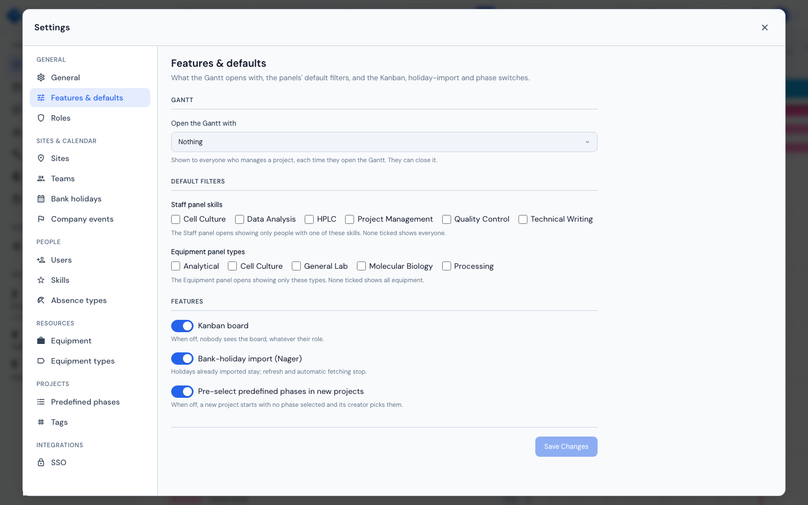
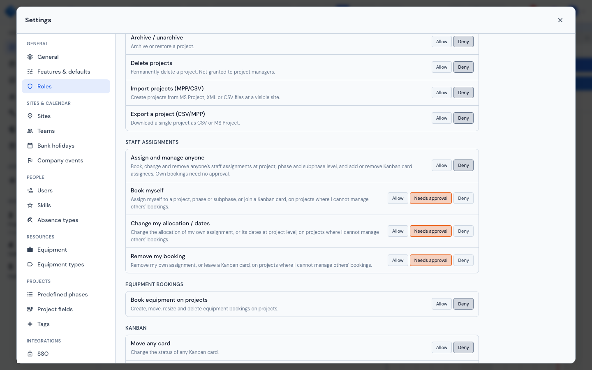
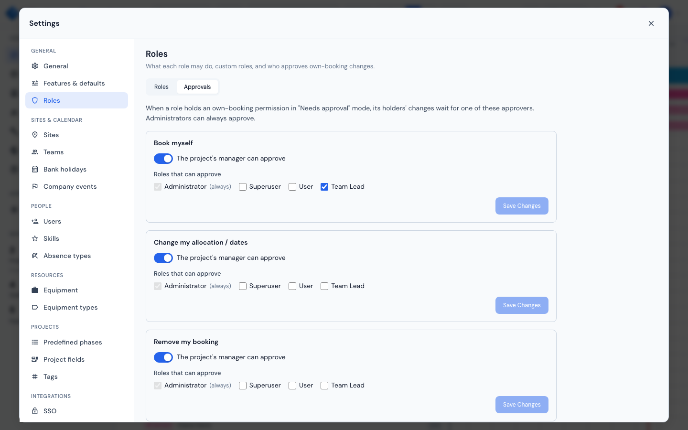
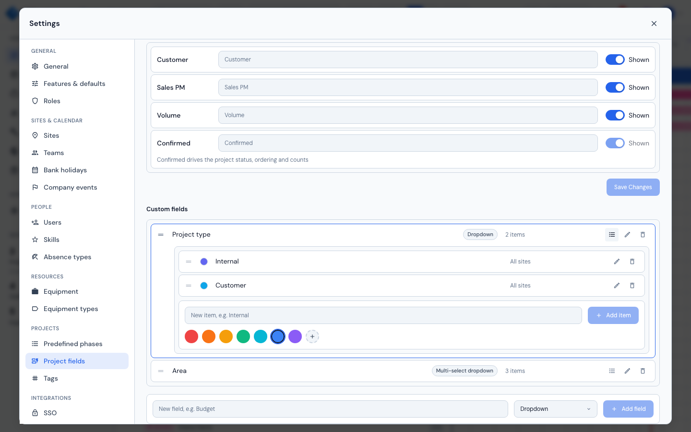

# Settings & Configuration

All administration happens in one **Settings** window. Open it from the **Settings** entry in the **Admin** section of the sidebar — the only admin entry there. The window lists its sections on the left, grouped by topic, and shows the selected section on the right.

!!! note "What-If mode"
    Settings is unavailable while a [What-If](what-if-planning.md) plan is open — the entry is disabled with an explanation. Apply or discard the plan first.

{ loading=lazy }

## Settings Sections

| Group | Section | What it manages | Who sees it (default roles) |
|-------|---------|-----------------|-------------|
| General | [General](#general) | Instance title, theme, logos, display defaults | Admin (Superuser: theme only) |
| | [Features & defaults](#features-defaults) | What the Gantt opens with, the panels' default filters, the Kanban board, the bank-holiday import, phase pre-selection | Admin |
| | [Roles](#roles-permissions) | Roles and their permissions; who approves own bookings ([Approvals](#approvals)) | Admin |
| Sites & calendar | [Sites](#sites) | Locations, country/region, site Excel export | Admin |
| | [Teams](#teams) | Teams per site, their members; the header team filter | Admin, Superuser |
| | [Bank holidays](#bank-holidays) | Public and custom holidays per site | Admin, Superuser |
| | [Company events](#company-events) | Audits, meetings and site closures on one or more sites | Admin, Superuser |
| People | [Users](#user-management) | Accounts, roles, sites, skills | Admin, Superuser |
| | [Skills](#skills-management) | Skill tags for staff | Admin, Superuser |
| | [Absence types](#absence-types) | Categories of time off, shared by all sites | Admin |
| Resources | Equipment | Lab equipment on one or more sites — see [Equipment Booking](equipment-booking.md#managing-equipment) | Admin, Superuser |
| | [Equipment types](#equipment-types) | Equipment categories | Admin, Superuser |
| Projects | [Predefined phases](#predefined-phases) | Phase templates for new projects | Admin, Superuser |
| | [Project fields](#project-fields) | The built-in project fields' labels, and your own dropdown, text, number and switch fields | Admin |
| | [Tags](#tags) | Project tags and the sites they apply to | Admin |
| Integrations | SSO | Microsoft Entra single sign-on for this workspace — see [Organization & SSO](../admin-guide/organizations-sso.md#configuring-sso-in-milestone) | Admin |

Each person only sees the sections their role's [permissions](#roles-permissions) let them change — with the default roles, **superusers** see General (theme only), Teams, Bank holidays, Company events, Users, Skills, Equipment, Equipment types and Predefined phases. Someone whose role grants none of these sections has no Settings entry; they manage their own time off from [My absences](vacations.md#my-absences) in the user menu.

!!! note "Unsaved changes"
    If you switch section or close the window while a form holds unsaved input — in **General**, **Features & defaults**, **Roles**, **Users**, **Equipment**, **Sites**, **Teams**, **Skills**, **Bank holidays**, **Company events**, **Absence types**, **Equipment types**, **Project fields** or **Tags** — Milestone asks before discarding it. Clicking outside the window never closes it.

Saving is protected against double submission: pressing Enter twice or double-clicking a Save, Add or Delete button runs the action only once.

Some sections link to each other: **Manage Types** in Equipment opens Equipment types, **Manage Skills** in Users opens Skills, and the bank-holiday status in a site's form links to Bank holidays for that site.

---

## General

The **General** section holds the theme picker and, for roles with **Edit instance settings** (admins by default), the instance-wide settings. Everyone else only sees **Appearance** (the theme family of their own browser).

### Instance Settings

- **Application Title** — Name displayed in the header and browser tab (e.g., "ACME R&D Planner")

### Branding & Themes

- Choose from available **theme families** (color schemes) — applied immediately and saved in this browser only
- Toggle **light/dark mode** using the sun/moon icon in the header
- Upload custom logos for dark and light themes (drag-and-drop or click to browse)
- Click **Remove** to revert to the default Milestone logo

{ loading=lazy }

### Display Settings

| Setting | Description |
|---------|-------------|
| Default View | Initial timeline granularity: Week, Month, Quarter, or Year |
| Week Starts On | Monday or Sunday |
| Show Weekends | Toggle weekend columns on/off |
| Auto-expand Projects | Automatically expand all projects on load |

---

## Features & defaults

**Settings → Features & defaults** (roles with **Edit instance settings** — admins by default) sets what everyone in the workspace starts with and turns whole features on or off. Change the controls and click **Save Changes**; **Reset** discards the unsaved changes.

{ loading=lazy }

| Setting | What it does | Default |
|---------|--------------|---------|
| **Open the Gantt with** | *Nothing*, *Staff panel* or *Equipment panel*: the [resource panel](gantt-charts.md#resource-panels) docked under the Gantt chart each time someone opens it — for everyone who may see the panels (people who can edit any project, and project managers). They can close it for the rest of their visit. *Nothing* leaves each browser's own choice | Nothing |
| **Staff panel skills** | The Staff panel and the Staff view open showing only people with one of the ticked [skills](#skills-management). None ticked shows everyone | None |
| **Equipment panel types** | The Equipment panel and view open showing only the ticked [equipment types](#equipment-types). None ticked shows all equipment | None |
| **Kanban board** | Turns the [Kanban board](kanban-board.md) on or off for the whole workspace | On |
| **Bank-holiday import (Nager)** | Turns the automatic [public-holiday fetching](#automatic-fetching) on or off | On |
| **Pre-select predefined phases in new projects** | Whether a new project starts with every active [predefined phase](#predefined-phases) selected, or with none | On |

The default filters are a starting point, not a restriction: people change them as usual, and the default applies again the next time the panel opens. A skill that was deleted or an equipment type that was renamed is shown as *(no longer exists)* so you can untick it; until then it is simply ignored.

**With the Kanban board off**, nobody sees the board or its sidebar entry, whatever their role — administrators included — and it takes effect for people already signed in without a new login. Card comments stay stored and reappear when the board is turned on again. [My Todos](my-todos.md) keeps working (its card links become plain text), and card notifications open the project on the Gantt chart instead. Turning the board off does not change any role: the [permission matrix](#the-permission-matrix) still shows the **Kanban board** permission as configured.

**With the bank-holiday import off**, the **Refresh from Nager** button, the site form's **Refresh** button and its *Last updated* line disappear, and setting or changing a site's country no longer fetches holidays. The holidays already imported stay, and you can still add, edit, delete and [import](#importing-holidays-from-a-calendar-file) holidays by hand.

**With phase pre-selection off**, the **New Project** dialog shows the predefined phases with none selected; click the ones the project needs. The phases you pick are created spread over the project's dates, as before.

---

## Roles & Permissions

What each person may do in Milestone is decided by their **role**. A role is a named set of permissions — one entry per thing you can do, such as *Create projects*, *Book equipment on projects* or *See colleagues' absences*. Open **Settings → Roles** (administrators only). The section has two tabs: **Roles** and [Approvals](#approvals).

The **Roles** tab lists every role with its description and how many users hold it. The three built-in roles carry a **System** badge.

{ loading=lazy }

### The Built-in Roles

| Role | What it can do by default |
|------|---------------------------|
| **Administrator** | Everything, at every site. Its permissions cannot be edited and it cannot be deleted, so there is always someone who can manage roles |
| **Superuser** | Plans projects, people and equipment at the sites they belong to: creates, edits, archives, deletes, imports and exports projects, assigns anyone, books equipment, manages colleagues' absences, staff notes, equipment, bank holidays, company events, teams, skills and phase templates, views and edits non-admin users, exports the site, uses What-If |
| **User** | Sees the plan at their sites, books their own time, manages their own absences and todos, comments on Kanban cards and moves the cards they are assigned to |

Both the Superuser and the User role can **act as project manager**: on a project where they are the *Project Manager*, they edit the project, archive it, assign people, book equipment, move cards, set column values and give todos to others — but never delete, create, import or export projects.

The defaults of Superuser and User match what these roles could do before roles became editable, so upgrading changes nothing for existing accounts — except that superusers now work only at the sites they belong to (see [Who sees which sites](#who-sees-which-sites)). An administrator can change the permissions of Superuser and User, but not delete them.

### Adding a Role

1. Click **Add role**
2. Type a **Name** (for example *Team Lead*) and an optional **Description**. The role's **key** — the short identifier stored on each account — is derived from the name and shown under the field (*Team Lead* → `team_lead`). It cannot be changed later; renaming the role keeps the key
3. Set the permissions in the matrix (a new role starts with nothing but *View projects and Gantt*)
4. Click **Create role**

Click the **edit icon** to change a role, then **Save Changes**. Custom roles can be deleted with the **delete icon** or **Delete role** in the form, after a confirmation — but only while nobody holds them: give those people another role first.

### The Permission Matrix

Permissions are grouped by topic: *Projects*, *Staff assignments*, *Equipment bookings*, *Kanban*, *Custom columns*, *Absences*, *Staff notes*, *Equipment*, *Calendar*, *Sites*, *Teams*, *Users*, *Skills*, *Project configuration*, *Instance settings*, *Roles, approvals, todos* and *Views and tools*. Each row shows what the permission allows and three choices:

- **Allow** — the role may do it
- **Needs approval** — only on the three own-booking permissions (*Book myself*, *Change my allocation / dates*, *Remove my booking*): people with the role can ask, and the booking waits for an approver (see [Approvals](#approvals))
- **Deny** — the role may not; the matching buttons and menu entries are hidden or disabled

Rows marked **Locked** cannot be changed: *View projects and Gantt* is always allowed, and *Manage roles and approval policies* belongs to the Administrator role alone.

A change applies to everyone holding the role on their next action — nobody has to sign out, and open windows pick up the new permissions straight away.

Some permissions worth knowing:

| Permission | What it does |
|-----------|--------------|
| **See all sites** | Every active site is visible. Without it, a person sees and works only at the sites they belong to. Administrators only, by default |
| **Act as project manager** | The project-manager rights described above, on the projects the person manages |
| **Assign and manage anyone** | Book, change and remove anyone's assignments. People with it (and project managers on their projects) never need approval for their own bookings |
| **See colleagues' absences** | See the absences of people at your sites; without it, only your own |
| **Change user roles** | Give people a role — but only a role whose permissions you hold yourself |
| **Kanban board**, **Staff overview**, **Equipment view**, **Cross-site view**, **Archived projects** | Show the matching view in the sidebar; without them it is hidden |
| **What-If mode** | Show the What-If toggle on the Gantt chart |

### Who Sees Which Sites

A role without **See all sites** limits its holders to the sites in their account: the site selector lists only those, and every project, person, piece of equipment, holiday and event elsewhere stays out of reach — also for editing. The **Cross-Site** view needs at least two visible sites; with one it is shown disabled with the reason.

### Giving People a Role

Roles are given in [Users](#user-management). Nobody can raise someone above themselves:

- The role list only offers roles whose permissions you hold yourself; the others are disabled with *(more than your role)*, and the Administrator role with *(admin only)*
- You can only change the role of someone whose current role grants no more than yours
- Nobody can change their own role, and the last active administrator cannot be demoted, deactivated or deleted
- A role other than the default *User* needs **Change user roles**; with **Create users** alone, new accounts get the User role

A custom role can also be the default role of accounts created by [single sign-on](../admin-guide/organizations-sso.md#configuring-sso-in-milestone).

---

## Approvals

When a role has **Needs approval** on an own-booking permission, people with that role can still book themselves, but the booking waits for someone to approve it. The **Approvals** tab of **Settings → Roles** decides who that is.

There is one card per action — **Book myself**, **Change my allocation / dates** and **Remove my booking**:

- **The project's manager can approve** — the *Project Manager* of the project the booking is on
- **Roles that can approve** — tick the roles whose holders may approve. The Administrator role is always ticked: administrators can approve every request

{ loading=lazy }

If neither the project's manager nor any role is set, a warning says that only administrators can approve these requests. Click **Save Changes** on the card to apply it. An approver must be able to see the project's site, and nobody approves their own request.

### What Happens to a Request

1. The person books themself as usual — the button reads **Request to assign me**, **Request to join**, **Request change** or **Request removal** — and sees *Sent for approval*
2. A new booking appears at once as a dashed row with a **Pending approval** badge (a change shows *Change pending* with the old and new values, a removal *Removal requested*). Hovering the badge shows who can approve it. A pending booking does **not** count towards anyone's workload until it is approved
3. The approvers get a notification and find the request in [My Todos](my-todos.md) under **To decide**. They can also approve or reject it from the booking's right-click menu in the Gantt chart or from the Kanban card. Rejecting can include a reason
4. The requester is notified of the decision and sees the outcome under **My requests**. Until then they can **Cancel request**

A request also closes on its own when it can no longer apply — the card or project was deleted, the requester's account was deactivated or lost the right to book themself there, someone changed the booking in the meantime, or the person is already booked there. The requester sees why under **My requests**.

---

## Sites

Sites represent your organization's physical locations. Projects, staff, equipment, and holidays are all scoped to sites. Open **Settings → Sites** (Admin only) to manage them.

{ loading=lazy }

### Creating a Site

1. Open **Settings → Sites**
2. Enter a site name in the text field (e.g., "Winterthur HQ")
3. Click **Add site** (or press Enter) — the site is created with minimal fields
4. Click the **edit icon** (pencil) on the new site to open its details form

### Editing a Site

{ loading=lazy }

The site details form has these fields:

| Field | Description | Example |
|-------|-------------|---------|
| **Site Name** | Display name (required, must be unique) | Winterthur HQ |
| **City** | City location | Winterthur |
| **Country** | Country from grouped dropdown (Europe, Americas, Asia & Pacific, Africa & Middle East) | Switzerland (CH) |
| **Region/State Code** | Sub-region for holiday filtering — varies by country | ZH (Zurich), HE (Hesse), BY (Bavaria) |
| **Active** | Checkbox — inactive sites are hidden from the site selector | Checked |

Click **Save Changes** to save, or **Back** to return to the list. Emptying **City**, **Country** or **Region/State Code** and saving clears the value.

!!! tip
    Setting the **Country** enables automatic bank holiday fetching. Adding a **Region/State Code** filters holidays to your specific region (e.g., canton-specific holidays in Switzerland).

### Site Selector

The **site selector** dropdown in the header filters everything to the selected site:

- Projects visible on the Gantt chart
- Staff in the Staff Overview
- Equipment in the Equipment View
- Bank holidays and company events on the timeline
- Custom columns

People whose role has **See all sites** (administrators by default) see every active site; everyone else only the sites they are assigned to.

- When the site has teams, the [team filter](#team-filter) next to the site selector narrows the views further to one or more teams.

!!! note "Sites are an access boundary"
    Without **See all sites**, a person reads and changes only the data of the sites they belong to — projects, assignments, absences, equipment, holidays, events and teams alike. Switching the site selector never reaches beyond them. See [Who Sees Which Sites](#who-sees-which-sites).

### Deactivating and Deleting a Site

The Sites section has no delete button: untick **Active** to hide a site from the site selector while keeping its data. Deleting a site is only possible through the API (`DELETE /api/sites/{id}`) and **deletes all of its projects** — with their phases, subphases, assignments, equipment bookings, Kanban comments and custom-column values — and its holidays. This now happens consistently, both in the application and at the database level. Equipment and company events shared with other sites stay on those sites; equipment or an event left without any site is deleted.

!!! danger
    Deleting a site is irreversible and removes all data associated with it. To keep its projects, move them to another site first, or deactivate the site instead.

---

## Teams

A team is a group of people within **one** site — a lab, a department, a shift. Teams let everyone narrow the views to the work and people they care about, and let you limit tags, dropdown-field items, equipment and company events to some teams of a site. Open **Settings → Teams** (Admins, and Superusers for the sites they belong to).

Pick the **Site** at the top; the list shows that site's teams with their colour, description, number of members and an **Inactive** badge where it applies.

{ loading=lazy }

### Creating a Team

1. Choose the **Site**
2. Type a name in **New team name** (names are unique within a site)
3. Click **Add team** (or press Enter) — the team is created, active and without members
4. Click the **edit icon** (pencil) to fill in the rest

### Editing a Team

| Field | Description |
|-------|-------------|
| **Name** | Required, unique within the site |
| **Description** | Optional free text |
| **Color** | Shown as a dot next to the team in lists and the team filter |
| **Active** | An inactive team is no longer offered in the header team filter or in new selections |
| **Members** | Tick the people of the site who belong to the team. A member must belong to the team's site; someone can be in several teams |

Click **Save Changes** to save, or **Cancel** to go back without saving. The teams a person belongs to are shown, read-only, in the **Teams** column of [Users](#user-management). Removing a site from a person also removes them from that site's teams.

!!! note "Inactive teams still count"
    Deactivating a team does not lift what it scopes. Projects, tags, equipment and company events keep their link to it, and a closure limited to it still takes out its members. Only the header team filter leaves inactive teams out — so equipment limited to an inactive team alone is hidden under any team filter and shown under **Whole site**. An inactive team stays listed in a dialog while it is ticked there, so you can untick it.

### Deleting a Team

Click the **delete icon** and confirm. The team's members, projects, tags, equipment and company events keep working without it; anything that was limited to that team alone becomes whole-site again. Deleting is refused while a project of the team carries a [tag](#tags) or a [dropdown-field item](#project-fields) that is also limited to other teams of the site and the project is in none of them — it would be left with a tag or item it no longer qualifies for. Add the project to one of the other teams, or widen the tag or item, then delete the team. Deleting a site deletes its teams.

### Team Filter

The **team filter** sits in the header next to the [site selector](#site-selector). It only appears when the current site has active teams. Open it and tick:

{ loading=lazy }

- **Whole site** — no filter (the default)
- one or more **teams** — what belongs to any of them
- **(No team)** — projects and people without a team; combines with the teams you ticked

**Clear** goes back to the whole site. The button shows the current choice, for example *Analytical Lab* or *2 teams + no team*. The choice is remembered **per site in this browser**, like the project filter, and does not change what other users see.

The filter narrows:

- the Gantt chart, the Kanban board and the archived projects (projects of the ticked teams)
- the sidebar statistics and the Staff and Equipment resource panels
- the Staff and Equipment views
- the project-manager list in the project dialog, and the staff, equipment and equipment-block pickers — a person or item already selected in the dialog stays listed
- in the [Cross-Site view](cross-site-view.md), the current site's lane only
- the options of the [project filter](gantt-charts.md#filtering-projects): a tag or dropdown-field item limited to teams at this site is offered only while one of them is ticked

Equipment that is not limited to any team of the site is always shown; equipment limited to teams is shown when one of them is ticked. A [company event](#company-events) limited to teams follows the same rule: it shows on the timelines and in the Staff Overview's Company Events row only while one of its teams is ticked (or under **Whole site**), while a whole-site event always shows.

A project created while the filter is active starts with the filter's teams ticked, so it appears in the view you are looking at.

### Who Can Manage Teams

| Action | Admin | Superuser | User |
|--------|-------|-----------|------|
| Create, edit and delete teams | Every site | Their own sites | No |
| Assign a project to teams | Yes | Yes | Project manager of that project |
| Use the team filter | Yes | Yes | Yes |

---

## Bank Holidays

Bank holidays are configured **per site** and affect working-day calculations. They appear as highlighted columns on the Gantt and Staff timelines.

Open **Settings → Bank holidays** (Admins and Superusers; superusers only for sites they belong to). Pick a **Site** (defaults to the site you are viewing) and a **Year** (or **All years**). The table lists each holiday's date, end date, name and **Source**:

- **Nager** — fetched automatically from the public-holiday service
- **Custom** — added by hand, imported from a calendar file, or a Nager holiday that has been edited

From the toolbar you can **Refresh from Nager**, **Export .ics**, **Import .ics** and **Add holiday**. **Refresh from Nager** is not shown while the bank-holiday import is turned off in [Features & defaults](#features-defaults).

### Automatic Fetching

If a site has a **country** set, Milestone can auto-fetch public holidays from the [Nager holiday API](https://nagerholidays.com/). Creating a site with a country, or changing a site's country, fetches them straight away. An administrator can turn this import off in [Features & defaults](#features-defaults); the holidays already imported then stay and are no longer refreshed.

1. In **Settings → Sites**, edit the site and set its **Country** (and optionally **Region/State Code**), then click **Save Changes**
2. In **Settings → Bank holidays**, select the site and click **Refresh from Nager** (the **Refresh** button in the site's details form does the same) — Milestone fetches public holidays for the current and next year
3. If a region code is set, only holidays that apply nationally or to that region are included
4. Only public and bank holidays are imported — school, observance and optional days don't affect working-day calculations

The last refresh timestamp is shown in the site's details form: *"Last updated: April 2026"*.

A refresh replaces the site's Nager holidays but never touches custom ones. A custom holiday also **wins over Nager for every day it covers**: Nager entries falling on those days are not added, so an edited or imported holiday is never duplicated. A Nager entry is also skipped when a custom holiday in the same year has the **same name** (ignoring case and surrounding spaces) — that is how a holiday you moved to another date is recognised.

!!! note "Holiday names are in English"
    Imported holiday names come from the holiday API in English (for example *Swiss National
    Day* rather than *Nationalfeiertag*). To use another name, edit the holiday — it becomes a
    custom holiday and keeps your name across refreshes.

!!! note "Behind a corporate firewall?"
    Fetching holidays is an outbound call from the Milestone **server** to `nagerholidays.com`.
    If your network blocks server-to-internet traffic, ask your administrator to allow it —
    see [Network & Firewall Requirements](../admin-guide/installation.md#network-firewall-requirements).
    Everything else keeps working if it's blocked — and you can still fill the site's holidays
    by [importing an .ics file](#importing-holidays-from-a-calendar-file).

### Adding a Holiday

1. Click **Add holiday**
2. Enter the **Name** (e.g., "Company Anniversary")
3. Set the **Date** (required)
4. Optionally set an **End date** for multi-day holidays — left empty it reads *Same day*, and **Clear end date** in the calendar removes one
5. Save

Added holidays are custom holidays for the selected site.

### Editing and Deleting Holidays

Every holiday can be edited or deleted with the icons at the end of its row, whatever its source:

- **Editing a Nager holiday** turns it into a **Custom** holiday. It keeps your changes on the next refresh instead of being overwritten or duplicated. A holiday moved to another date is recognised by its name, so the original does not come back — but if you both **rename and move** it, the refresh no longer recognises it and the Nager original returns at its original date. Keep the original name when you move a holiday.
- **Deleting a Nager holiday** removes it until the next **Refresh from Nager**, which brings it back. To drop a public holiday for good, edit it instead (for example rename it) or accept that it returns on refresh. While the import is turned off, a deleted holiday does not come back.
- **Deleting a custom holiday** removes it permanently.

### Importing Holidays from a Calendar File

Use **Import .ics** to load holidays from a calendar export — useful when the server cannot reach the holiday service, or when your HR department publishes the official calendar as a file.

1. Click **Import .ics**
2. Under **Import into**, tick one or more target sites (the selected site is preselected)
3. Drop an `.ics` file onto the upload zone, or click to browse
4. Review the preview: one file can hold many entries, and **yearly recurring** entries are expanded into one row per year (from last year up to two years ahead). Entries that already exist on the site (same date and name) are flagged **Exists** and unticked; yearly rows are flagged **Yearly**
5. Untick anything you don't want and click **Import**

A summary shows how many holidays were created and skipped. Imported holidays are stored as **custom** holidays. Entries with a recurrence other than yearly, cancelled entries, and entries without a date are listed as *not imported* with the reason.

Calendar files are limited to **5 MB** (for holidays, company events and absences alike); for a larger export, export a shorter date range. Large files are imported in batches of 500 entries, so a long export is fine as long as it stays under the size limit. `.ics` imports are unavailable in [What-If mode](what-if-planning.md).

### Exporting Holidays to Calendar

Click **Export .ics** to download the holidays currently listed (selected site and year) as an `.ics` calendar file. The **Export to Outlook** button on the Bank Holidays row of the Staff Overview does the same for the current site. Import the file into Outlook, Google Calendar, or any calendar app.

### Holidays in the Staff Overview

Expand the **Bank Holidays** row in the Staff Overview to see all holidays for the current site. Each entry is labelled **Holiday** (from the holiday service) or **Custom**. Admins and superusers can click an entry to edit it in Settings, delete it with the × button, or click **+ Add custom holiday** to open Settings → Bank holidays with the add form ready.

{ loading=lazy }

### How Holidays Affect the Timeline

- Holiday dates appear as **shaded columns** on the Gantt timeline
- They are **not counted as working days** in working-day calculations
- They do **not** reduce anyone's capacity in the Staff workload view — to take a site's staff out of the plan for a day, add a company event marked as a [site closure](#site-closures)
- The Staff View shows holiday labels in the timeline header

!!! note
    Only **Superusers and Admins** can add, edit, delete, import and refresh holidays — superusers only on sites they belong to. Regular users can view holidays but not modify them. Changes appear for other signed-in users straight away.

---

## Company Events

Company events are dated markers shown on the timeline (e.g., "ISO Audit", "All-Hands Meeting", "Annual Retreat"). One event can apply to **several sites**, so an audit or shutdown is entered once instead of once per site. An event can also be marked as a [site closure](#site-closures), which makes the staff of its sites unavailable for its dates.

Open **Settings → Company events** (Admins and Superusers). Filter by **Site** (or **All my sites**) and **Year**. The table shows each event's dates, name, color, **Sites** and **Teams** — the teams it is limited to, or *Whole site*; site closures carry a **Closure** badge.

### Adding and Editing an Event

1. Click **Add event**, or the edit icon on an existing event
2. Enter the **Name** (e.g., "ISO Audit")
3. Set the **Start date** (required) and optionally an **End date** for multi-day events — left empty it reads *Same day*, and **Clear end date** in the calendar removes one
4. Under **Sites**, tick every site the event applies to. Superusers can only choose sites they belong to
5. **Teams (optional)** — for each selected site that has teams, leave **Whole site** on, or switch it off and tick the [teams](#teams) the event is for. A site where no team is ticked keeps the whole site
6. Pick a **Color**
7. Tick **Site closure — staff on these sites are unavailable** if the sites are closed on those dates (see [Site Closures](#site-closures))
8. Save

Editing an event changes it on every site it is linked to.

### Deleting an Event

- In **Settings → Company events**, the delete icon removes the event from **all** of its sites (the confirmation lists them).
- Superusers can't edit or delete an event that is also **shared with sites they don't manage** (the edit and delete icons are disabled). Instead, **Remove from my sites** (the broken-link icon) unlinks it from their own sites; the other sites keep it.
- In the Staff Overview, the × on a Company Events entry deletes a single-site event. For an event **shared with other sites**, it only removes the event from the current site; the other sites keep it.

### Importing and Exporting Events

**Import .ics** works like the [holiday import](#importing-holidays-from-a-calendar-file): choose the target sites under **Add the events to**, pick a default **Color** for the imported events, optionally tick **Site closure — staff on these sites are unavailable**, drop the file and review the preview. The closure tick applies to the newly created events only. An event that already exists with the same dates and name is not duplicated — it is linked to any selected sites it is missing and keeps its own closure setting. **Export .ics** downloads the events currently listed; site closures are exported as busy / *out of office* time, plain events as free time.

### How Events Appear

- Company events display as **colored markers** on the Staff Overview timeline
- A plain event is informational only — it **does not affect working day calculations** or staff availability
- Events are visible to all users on the sites they are linked to
- In the Staff Overview, admins and superusers can click an event to edit it in Settings, or click **+** on the Company Events row to add one
- An event limited to teams follows the header [team filter](#team-filter), and the Company Events row names its teams after the event's name

### Site Closures

Tick **Site closure — staff on these sites are unavailable** on an event for a shutdown, a company holiday or anything else that closes a site. For every day of the event, everyone who belongs to one of the event's sites is treated as away, like an [absence that counts as unavailable](vacations.md#absence-types):

- In the [Staff workload view](staff-management.md#site-closures-in-the-workload) their cells show **0% available** in the event's color, with the tooltip *Site closed: &lt;event name&gt;*. Work assigned on those days is flagged as a **conflict**
- Today's availability in the Staff Overview and on the resource cards shows them as unavailable during a closure
- Their assignment bars in the Gantt chart are marked on the closed days
- The timeline columns of the event get a stronger, hatched tint, and the Staff Overview's Company Events row labels the entry **Closure** instead of **Event**

A person on several sites is unavailable when **any** of their sites is closed. Plain events and bank holidays do not reduce anyone's availability — only events marked as closures do.

**A closure limited to teams takes out only their members.** At a site where the event names teams, only the members of those teams are unavailable; everyone else on that site keeps working. Such a closure never shades the calendar header as closed: its timeline columns get a plain event's tint instead of the hatched closure tint, since the rest of the site is open. In the Staff Overview's Company Events row, the hover text of its **Closure** label names the teams. A plain event limited to teams is still shown to the whole site, unless the header [team filter](#team-filter) leaves its teams out.

The site export's **Company events** sheet has a **Staff unavailable** column showing which events are closures.

---

## User Management

Open **Settings → Users** to manage accounts. What you can do here follows your role's **Users** permissions: viewing accounts, creating them, editing names, job titles, capacity, sites, teams and skills, changing someone else's email or password, editing administrator accounts, changing roles, activating or deactivating, and deleting. With the default roles, administrators can do all of it; superusers can view users and edit their details, sites and skills — but not create, delete, enable or disable users, change roles, change someone else's email or password, or edit administrator accounts. Fields you cannot change are shown read-only. The list only holds people of the sites you can see. Nobody can change their own role or deactivate or delete their own account.

Deactivating, deleting or demoting a user, or resetting their password, signs them out everywhere immediately, including live updates in open tabs.

{ loading=lazy }

### User Fields

| Field | Description |
|-------|-------------|
| **Email** | Login email address (unique) |
| **Password** | Required for new users, optional when editing (leave empty to keep it). New and changed passwords need **at least 8 characters** and at most 72 bytes; existing shorter passwords keep working until they are changed |
| **First Name** / **Last Name** | Display name |
| **Job Title** | Role description shown in staff lists. Free-text with autocomplete suggestions — see [Job Title Suggestions](#job-title-suggestions) |
| **Role** | Administrator, Superuser, User or a custom role — see [Roles & Permissions](#roles-permissions). Roles granting permissions you don't hold are disabled in the list |
| **Sites** | One or more sites the user belongs to — and, without **See all sites**, the only sites they can see. You can only pick among the sites you see yourself |
| **Skills** | Tags for resource planning (see Skills Management below) |
| **Teams** | Shown read-only in the user list; membership is edited in [Settings → Teams](#teams) |
| **Active** | Deactivate to prevent login without deleting |
| **Bookable as a resource** | Whether the person appears in the Staff view and panel and can be booked on projects — see [Bookable as a Resource](#bookable-as-a-resource). Off by default for administrators, on for everyone else |

### Bookable as a Resource

The **Bookable as a resource** switch (under **Resource** in the user form) decides who can be planned, independently of the role:

- **On** — the person is listed in the [Staff view and panel](staff-management.md#staff-list-panel) of their sites and can be booked on projects, phases, subphases and Kanban cards, by others or by themself
- **Off** — the person is not listed and cannot receive new bookings: booking them is refused with *This person is not bookable as a resource*, and their own **Assign me** and **Join** entries are hidden. Their existing bookings stay as they are and can still be changed or removed. A pending request of theirs to be booked somewhere can no longer be approved — it closes as expired; their requests to change or remove an existing booking can still be decided

New administrator accounts start with the switch **off** (an administrator who also works on projects can simply turn it on); every other new account starts with it **on**. While you create an account the switch follows the role you pick until you change it yourself. Upgrading changes nobody: existing administrators are not bookable, everyone else is. The user list shows a **Not bookable** badge next to people with the switch off.

Changing the switch is a profile edit: it needs the same permission as editing the person's name or capacity (and **Edit administrator accounts** for an administrator). The site's [Excel export](import-export.md#site-excel-export) lists it in the **Bookable** column of the Users sheet.

### User Roles

What each role may do is set in [Settings → Roles](#roles-permissions). With the shipped defaults:

| Permission | Admin | Superuser | User |
|-----------|-------|-----------|------|
| View projects & timeline | Yes | Yes | Yes |
| Create and delete projects (at their sites) | Yes | Yes | No |
| Edit a project, its phases, subphases and Kanban cards | Yes | Yes | Project manager of that project |
| Manage staff assignments | Yes | Yes | Project manager of that project; anyone for their own time ("Assign me"), with [approval](#approvals) where the role needs it |
| Manage equipment assignments | Yes | Yes | Project manager of that project |
| Enter What-If mode (from the Gantt chart) | Yes | Yes | No |
| Manage bank holidays & company events (own sites) | Yes | Yes | No |
| Manage teams (own sites) | Yes | Yes | No |
| Edit users, skills, equipment, equipment types, predefined phases | Yes | Yes | No |
| Create, delete, enable/disable users; change roles | Yes | No | No |
| General settings, sites, absence types, tags, project fields, custom columns, SSO, roles | Yes | No | No |
| See every site | Yes | No (own sites) | No (own sites) |
| Book own absences ([My absences](vacations.md#my-absences)) | Yes | Yes | Yes |
| Personal tasks in [My Todos](my-todos.md); give tasks to others | Yes | Yes | Own tasks only |

### Filtering Users

The user management table supports filtering by:

- **Status**: Active / Disabled
- **Role**: any role, built-in or custom
- **Job Title**: Dynamic list from existing users
- **Site**: Filter by site assignment
- **Skills**: Filter by assigned skill

The results count updates as filters are applied (e.g., "12 users (filtered from 20)").

### Job Title Suggestions

The **Job Title** field is a free-text input backed by an autocomplete
dropdown. It does not have a separately managed list — instead, it
suggests every distinct job title already used by another user on this
instance. This keeps titles consistent across the team without an admin
needing to curate them.

How it behaves:

- **Click or focus** the field to see all existing titles, sorted
  alphabetically.
- **Start typing** to narrow suggestions to those containing what you've
  typed (case-insensitive substring match).
- **Pick a suggestion** with the mouse or **↑ / ↓ arrow keys** + **Enter**.
- **Type a brand-new value** and just save — the entry doesn't have to
  match a suggestion. Once saved, that new title becomes a suggestion
  for the next user added.
- **Press Escape** to close the dropdown without picking anything.
- The dropdown is scrollable when the list is long and stays anchored
  to the input even on small screens.

Notes:

- SSO-provisioned users (Microsoft Entra ID) receive their job title
  directly from the `jobTitle` claim returned by the identity provider —
  these are written to the user record as-is and become available as
  suggestions for the next user you create manually.
- Renaming a title on one user does not propagate to other users; you
  must edit each user individually if you want to retire an old title.
  An old title only stops appearing in suggestions once no remaining
  user has it set.

---

## Skills Management

Skills are colored tags assigned to staff members for resource planning and filtering. Open **Settings → Skills** (or **Manage Skills** in the Users section).

{ loading=lazy }

### Creating a Skill

1. Click **Add Skill** in the Skills section
2. Fill in:
   - **Name** (required, max 100 characters, must be unique)
   - **Description** (optional)
   - **Color** — choose from 10 preset colors or use the custom color picker:
     - Presets: Blue, Purple, Green, Amber, Red, Cyan, Pink, Lime, Orange, Indigo
     - Custom: Click the color picker to choose any hex color
3. A **live preview** shows the skill name with its color dot
4. Click **Save**

### Editing a Skill

Click the **edit icon** on any skill in the list to modify its name, description, or color. Changes apply immediately to all users who have the skill assigned.

### Deleting a Skill

Click the **trash icon** on a skill. A confirmation dialog warns: *"This will remove the skill from all users who have it assigned."* Deletion cascades to remove the skill from every user.

### Assigning Skills to Users

1. Open **Settings → Users** and edit (or create) a user
2. In the **Skills** section, click skill buttons to toggle them on/off
   - Selected skills show a blue-tinted background with a color dot
   - Unselected skills show a gray border
3. To create a new skill inline, click **+ New skill**, type a name, and press Enter
4. Save the user — skills are updated immediately

### Filtering Staff by Skills

In the **Staff Overview**, open the **Filter** panel:

1. Under the **Skills** section, check one or more skills
2. Each skill shows its assigned **color dot** next to the name
3. Staff members matching **any** of the selected skills are shown (OR logic)
4. The header updates to show the filtered count: "8/20 staff"
5. Click **Clear All** to reset all filters

Skills are also visible as colored badges in the **Users** table (first 3 shown, "+N" for additional).

---

## Absence Types

Absence types are the kinds of time off people can book — for example Holidays, Home Office or Illness. They are shared by **all sites** and managed by **admins** in **Settings → Absence types**. Every absence is booked with a type; see [Vacations & Time Off](vacations.md#absence-types) for how they are used.

New installations and upgraded ones start with these types:

| Type | Counts as unavailable |
|------|-----------------------|
| Holidays | Yes |
| Home Office | No |
| Illness | Yes |
| Business Trip | Yes |
| Training | Yes |

Absences that existed before absence types were introduced are filed under **Holidays**.

### Managing Types

Each type has:

- **Name** — must be unique
- **Color** — used for the absence bars and badges in the Staff Overview and on the timeline
- **Counts as unavailable** — when ticked (Holidays, Illness…), the absence removes the person's capacity in the workload views. When unticked (Home Office), the absence is shown on the timeline but the person stays available for planning
- **Active** — inactive types are hidden when booking a new absence, but existing absences keep their label and color

To add a type, enter a name at the bottom of the list (e.g., "Parental leave"), choose whether it counts as unavailable, pick a color and add it. Click the edit icon to change a type's name or color, and use the toggles to change the other settings. **Drag** types to reorder them — the order is used in every absence-type picker.

### Deleting a Type

A type can only be deleted while **no absence uses it**. If it is in use, deletion is refused with *"in use — deactivate it instead"*: untick **Active** so it is no longer offered for new absences.

---

## Equipment Types

Equipment types categorize your inventory for filtering in the Equipment View. Manage them in **Settings → Equipment types**, or click **Manage Types** in the Equipment section.

### Creating Types

A type exists as long as at least one piece of equipment uses it, so types are created through equipment: when creating or editing an equipment item, click **+ New type**, enter a name, and confirm. The type is saved with the equipment item. (Settings → Equipment types has no **Add Type** button any more — a type without equipment could not be stored.)

### Renaming Types

1. Open **Settings → Equipment types**
2. Click the **edit icon** on a type
3. Enter the new name
4. Click **Rename Type**

!!! note
    Renaming a type updates **all equipment items** that use it. A warning shows how many items will be affected.

### Deleting Types

Click the delete icon on a type and confirm. A type can only be deleted once **no equipment item** uses it; if equipment still uses it, the deletion is refused with a message telling you to change those items' type in **Equipment** first.

Superusers can rename or delete a type only when **every** piece of equipment of that type is at one of their sites; otherwise the change is refused, because types are shared by the whole workspace.

### Type Filtering

In the **Equipment View**, use the type filter dropdown to show/hide equipment by type:

- Click the filter button to open the dropdown
- Use **Select All** / **Clear** for quick selection
- Check individual types to filter
- The filter button shows the active count (e.g., "3 types")

---

## Project Fields

Project fields are what a project holds besides its name, dates, manager and teams (see [Project fields in the Gantt chart](gantt-charts.md#project-fields)). Open **Settings → Project fields** (Admins — the *Manage project fields* permission); everyone who can edit a project fills them in the project dialog.

{ loading=lazy }

### Built-in Fields

**Customer**, **Sales PM**, **Volume** and **Confirmed** are part of every project. For each:

- **Label** — Type another name (for example *Client* instead of *Customer*); leave the box empty to keep the default. The new name replaces the default everywhere the field is named, for the whole workspace: in the project dialog, the Gantt chart's Shift-hover tooltip and the Archived view (*No Client*). The defaults shown here are the names used everywhere else too.
- **Shown** — Switch Customer, Sales PM or Volume off to hide it from the project dialog and the views. Hiding keeps the values stored; switching the field back on shows them again.

**Confirmed** can be renamed but not hidden: it drives the project status, the striped look of unconfirmed projects, the default project order and the sidebar counts.

Click **Save Changes** to apply the labels and switches; **Reset** discards the edits.

### Custom Fields

In the add row under the **Custom fields** list, type the new field's name, pick its type and click **Add field**:

| Type | In the project dialog |
|------|-----------------------|
| **Dropdown** | One item of a list |
| **Multi-select dropdown** | Any number of items of a list |
| **Text** | Free text, up to 2,000 characters |
| **Number** | A number |
| **Switch** | On or off |

- **Order** — Drag fields to change the order of the project dialog, the [Filter](gantt-charts.md#filtering-projects) and the **Group by** / **Colour by** lists.
- **Rename** — Click the pencil. A field's type cannot be changed after it is created.
- **Delete** — Click the bin; the confirmation says how many projects hold a value, and every value of the field is removed.

No field is required, and custom fields cannot be hidden — delete one you no longer need.

### Dropdown Items

Click the list icon (**Items**) of a dropdown or multi-select dropdown field (a new one opens there directly) to edit its items:

- **Add** — Type the item's name, pick a colour and click **Add item**. A new item is available at all sites.
- **Name, colour and sites** — Click the pencil on an item. By default an item applies to **all sites**; switch that off to pick the sites where it is offered. For each site that has [teams](#teams), leave **Whole site** on, or switch it off and tick teams: at that site the item is then offered only on projects of those teams. Restricting an item is refused while a project at a removed site, or outside the ticked teams, still holds it; the message says how many.
- **Order** — Drag items to reorder them within the field. The order decides which item a project is grouped under and coloured by when it holds several.
- **Delete** — Removes the item from every project; you are asked to confirm.

The item colours are the dots in the project dialog's multi-select dropdowns, the Filter dots, the section headers of **Group by** and the bar colours of **Colour by**.

!!! note "Former tag groups"
    Version 2.0.0 turned tag groups into project fields. On upgrade, each tag group became a dropdown field — a single-select group a **Dropdown**, any other group a **Multi-select dropdown** — with its tags as the items, keeping their colours, order and site and team limits; projects keep what they had selected. Tags that were in no group stay tags.

---

## Tags

Tags are coloured labels attached to projects (see [Tags in the Gantt chart](gantt-charts.md#tags)). Admins manage them in **Settings → Tags**; everyone who can edit a project attaches them from the project dialog. Categories with fixed choices, such as a project type, belong in a dropdown [project field](#project-fields).

{ loading=lazy }

- **Name and colour** — Edit the name inline; pick a colour from the swatches or enter a custom one.
- **Sites** — By default a tag applies to **all sites**. Switch that off to pick the sites where the tag is offered. Restricting a tag is refused while projects at a site you are removing still use it. Deleting a site also deletes tags that were limited to that site only.
- **Teams** — For each site where the tag applies and that has [teams](#teams), leave **Whole site** on, or switch it off and tick teams: at that site the tag is then offered only on projects of those teams. Limiting a tag is refused while a project outside the ticked teams still uses it. The tag list shows *limited to N teams* next to the sites.
- **Order** — Drag tags to reorder them; the order is the one of the picker, the Filter and **Colour by → Tags**.
- **Delete** — Removes the tag from every project; you are asked to confirm.

---

## Predefined Phases

Phase templates that appear as options when creating a new project — pre-selected, unless an administrator turned that off in [Features & defaults](#features-defaults).

{ loading=lazy }

### Managing Templates

1. Open **Settings → Predefined phases** (Admins and Superusers)
2. Each template has:
   - **Name** — The phase name (e.g., "Planning", "Execution", "Review")
   - **Color** — Color used for the phase bar on the timeline
   - **Active/Inactive** — Only active templates appear in the project creation modal
   - **Display Order** — Drag to reorder how templates are listed

### How Templates Work

When creating a new project, all **active** predefined phases are pre-selected as checkboxes. Uncheck any you don't need for that project. The selected phases are created with default durations matching the project's start and end dates.

### Adding a Template

1. Click **+ Add Phase**
2. Enter the name and pick a color
3. The new template is active by default and appears at the end of the list
4. Drag to reorder as needed

---

## Custom Columns

Add custom data fields to the project panel in the Gantt chart. See [Gantt Charts — Custom Columns](gantt-charts.md#custom-columns) for full details on creating, editing, and using custom columns.
