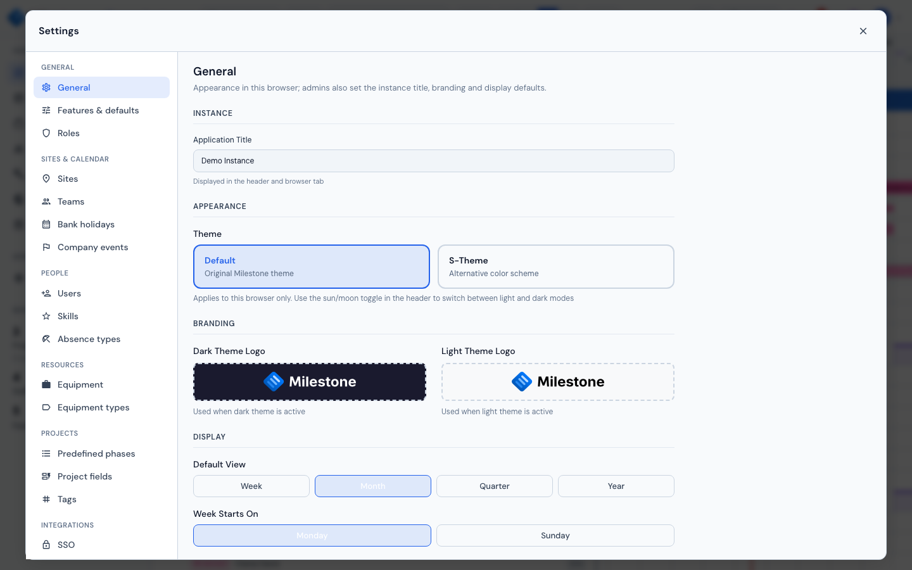
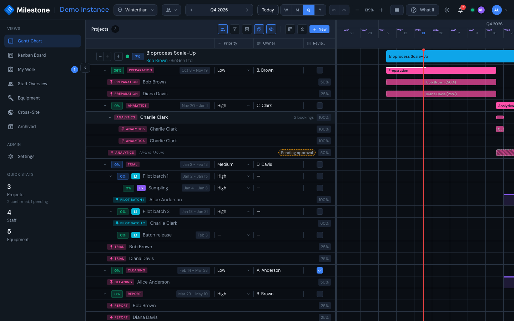
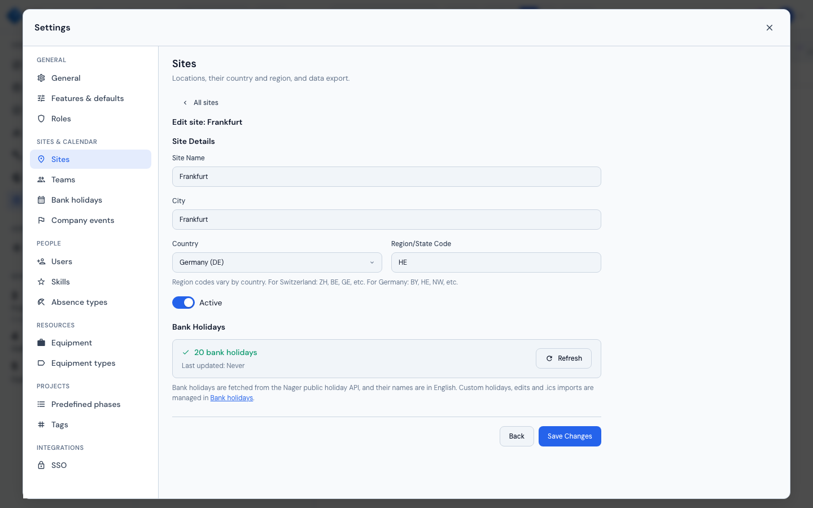
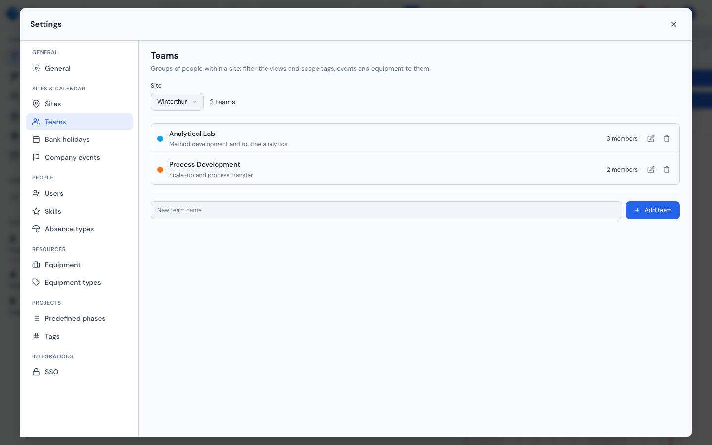
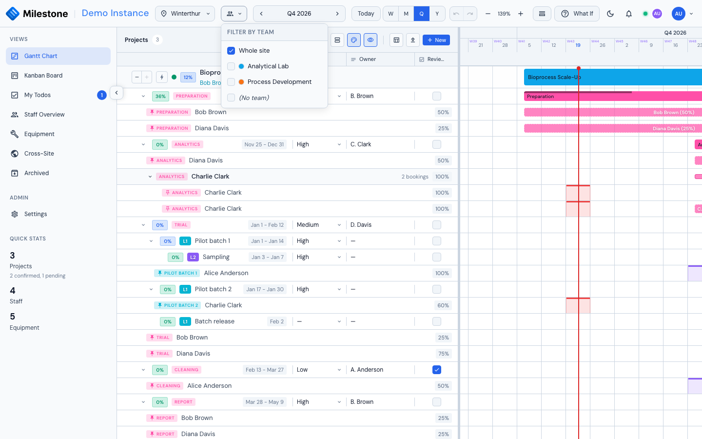
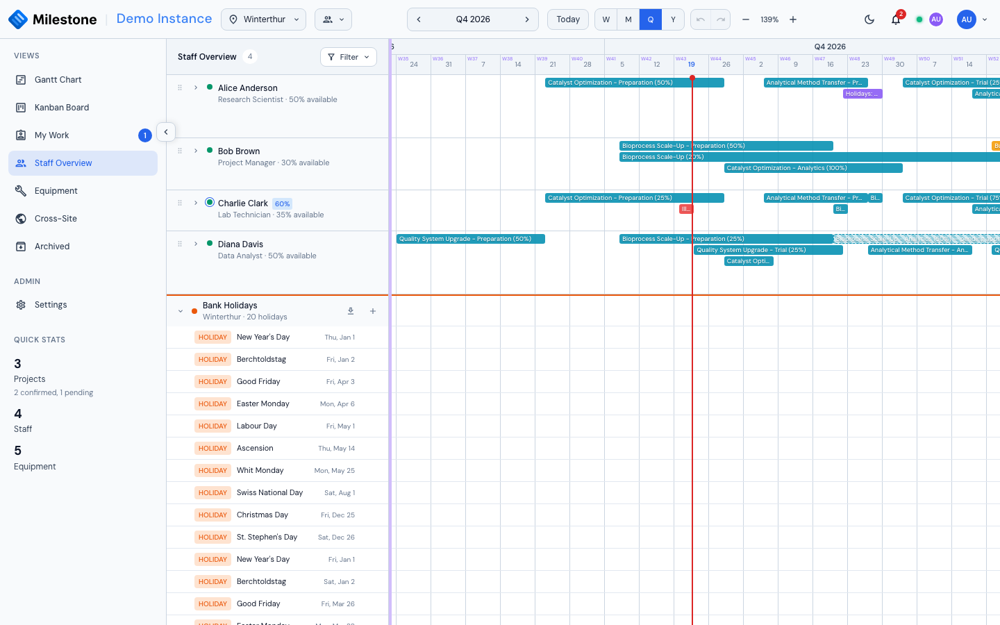
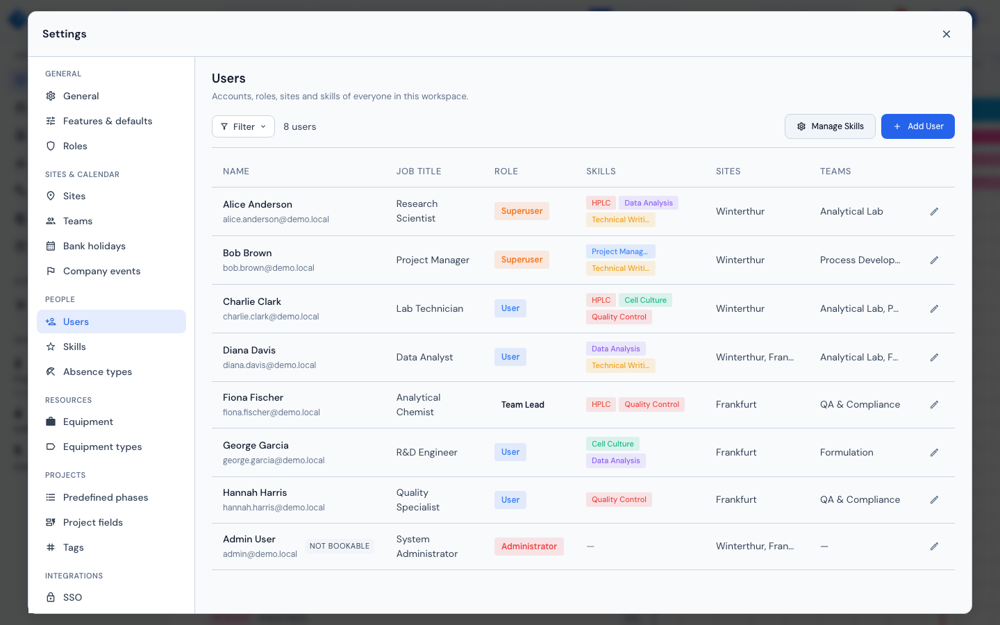
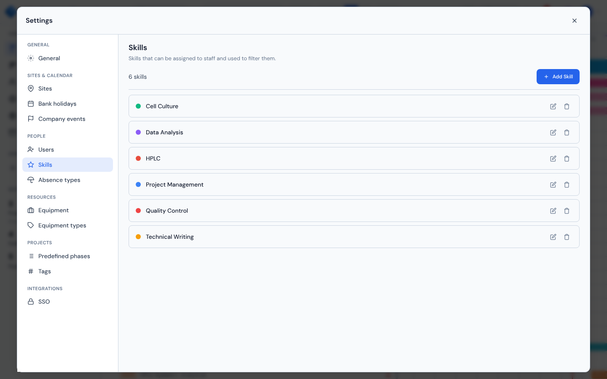
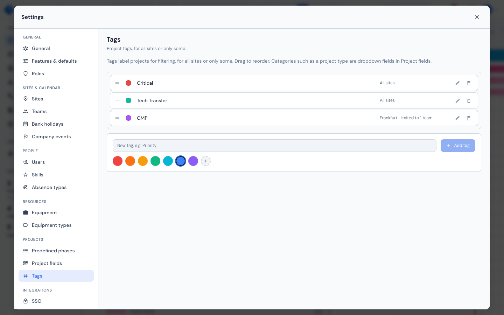
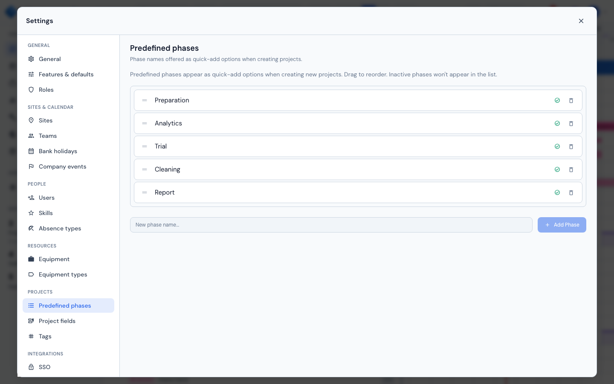

# Settings & Configuration

All administration happens in one **Settings** window. Open it from the **Settings** entry in the **Admin** section of the sidebar — the only admin entry there. The window lists its sections on the left, grouped by topic, and shows the selected section on the right.

!!! note "What-If mode"
    Settings is unavailable while a [What-If](what-if-planning.md) plan is open — the entry is disabled with an explanation. Apply or discard the plan first.

{ loading=lazy }

## Settings Sections

| Group | Section | What it manages | Who sees it |
|-------|---------|-----------------|-------------|
| General | [General](#general) | Instance title, theme, logos, display defaults | Admin (Superuser: theme only) |
| Sites & calendar | [Sites](#sites) | Locations, country/region, site Excel export | Admin |
| | [Teams](#teams) | Teams per site, their members; the header team filter | Admin, Superuser |
| | [Bank holidays](#bank-holidays) | Public and custom holidays per site | Admin, Superuser |
| | [Company events](#company-events) | Audits, meetings and site closures on one or more sites | Admin, Superuser |
| People | [Users](#user-management) | Accounts, roles, sites, skills | Admin, Superuser |
| | [Skills](#skills-management) | Skill tags for staff | Admin, Superuser |
| | [Absence types](#absence-types) | Categories of time off, shared by all sites | Admin |
| Resources | Equipment | Lab equipment on one or more sites — see [Equipment Booking](equipment-booking.md#managing-equipment) | Admin, Superuser |
| | [Equipment types](#equipment-types) | Equipment categories | Admin, Superuser |
| Projects | [Predefined phases](#predefined-phases) | Phase templates for new projects | Admin, Superuser |
| | [Tags](#tags) | Project tags, tag groups and the sites they apply to | Admin |
| Integrations | SSO | Microsoft Entra single sign-on for this workspace — see [Organization & SSO](../admin-guide/organizations-sso.md#configuring-sso-in-milestone) | Admin |

Each person only sees the sections their role can change: **superusers** see General (theme only), Teams, Bank holidays, Company events, Users, Skills, Equipment, Equipment types and Predefined phases. Regular users have no Settings entry; they manage their own time off from [My absences](vacations.md#my-absences) in the user menu.

!!! note "Unsaved changes"
    If you switch section or close the window while a form holds unsaved input — in **General**, **Users**, **Equipment**, **Sites**, **Teams**, **Skills**, **Bank holidays**, **Company events**, **Absence types**, **Equipment types** or **Tags** — Milestone asks before discarding it. Clicking outside the window never closes it.

Saving is protected against double submission: pressing Enter twice or double-clicking a Save, Add or Delete button runs the action only once.

Some sections link to each other: **Manage Types** in Equipment opens Equipment types, **Manage Skills** in Users opens Skills, and the bank-holiday status in a site's form links to Bank holidays for that site.

---

## General

The **General** section holds the theme picker and, for admins, the instance-wide settings. Superusers only see **Appearance** (the theme family of their own browser); the instance title, branding and display defaults are admin-only.

### Instance Settings

- **Application Title** — Name displayed in the header and browser tab (e.g., "ACME R&D Planner")

### Branding & Themes

- Choose from available **theme families** (color schemes) — applied immediately and saved in this browser only
- Toggle **light/dark mode** using the sun/moon icon in the header
- Upload custom logos for dark and light themes (drag-and-drop or click to browse)
- Click **Remove** to revert to the default Milestone logo

{ loading=lazy }

### Display Settings

| Setting | Description |
|---------|-------------|
| Default View | Initial timeline granularity: Week, Month, Quarter, or Year |
| Week Starts On | Monday or Sunday |
| Show Weekends | Toggle weekend columns on/off |
| Auto-expand Projects | Automatically expand all projects on load |

---

## Sites

Sites represent your organization's physical locations. Projects, staff, equipment, and holidays are all scoped to sites. Open **Settings → Sites** (Admin only) to manage them.

{ loading=lazy }

### Creating a Site

1. Open **Settings → Sites**
2. Enter a site name in the text field (e.g., "Winterthur HQ")
3. Click **Add site** (or press Enter) — the site is created with minimal fields
4. Click the **edit icon** (pencil) on the new site to open its details form

### Editing a Site

{ loading=lazy }

The site details form has these fields:

| Field | Description | Example |
|-------|-------------|---------|
| **Site Name** | Display name (required, must be unique) | Winterthur HQ |
| **City** | City location | Winterthur |
| **Country** | Country from grouped dropdown (Europe, Americas, Asia & Pacific, Africa & Middle East) | Switzerland (CH) |
| **Region/State Code** | Sub-region for holiday filtering — varies by country | ZH (Zurich), HE (Hesse), BY (Bavaria) |
| **Active** | Checkbox — inactive sites are hidden from the site selector | Checked |

Click **Save Changes** to save, or **Back** to return to the list. Emptying **City**, **Country** or **Region/State Code** and saving clears the value.

!!! tip
    Setting the **Country** enables automatic bank holiday fetching. Adding a **Region/State Code** filters holidays to your specific region (e.g., canton-specific holidays in Switzerland).

### Site Selector

The **site selector** dropdown in the header filters everything to the selected site:

- Projects visible on the Gantt chart
- Staff in the Staff Overview
- Equipment in the Equipment View
- Bank holidays and company events on the timeline
- Custom columns

Admins see all sites. Regular users only see sites they are assigned to.

- When the site has teams, the [team filter](#team-filter) next to the site selector narrows the views further to one or more teams.

!!! note "Sites scope what you see, not what a superuser may edit"
    The site selector decides which projects, staff and equipment are shown. It is not an access boundary for project work: **superusers can edit projects, phases, assignments and absences at every site**. Only bank holidays, company events, equipment, equipment blocks, equipment types and teams are limited to the sites a superuser belongs to.

### Deactivating and Deleting a Site

The Sites section has no delete button: untick **Active** to hide a site from the site selector while keeping its data. Deleting a site is only possible through the API (`DELETE /api/sites/{id}`) and **deletes all of its projects** — with their phases, subphases, assignments, equipment bookings, Kanban comments and custom-column values — and its holidays. This now happens consistently, both in the application and at the database level. Equipment and company events shared with other sites stay on those sites; equipment or an event left without any site is deleted.

!!! danger
    Deleting a site is irreversible and removes all data associated with it. To keep its projects, move them to another site first, or deactivate the site instead.

---

## Teams

A team is a group of people within **one** site — a lab, a department, a shift. Teams let everyone narrow the views to the work and people they care about, and let you limit tags, equipment and company events to some teams of a site. Open **Settings → Teams** (Admins, and Superusers for the sites they belong to).

Pick the **Site** at the top; the list shows that site's teams with their colour, description, number of members and an **Inactive** badge where it applies.

{ loading=lazy }

### Creating a Team

1. Choose the **Site**
2. Type a name in **New team name** (names are unique within a site)
3. Click **Add team** (or press Enter) — the team is created, active and without members
4. Click the **edit icon** (pencil) to fill in the rest

### Editing a Team

| Field | Description |
|-------|-------------|
| **Name** | Required, unique within the site |
| **Description** | Optional free text |
| **Color** | Shown as a dot next to the team in lists and the team filter |
| **Active** | An inactive team is no longer offered in the header team filter or in new selections |
| **Members** | Tick the people of the site who belong to the team. A member must belong to the team's site; someone can be in several teams |

Click **Save Changes** to save, or **Cancel** to go back without saving. The teams a person belongs to are shown, read-only, in the **Teams** column of [Users](#user-management). Removing a site from a person also removes them from that site's teams.

!!! note "Inactive teams still count"
    Deactivating a team does not lift what it scopes. Projects, tags, equipment and company events keep their link to it, and a closure limited to it still takes out its members. Only the header team filter leaves inactive teams out — so equipment limited to an inactive team alone is hidden under any team filter and shown under **Whole site**. An inactive team stays listed in a dialog while it is ticked there, so you can untick it.

### Deleting a Team

Click the **delete icon** and confirm. The team's members, projects, tags, equipment and company events keep working without it; anything that was limited to that team alone becomes whole-site again. Deleting is refused while a project of the team carries a [tag](#tags) that is also limited to other teams of the site and the project is in none of them — it would be left with a tag it no longer qualifies for. Add the project to one of the tag's other teams, or widen the tag, then delete the team. Deleting a site deletes its teams.

### Team Filter

The **team filter** sits in the header next to the [site selector](#site-selector). It only appears when the current site has active teams. Open it and tick:

{ loading=lazy }

- **Whole site** — no filter (the default)
- one or more **teams** — what belongs to any of them
- **(No team)** — projects and people without a team; combines with the teams you ticked

**Clear** goes back to the whole site. The button shows the current choice, for example *Analytical Lab* or *2 teams + no team*. The choice is remembered **per site in this browser**, like the tag filter, and does not change what other users see.

The filter narrows:

- the Gantt chart, the Kanban board and the archived projects (projects of the ticked teams)
- the sidebar statistics and the Staff and Equipment resource panels
- the Staff and Equipment views
- the project-manager list in the project dialog, and the staff, equipment and equipment-block pickers — a person or item already selected in the dialog stays listed
- in the [Cross-Site view](cross-site-view.md), the current site's lane only

Equipment that is not limited to any team of the site is always shown; equipment limited to teams is shown when one of them is ticked.

A project created while the filter is active starts with the filter's teams ticked, so it appears in the view you are looking at.

### Who Can Manage Teams

| Action | Admin | Superuser | User |
|--------|-------|-----------|------|
| Create, edit and delete teams | Every site | Their own sites | No |
| Assign a project to teams | Yes | Yes | Project manager of that project |
| Use the team filter | Yes | Yes | Yes |

---

## Bank Holidays

Bank holidays are configured **per site** and affect working-day calculations. They appear as highlighted columns on the Gantt and Staff timelines.

Open **Settings → Bank holidays** (Admins and Superusers; superusers only for sites they belong to). Pick a **Site** (defaults to the site you are viewing) and a **Year** (or **All years**). The table lists each holiday's date, end date, name and **Source**:

- **Nager** — fetched automatically from the public-holiday service
- **Custom** — added by hand, imported from a calendar file, or a Nager holiday that has been edited

From the toolbar you can **Refresh from Nager**, **Export .ics**, **Import .ics** and **Add holiday**.

### Automatic Fetching

If a site has a **country** set, Milestone can auto-fetch public holidays from the [Nager holiday API](https://nagerholidays.com/):

1. In **Settings → Sites**, edit the site and set its **Country** (and optionally **Region/State Code**), then click **Save Changes**
2. In **Settings → Bank holidays**, select the site and click **Refresh from Nager** (the **Refresh** button in the site's details form does the same) — Milestone fetches public holidays for the current and next year
3. If a region code is set, only holidays that apply nationally or to that region are included
4. Only public and bank holidays are imported — school, observance and optional days don't affect working-day calculations

The last refresh timestamp is shown in the site's details form: *"Last updated: April 2026"*.

A refresh replaces the site's Nager holidays but never touches custom ones. A custom holiday also **wins over Nager for every day it covers**: Nager entries falling on those days are not added, so an edited or imported holiday is never duplicated. A Nager entry is also skipped when a custom holiday in the same year has the **same name** (ignoring case and surrounding spaces) — that is how a holiday you moved to another date is recognised.

!!! note "Holiday names are in English"
    Imported holiday names come from the holiday API in English (for example *Swiss National
    Day* rather than *Nationalfeiertag*). To use another name, edit the holiday — it becomes a
    custom holiday and keeps your name across refreshes.

!!! note "Behind a corporate firewall?"
    Fetching holidays is an outbound call from the Milestone **server** to `nagerholidays.com`.
    If your network blocks server-to-internet traffic, ask your administrator to allow it —
    see [Network & Firewall Requirements](../admin-guide/installation.md#network-firewall-requirements).
    Everything else keeps working if it's blocked — and you can still fill the site's holidays
    by [importing an .ics file](#importing-holidays-from-a-calendar-file).

### Adding a Holiday

1. Click **Add holiday**
2. Enter the **Name** (e.g., "Company Anniversary")
3. Set the **Date** (required)
4. Optionally set an **End date** for multi-day holidays
5. Save

Added holidays are custom holidays for the selected site.

### Editing and Deleting Holidays

Every holiday can be edited or deleted with the icons at the end of its row, whatever its source:

- **Editing a Nager holiday** turns it into a **Custom** holiday. It keeps your changes on the next refresh instead of being overwritten or duplicated. A holiday moved to another date is recognised by its name, so the original does not come back — but if you both **rename and move** it, the refresh no longer recognises it and the Nager original returns at its original date. Keep the original name when you move a holiday.
- **Deleting a Nager holiday** removes it until the next **Refresh from Nager**, which brings it back. To drop a public holiday for good, edit it instead (for example rename it) or accept that it returns on refresh.
- **Deleting a custom holiday** removes it permanently.

### Importing Holidays from a Calendar File

Use **Import .ics** to load holidays from a calendar export — useful when the server cannot reach the holiday service, or when your HR department publishes the official calendar as a file.

1. Click **Import .ics**
2. Under **Import into**, tick one or more target sites (the selected site is preselected)
3. Drop an `.ics` file onto the upload zone, or click to browse
4. Review the preview: one file can hold many entries, and **yearly recurring** entries are expanded into one row per year (from last year up to two years ahead). Entries that already exist on the site (same date and name) are flagged **Exists** and unticked; yearly rows are flagged **Yearly**
5. Untick anything you don't want and click **Import**

A summary shows how many holidays were created and skipped. Imported holidays are stored as **custom** holidays. Entries with a recurrence other than yearly, cancelled entries, and entries without a date are listed as *not imported* with the reason.

Calendar files are limited to **5 MB** (for holidays, company events and absences alike); for a larger export, export a shorter date range. Large files are imported in batches of 500 entries, so a long export is fine as long as it stays under the size limit. `.ics` imports are unavailable in [What-If mode](what-if-planning.md).

### Exporting Holidays to Calendar

Click **Export .ics** to download the holidays currently listed (selected site and year) as an `.ics` calendar file. The **Export to Outlook** button on the Bank Holidays row of the Staff Overview does the same for the current site. Import the file into Outlook, Google Calendar, or any calendar app.

### Holidays in the Staff Overview

Expand the **Bank Holidays** row in the Staff Overview to see all holidays for the current site. Each entry is labelled **Holiday** (from the holiday service) or **Custom**. Admins and superusers can click an entry to edit it in Settings, delete it with the × button, or click **+ Add custom holiday** to open Settings → Bank holidays with the add form ready.

{ loading=lazy }

### How Holidays Affect the Timeline

- Holiday dates appear as **shaded columns** on the Gantt timeline
- They are **not counted as working days** in working-day calculations
- They do **not** reduce anyone's capacity in the Staff workload view — to take a site's staff out of the plan for a day, add a company event marked as a [site closure](#site-closures)
- The Staff View shows holiday labels in the timeline header

!!! note
    Only **Superusers and Admins** can add, edit, delete, import and refresh holidays — superusers only on sites they belong to. Regular users can view holidays but not modify them. Changes appear for other signed-in users straight away.

---

## Company Events

Company events are dated markers shown on the timeline (e.g., "ISO Audit", "All-Hands Meeting", "Annual Retreat"). One event can apply to **several sites**, so an audit or shutdown is entered once instead of once per site. An event can also be marked as a [site closure](#site-closures), which makes the staff of its sites unavailable for its dates.

Open **Settings → Company events** (Admins and Superusers). Filter by **Site** (or **All my sites**) and **Year**. The table shows each event's dates, name, color and **Sites**; site closures carry a **Closure** badge.

### Adding and Editing an Event

1. Click **Add event**, or the edit icon on an existing event
2. Enter the **Name** (e.g., "ISO Audit")
3. Set the **Start date** (required) and optionally an **End date** for multi-day events
4. Under **Sites**, tick every site the event applies to. Superusers can only choose sites they belong to
5. **Teams (optional)** — for each selected site that has teams, leave **Whole site** on, or switch it off and tick the [teams](#teams) the event is for. A site where no team is ticked keeps the whole site
6. Pick a **Color**
7. Tick **Site closure — staff on these sites are unavailable** if the sites are closed on those dates (see [Site Closures](#site-closures))
8. Save

Editing an event changes it on every site it is linked to.

### Deleting an Event

- In **Settings → Company events**, the delete icon removes the event from **all** of its sites (the confirmation lists them).
- Superusers can't edit or delete an event that is also **shared with sites they don't manage** (the edit and delete icons are disabled). Instead, **Remove from my sites** (the broken-link icon) unlinks it from their own sites; the other sites keep it.
- In the Staff Overview, the × on a Company Events entry deletes a single-site event. For an event **shared with other sites**, it only removes the event from the current site; the other sites keep it.

### Importing and Exporting Events

**Import .ics** works like the [holiday import](#importing-holidays-from-a-calendar-file): choose the target sites under **Add the events to**, pick a default **Color** for the imported events, optionally tick **Site closure — staff on these sites are unavailable**, drop the file and review the preview. The closure tick applies to the newly created events only. An event that already exists with the same dates and name is not duplicated — it is linked to any selected sites it is missing and keeps its own closure setting. **Export .ics** downloads the events currently listed; site closures are exported as busy / *out of office* time, plain events as free time.

### How Events Appear

- Company events display as **colored markers** on the Staff Overview timeline
- A plain event is informational only — it **does not affect working day calculations** or staff availability
- Events are visible to all users on the sites they are linked to
- In the Staff Overview, admins and superusers can click an event to edit it in Settings, or click **+** on the Company Events row to add one

### Site Closures

Tick **Site closure — staff on these sites are unavailable** on an event for a shutdown, a company holiday or anything else that closes a site. For every day of the event, everyone who belongs to one of the event's sites is treated as away, like an [absence that counts as unavailable](vacations.md#absence-types):

- In the [Staff workload view](staff-management.md#site-closures-in-the-workload) their cells show **0% available** in the event's color, with the tooltip *Site closed: &lt;event name&gt;*. Work assigned on those days is flagged as a **conflict**
- Today's availability in the Staff Overview and on the resource cards shows them as unavailable during a closure
- Their assignment bars in the Gantt chart are marked on the closed days
- The timeline columns of the event get a stronger, hatched tint, and the Staff Overview's Company Events row labels the entry **Closure** instead of **Event**

A person on several sites is unavailable when **any** of their sites is closed. Plain events and bank holidays do not reduce anyone's availability — only events marked as closures do.

**A closure limited to teams takes out only their members.** At a site where the event names teams, only the members of those teams are unavailable; everyone else on that site keeps working. Such a closure never shades the calendar header as closed: its timeline columns get a plain event's tint instead of the hatched closure tint, since the rest of the site is open. In the Staff Overview's Company Events row, the hover text of its **Closure** label names the teams. A plain event limited to teams is still shown to the whole site.

The site export's **Company events** sheet has a **Staff unavailable** column showing which events are closures.

---

## User Management

Open **Settings → Users** to manage accounts. Administrators can create, edit, deactivate and delete users and change their roles; superusers can view users and edit their details, sites and skills, but cannot create, delete, enable/disable users or change roles — for them the role and active status are shown read-only. Superusers cannot change other users' email address or password, and cannot edit administrator accounts. An admin cannot change their own role, deactivate or delete their own account.

Deactivating, deleting or demoting a user, or resetting their password, signs them out everywhere immediately, including live updates in open tabs.

{ loading=lazy }

### User Fields

| Field | Description |
|-------|-------------|
| **Email** | Login email address (unique) |
| **Password** | Required for new users, optional when editing (leave empty to keep it). New and changed passwords need **at least 8 characters** and at most 72 bytes; existing shorter passwords keep working until they are changed |
| **First Name** / **Last Name** | Display name |
| **Job Title** | Role description shown in staff lists. Free-text with autocomplete suggestions — see [Job Title Suggestions](#job-title-suggestions) |
| **Role** | Admin, Superuser, or User (see below) |
| **Sites** | One or more sites the user can access |
| **Skills** | Tags for resource planning (see Skills Management below) |
| **Teams** | Shown read-only in the user list; membership is edited in [Settings → Teams](#teams) |
| **Active** | Deactivate to prevent login without deleting |

### User Roles

| Permission | Admin | Superuser | User |
|-----------|-------|-----------|------|
| View projects & timeline | Yes | Yes | Yes |
| Create and delete projects | Yes | Yes | No |
| Edit a project, its phases, subphases and Kanban cards | Yes | Yes | Project manager of that project |
| Manage staff assignments | Yes | Yes | Project manager of that project; anyone for their own time ("Assign me") |
| Manage equipment assignments | Yes | Yes | Project manager of that project |
| Enter What-If mode (from the Gantt chart) | Yes | Yes | No |
| Manage bank holidays & company events (own sites) | Yes | Yes | No |
| Manage teams (own sites) | Yes | Yes | No |
| Edit users, skills, equipment, equipment types, predefined phases | Yes | Yes | No |
| Create, delete, enable/disable users; change roles | Yes | No | No |
| General settings, sites, absence types, SSO | Yes | No | No |
| Book own absences ([My absences](vacations.md#my-absences)) | Yes | Yes | Yes |

### Filtering Users

The user management table supports filtering by:

- **Status**: Active / Disabled
- **Role**: Admin / Superuser / User
- **Job Title**: Dynamic list from existing users
- **Site**: Filter by site assignment
- **Skills**: Filter by assigned skill

The results count updates as filters are applied (e.g., "12 users (filtered from 20)").

### Job Title Suggestions

The **Job Title** field is a free-text input backed by an autocomplete
dropdown. It does not have a separately managed list — instead, it
suggests every distinct job title already used by another user on this
instance. This keeps titles consistent across the team without an admin
needing to curate them.

How it behaves:

- **Click or focus** the field to see all existing titles, sorted
  alphabetically.
- **Start typing** to narrow suggestions to those containing what you've
  typed (case-insensitive substring match).
- **Pick a suggestion** with the mouse or **↑ / ↓ arrow keys** + **Enter**.
- **Type a brand-new value** and just save — the entry doesn't have to
  match a suggestion. Once saved, that new title becomes a suggestion
  for the next user added.
- **Press Escape** to close the dropdown without picking anything.
- The dropdown is scrollable when the list is long and stays anchored
  to the input even on small screens.

Notes:

- SSO-provisioned users (Microsoft Entra ID) receive their job title
  directly from the `jobTitle` claim returned by the identity provider —
  these are written to the user record as-is and become available as
  suggestions for the next user you create manually.
- Renaming a title on one user does not propagate to other users; you
  must edit each user individually if you want to retire an old title.
  An old title only stops appearing in suggestions once no remaining
  user has it set.

---

## Skills Management

Skills are colored tags assigned to staff members for resource planning and filtering. Open **Settings → Skills** (or **Manage Skills** in the Users section).

{ loading=lazy }

### Creating a Skill

1. Click **Add Skill** in the Skills section
2. Fill in:
   - **Name** (required, max 100 characters, must be unique)
   - **Description** (optional)
   - **Color** — choose from 10 preset colors or use the custom color picker:
     - Presets: Blue, Purple, Green, Amber, Red, Cyan, Pink, Lime, Orange, Indigo
     - Custom: Click the color picker to choose any hex color
3. A **live preview** shows the skill name with its color dot
4. Click **Save**

### Editing a Skill

Click the **edit icon** on any skill in the list to modify its name, description, or color. Changes apply immediately to all users who have the skill assigned.

### Deleting a Skill

Click the **trash icon** on a skill. A confirmation dialog warns: *"This will remove the skill from all users who have it assigned."* Deletion cascades to remove the skill from every user.

### Assigning Skills to Users

1. Open **Settings → Users** and edit (or create) a user
2. In the **Skills** section, click skill buttons to toggle them on/off
   - Selected skills show a blue-tinted background with a color dot
   - Unselected skills show a gray border
3. To create a new skill inline, click **+ New skill**, type a name, and press Enter
4. Save the user — skills are updated immediately

### Filtering Staff by Skills

In the **Staff Overview**, open the **Filter** panel:

1. Under the **Skills** section, check one or more skills
2. Each skill shows its assigned **color dot** next to the name
3. Staff members matching **any** of the selected skills are shown (OR logic)
4. The header updates to show the filtered count: "8/20 staff"
5. Click **Clear All** to reset all filters

Skills are also visible as colored badges in the **Users** table (first 3 shown, "+N" for additional).

---

## Absence Types

Absence types are the kinds of time off people can book — for example Holidays, Home Office or Illness. They are shared by **all sites** and managed by **admins** in **Settings → Absence types**. Every absence is booked with a type; see [Vacations & Time Off](vacations.md#absence-types) for how they are used.

New installations and upgraded ones start with these types:

| Type | Counts as unavailable |
|------|-----------------------|
| Holidays | Yes |
| Home Office | No |
| Illness | Yes |
| Business Trip | Yes |
| Training | Yes |

Absences that existed before absence types were introduced are filed under **Holidays**.

### Managing Types

Each type has:

- **Name** — must be unique
- **Color** — used for the absence bars and badges in the Staff Overview and on the timeline
- **Counts as unavailable** — when ticked (Holidays, Illness…), the absence removes the person's capacity in the workload views. When unticked (Home Office), the absence is shown on the timeline but the person stays available for planning
- **Active** — inactive types are hidden when booking a new absence, but existing absences keep their label and color

To add a type, enter a name at the bottom of the list (e.g., "Parental leave"), choose whether it counts as unavailable, pick a color and add it. Click the edit icon to change a type's name or color, and use the toggles to change the other settings. **Drag** types to reorder them — the order is used in every absence-type picker.

### Deleting a Type

A type can only be deleted while **no absence uses it**. If it is in use, deletion is refused with *"in use — deactivate it instead"*: untick **Active** so it is no longer offered for new absences.

---

## Equipment Types

Equipment types categorize your inventory for filtering in the Equipment View. Manage them in **Settings → Equipment types**, or click **Manage Types** in the Equipment section.

### Creating Types

A type exists as long as at least one piece of equipment uses it, so types are created through equipment: when creating or editing an equipment item, click **+ New type**, enter a name, and confirm. The type is saved with the equipment item. (Settings → Equipment types has no **Add Type** button any more — a type without equipment could not be stored.)

### Renaming Types

1. Open **Settings → Equipment types**
2. Click the **edit icon** on a type
3. Enter the new name
4. Click **Rename Type**

!!! note
    Renaming a type updates **all equipment items** that use it. A warning shows how many items will be affected.

### Deleting Types

Click the delete icon on a type and confirm. A type can only be deleted once **no equipment item** uses it; if equipment still uses it, the deletion is refused with a message telling you to change those items' type in **Equipment** first.

Superusers can rename or delete a type only when **every** piece of equipment of that type is at one of their sites; otherwise the change is refused, because types are shared by the whole workspace.

### Type Filtering

In the **Equipment View**, use the type filter dropdown to show/hide equipment by type:

- Click the filter button to open the dropdown
- Use **Select All** / **Clear** for quick selection
- Check individual types to filter
- The filter button shows the active count (e.g., "3 types")

---

## Tags

Tags are coloured labels attached to projects (see [Tags in the Gantt chart](gantt-charts.md#tags)). Admins manage them in **Settings → Tags**; everyone who can edit a project attaches them from the project dialog.

{ loading=lazy }

### Tag Groups

A group turns a set of tags into a category, for example **Project type** with the tags *Internal* and *Customer*.

- **Single select** — A project can carry at most one tag of the group. In the project dialog the group's tags behave like radio buttons: choosing one replaces the other.
- **Order** — Drag groups to change the order in which they appear in the picker and the filter.
- **Delete** — The group's tags are kept and become ungrouped.

Switching a group to single select is refused while any project holds two or more of its tags; the message says how many projects need attention first.

Colouring the Gantt project bars by a group is not set here: each user picks it with **Colour by** in the Gantt chart (see [Project colours](gantt-charts.md#project-colours)).

### Managing Tags

Tags are listed under their group, with ungrouped tags under **Other**.

- **Name and colour** — Edit the name inline; pick a colour from the swatches or enter a custom one.
- **Group** — Move a tag into a group or out of it. Moving it into a single-select group is refused if a project already holds another tag of that group together with it.
- **Sites** — By default a tag applies to **all sites**. Switch that off to pick the sites where the tag is offered. Restricting a tag is refused while projects at a site you are removing still use it. Deleting a site also deletes tags that were limited to that site only.
- **Teams** — For each site where the tag applies and that has [teams](#teams), leave **Whole site** on, or switch it off and tick teams: at that site the tag is then offered only on projects of those teams. Limiting a tag is refused while a project outside the ticked teams still uses it. The tag list shows *limited to N teams* next to the sites.
- **Order** — Drag tags to reorder them within their group.
- **Delete** — Removes the tag from every project; you are asked to confirm.

---

## Predefined Phases

Phase templates that appear as pre-selected options when creating a new project.

{ loading=lazy }

### Managing Templates

1. Open **Settings → Predefined phases** (Admins and Superusers)
2. Each template has:
   - **Name** — The phase name (e.g., "Planning", "Execution", "Review")
   - **Color** — Color used for the phase bar on the timeline
   - **Active/Inactive** — Only active templates appear in the project creation modal
   - **Display Order** — Drag to reorder how templates are listed

### How Templates Work

When creating a new project, all **active** predefined phases are pre-selected as checkboxes. Uncheck any you don't need for that project. The selected phases are created with default durations matching the project's start and end dates.

### Adding a Template

1. Click **+ Add Phase**
2. Enter the name and pick a color
3. The new template is active by default and appears at the end of the list
4. Drag to reorder as needed

---

## Custom Columns

Add custom data fields to the project panel in the Gantt chart. See [Gantt Charts — Custom Columns](gantt-charts.md#custom-columns) for full details on creating, editing, and using custom columns.
