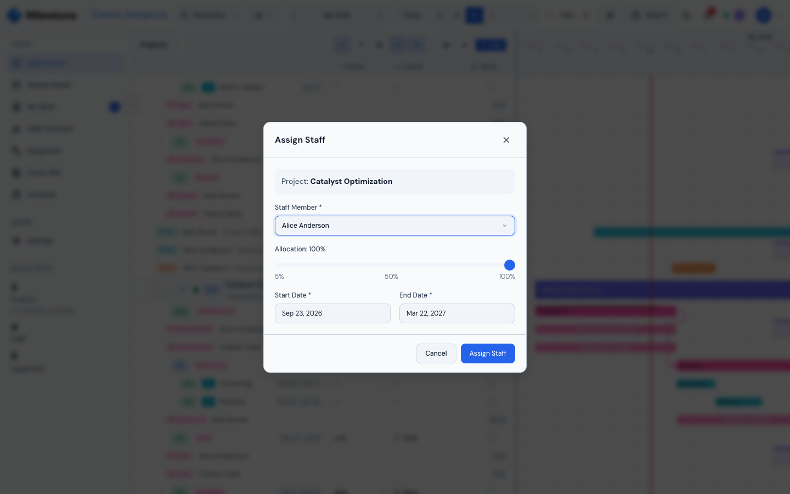
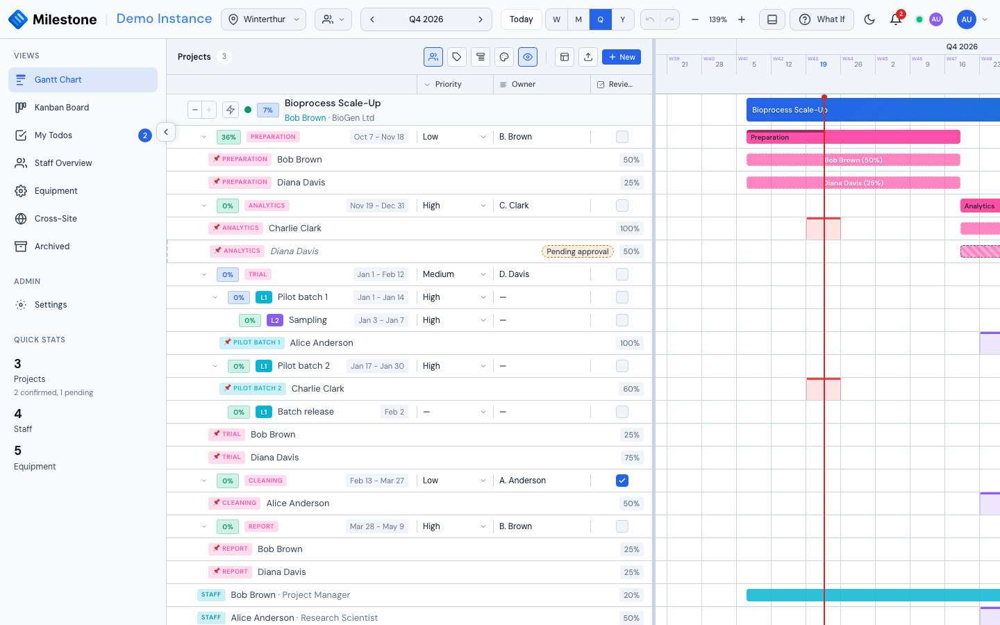
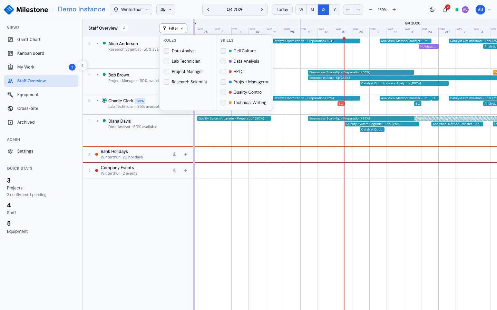

# Staff Management

The **Staff Overview** provides a timeline view centered on people rather than projects. It shows each staff member's assignments, availability, and time off.

{ loading=lazy }

!!! tip
    People who can edit projects (admins and superusers by default) and project managers can dock the Staff Overview directly below the Gantt chart via the **Panels** button — see [Resource Panels](gantt-charts.md#resource-panels).

## Staff List Panel

The left panel lists every person of the site who is **bookable as a resource** — whatever their role. Administrators are not bookable by default, so they appear only once an administrator turns on **Bookable as a resource** for them in [Settings → Users](settings.md#bookable-as-a-resource); people with the switch off are not listed and cannot be booked, but keep the bookings they already have. Each person is shown with:

- **Status indicator**: Green (available) or Red (overallocated)
- **Part-time badge**: Shows maximum capacity if less than 100%
- **Role and allocation**: Job title and current total allocation percentage
- **Drag handle**: Admins, superusers and project managers can drag staff onto the Gantt timeline to create assignments; everyone else can drag **their own** card when their role lets them book themselves (see [Adding Yourself to a Project](#adding-yourself-to-a-project))

Click the arrow to expand a staff member and see their absences (with each absence's type), recurring absences, and current project assignments. You see the absences of colleagues at the sites you can see, if your role has **See colleagues' absences** (see [Who Sees Whose Absences](vacations.md#who-sees-whose-absences)).

## Staff Timeline

The right side shows a horizontal timeline with:

- **Assignment bars** — Colored by project, stacked when overlapping; a booking still [awaiting approval](#booking-yourself-when-approval-is-required) is hatched and does not count towards the workload
- **Absence blocks** — Drawn in the color of their [absence type](vacations.md#absence-types). Only types that count as unavailable reduce capacity; a Home Office day is shown but leaves the person available
- **Workload indicator** — Thin bar showing total utilization level
- **Site closures** — Company events marked as closures make the staff of their sites unavailable; see [below](#site-closures-in-the-workload)
- **Bank holidays and company events** — Expandable rows at the bottom. Admins and superusers can click an entry to edit it, or **+** to add one, in [Settings](settings.md#bank-holidays); changes appear for other users straight away

## Site Closures in the Workload

A [company event marked as a site closure](settings.md#site-closures) takes everyone on the event's sites out of the plan for its dates:

- their workload cells show **0% available**, colored with the event's color, and the tooltip reads *Site closed: &lt;event name&gt;*
- if they have work assigned on those days, the cell is flagged as a **conflict** (*Conflict: N% assigned during site closure*), just like work booked during an unavailable absence
- today's availability in the staff list and on the resource cards shows them as unavailable while the closure lasts

Someone who belongs to several sites is unavailable as soon as **one** of their sites is closed. Bank holidays and plain company events are shown on the timeline but do not reduce capacity.

A closure can be limited to [teams](settings.md#teams): then only the members of those teams are unavailable at that site, and everyone else keeps their normal availability. The event still appears in the Company Events row (unless the header team filter leaves its teams out), but the calendar columns are not shaded as closed.

With the header [team filter](settings.md#team-filter) set, the Staff Overview lists only the people of the ticked teams (or those without a team, with **(No team)**) and only the company events open to them.

## Assigning Staff

Admins and superusers (any role with **Assign and manage anyone**) can assign anyone to any project at the sites they can see. The **project manager** of a project can do the same on that project. Everyone else can [add themselves](#adding-yourself-to-a-project) — directly, or with approval when their role requires it.

New assignments (drag-and-drop, **Assign Staff**, **Assign me**) can't be created while [What-If mode](what-if-planning.md) is active; existing ones can still be edited, moved and removed there. What-If is entered from the Gantt chart, and the Staff Overview itself is not reachable while a plan is open.

### Method 1: Drag & Drop

1. Grab a staff member by the drag handle in the Staff Overview or the resource panel
2. Drag them onto a project/phase/subphase bar on the Gantt timeline
3. A five-day assignment at the person's maximum capacity is created where you drop it — adjust its dates or allocation afterwards

### Method 2: Context Menu

1. Right-click on a project, phase, or subphase in the Gantt chart
2. Select **Assign Staff**
3. The Staff Assignment Modal opens

### Assignment Modal

{ loading=lazy }

- Select a **staff member** from the dropdown
- Set **allocation percentage** (5–100% in 5% increments). The server accepts any whole number from 1 to 100 for a single assignment and rejects 0 or more than 100; over-allocation comes from several overlapping assignments
- Assignment dates are picked on the [shared calendar](gantt-charts.md#picking-dates), so the end date can never fall before the start date
- A warning appears if the assignment would exceed capacity
- Phase/subphase assignments inherit dates automatically
- Project-level assignments allow custom start/end dates

## Adding Yourself to a Project

With the default roles, anyone — including users with the plain **User** role — can book their own time on a project, change it and withdraw it again, without being able to assign other people. An administrator can change that per role in [Settings → Roles](settings.md#roles-permissions): booking yourself, changing your booking and removing it can each be allowed, need approval (see [below](#booking-yourself-when-approval-is-required)) or be denied — then the matching menu entries and buttons are hidden.

- **Right-click** a project, phase or subphase in the Gantt chart and choose **Assign me**. You are booked at your own maximum capacity for the item's dates. The entry reads **Assigned to me** (greyed out) once you are on it
- **Drag your own card** from the Staff Overview or the resource panel onto a project, phase or subphase bar — this creates a five-day assignment at your maximum capacity where you drop it (in quarter and year views, starting at the day under the pointer). Only your own card can be dragged
- On the [Kanban board](kanban-board.md#joining-a-card-yourself), open a card and click **Join this card**
- On **your own** assignment row you can change the allocation with the slider, move or resize your own assignment bar, and remove the assignment. **Edit Assignment** in its right-click menu opens the assignment dialog with the staff member fixed to **You**

If you are not **bookable as a resource** (see [Settings → Users](settings.md#bookable-as-a-resource)), **Assign me**, **Join this card** and dragging your own card are hidden, and the assignment dialog explains that you cannot book your own time. Your existing bookings can still be changed and removed.

Assigning or editing someone else still needs **Assign and manage anyone** (superusers by default) or being the project's manager.

## Booking Yourself When Approval Is Required

If your role books your own time **with approval**, the same actions send a request instead of booking you straight away:

- The entries read **Request to assign me** (right-click menu and assignment dialog), **Request to join** (Kanban card), **Request change** and **Request removal**. After sending, *Sent for approval* appears
- A new booking shows at once as a **dashed row** with a **Pending approval** badge, and a hatched bar on the timeline. Hover the badge to see who can approve it. Until it is approved it is **not counted** in the workload heatmap, the availability or the resource cards, and it does not make you an assignee of a Kanban card
- A requested change keeps the booking as it was and shows the old and new values (*40% → 60%*, *Change pending*); a requested removal shows *Removal requested*. The bar stays where it is and cannot be dragged while the request is open
- While a request is open, right-click your row and choose **Cancel request** to withdraw it (or **Cancel request** on the Kanban card). The rest of the row stays locked until the request is decided

{ loading=lazy }

Approvers — the project's manager and the roles chosen in [Settings → Roles → Approvals](settings.md#approvals), and always administrators — get a notification. They can decide from [My Todos](my-todos.md), from the Kanban card or right here: right-click the dashed row and choose **Approve request** or **Reject request…** (with an optional reason). Approving turns the row into a normal booking; rejecting removes it. You are notified either way.

People who can manage anyone's bookings — and project managers on their own projects — never need approval, not even for themselves.

## Filtering Staff

Click the **Filter** dropdown to filter by:

- **Role** — Multi-select checkboxes (e.g., Research Scientist, Lab Technician)
- **Skills** — Multi-select with colored dots matching each skill's color
- **Clear All** — Reset all filters

The header shows filtered/total count (e.g., "12/20 staff") when filters are active.

If an administrator set default skills in [Settings → Features & defaults](settings.md#features-defaults), the Staff view and panel open with those skills already ticked; change or clear them as usual.

{ loading=lazy }

## Staff Notes

Staff notes are short, date-pinned annotations attached to a site — for example *"Covering weekend shift for stability study sampling"* — optionally linked to a specific staff member. They are useful for recording scheduling context that doesn't belong in an assignment or vacation entry.

Notes are currently managed through the API (`GET /api/notes` to list; creating and deleting need the **Manage staff notes** permission, superusers and admins by default) and are included in the **Staff notes** sheet of the [full site Excel export](import-export.md#site-excel-export), so they travel with the rest of your site's data in backups and migrations. A dedicated notes UI is not available yet.
