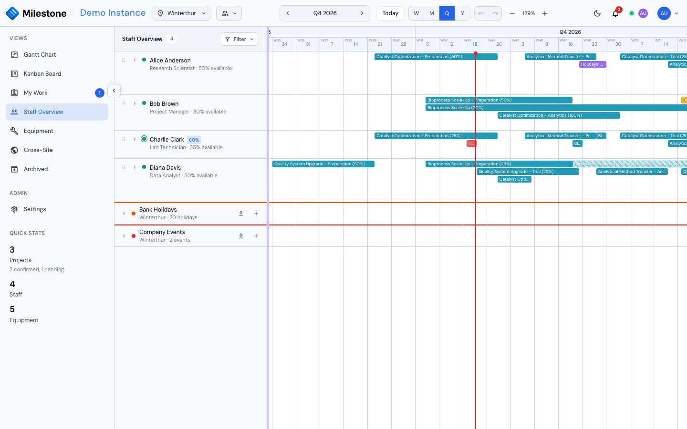
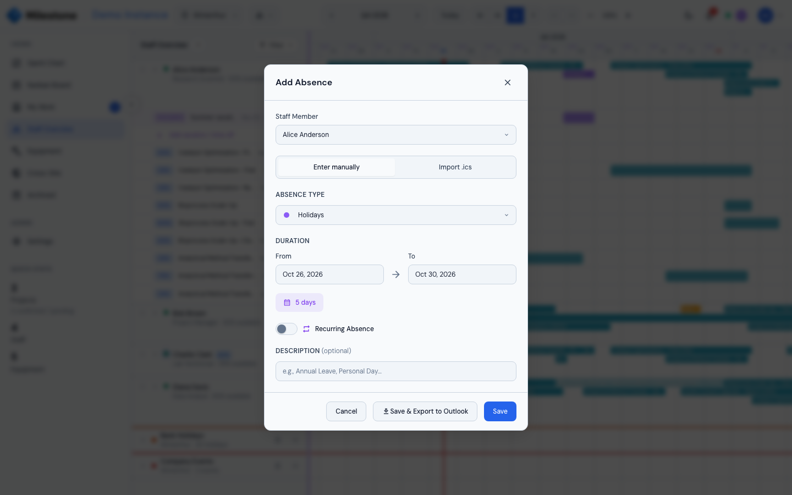

# Vacations & Time Off

Milestone tracks staff absences — vacations, home-office days, illness, business trips, training and other time off — to provide accurate availability data in the Staff Overview and the workload views.

{ loading=lazy }

## Absence Types

Every absence is booked with an **absence type**. Admins define the types for all sites in [Settings → Absence types](settings.md#absence-types); new installations start with **Holidays**, **Home Office**, **Illness**, **Business Trip** and **Training**.

Each type has a color and a **Counts as unavailable** setting, which decides how the absence affects planning:

| | Counts as unavailable (e.g. Holidays, Illness) | Available (e.g. Home Office) |
|---|---|---|
| Shown on the Staff timeline | Yes, in the type's color | Yes, in the type's color |
| Reduces capacity in the workload heatmap | Yes — the day counts as time off | No — the person stays fully plannable |
| Today's availability in the Staff Overview and resource cards | Unavailable | Available |

If an unavailable and an available absence overlap on the same day (for example Illness during a Home Office week), the unavailable one wins.

!!! note "Site closures"
    A shutdown or company holiday that applies to a whole site doesn't need an absence for every person: a [company event marked as a site closure](settings.md#site-closures) makes everyone on its sites unavailable for its dates, shown in the Staff workload view under the event's name and color.

## Creating an Absence

1. In the Staff Overview, expand a staff member and click **+ Add vacation / time off** — or use [My absences](#my-absences) for your own
2. Choose the **Absence type** — it defaults to the first active type that counts as unavailable (normally Holidays)
3. Set the **From** and **To** dates (duration is calculated automatically)
4. Optionally add a **description** (e.g., "Annual Leave", "Conference")
5. Click **Save**

Admins and superusers can create absences for any staff member by selecting them from the dropdown — at any site, not only their own; regular users can only book their own. Admins and superusers can click an existing absence in the Staff Overview to edit it. A person who belongs to several sites appears once in the staff picker.

An absence whose **To** date is before its **From** date is rejected.

!!! note "What-If mode"
    Adding absences is unavailable while [What-If mode](what-if-planning.md) is active, like other creates — the **Add** buttons are disabled with an explanation. Editing and deleting existing absences still works.

## Who Sees Whose Absences

| Role | Absences shown |
|------|----------------|
| Admin, Superuser | Everyone's, at every site |
| User | Their own, plus those of colleagues who share at least one site with them |

Absence descriptions can be personal (for example a reason for illness), so plain users no longer see the absences of people at sites they don't belong to.

{ loading=lazy }

## Recurring Absences

For regular part-time patterns (e.g., every Monday and Wednesday off):

1. Check **Recurring Absence** in the absence form
2. Select the days of the week (Mon through Sun)
3. Click **Save**

Recurring patterns are shown with a repeat badge in the staff list and only affect the selected weekdays — the Staff Overview, the workload heatmap and resource cards all treat the other days in the range as normal working days.

## My Absences

Everyone — including regular users — can manage their own time off from the **user menu** (click your avatar in the header) → **My absences**. The window lists:

- **Upcoming and current** absences
- Absences from the **last 90 days**

Each entry shows its type (with an *available* note for types such as Home Office that don't reduce capacity), dates, description and any recurring days, with **Edit** and **Delete** buttons. Click **Add absence** to book a new one, or **Import .ics** to load several from a calendar file.

The Staff Overview keeps its own entry points — **+ Add vacation / time off** and clicking an existing absence — for admins and superusers planning on behalf of others.

## Importing from Calendar (ICS)

Import absences directly from Outlook or other calendar applications — from **My absences → Import .ics**, or from the **Import .ics** tab of the absence form in the Staff Overview:

1. Pick a **Default absence type** for the import
2. Drag-and-drop an **.ics file** onto the upload zone (or click to browse)
3. Milestone parses every event in the file and shows a preview with a **Type** column per row. The type is prefilled from the file where possible:
    - Outlook entries marked **Working elsewhere** become **Home Office**
    - an Outlook **category** with the same name as an absence type, or a **title** containing a type name (e.g. "Training — Excel basics"), uses that type
    - anything else follows the default type
4. Absences that already exist for that person with the same dates are flagged **Exists** and unticked
5. Adjust the type of any row, untick what you don't want, and click **Import**

A summary shows how many absences were created and skipped. Yearly recurring entries are expanded into one absence per year; other recurring entries can't be imported and are listed as *not imported*. The importer handles UTF-16 encoding (common with SAP calendar exports). Files larger than **5 MB** are refused — export a shorter date range from your calendar instead.

!!! note "What-If mode"
    Importing is unavailable while [What-If mode](what-if-planning.md) is active — apply or discard your What-If changes first.

## Exporting to Outlook

Click **Save & Export to Outlook** (instead of just Save) to download an **.ics file** that you can open in Outlook or any calendar app to sync the time off to your personal calendar.
