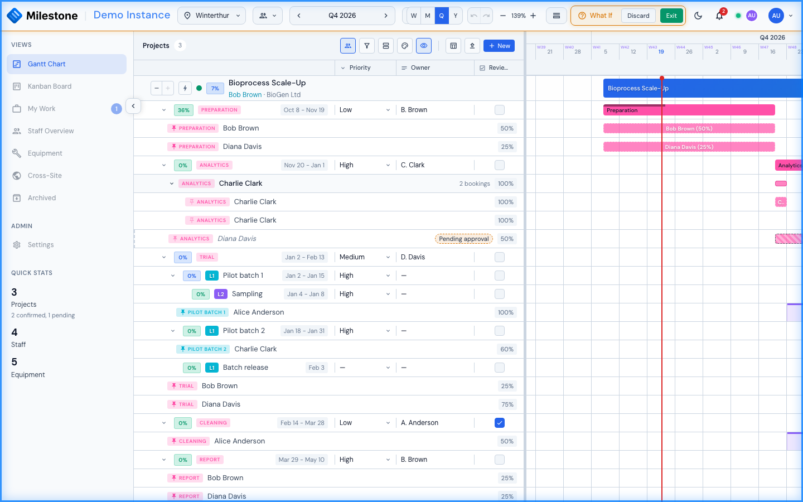

# What-If Planning

**What-If Mode** lets administrators and superusers experiment with scheduling changes without affecting the live data.

{ loading=lazy }

## How It Works

1. Open the **Gantt chart** and click the **What If** toggle in the header (the toggle only appears there)
2. The interface changes visually to remind you that you're in planning mode; a badge next to *What If* counts the changes you have queued
3. Make changes: move and resize phases, edit dates and details, change or remove assignments, delete items
4. Changes are **not saved to the database** — they are queued in your browser
5. When done, choose:
    - **Apply** — send the queued changes to the server (the button reads **Exit** while nothing is queued)
    - **Discard** — throw the changes away and restore the plan as it was when you entered What-If mode

## Key Behaviors

- What-If is a **private sandbox**: your experimental changes stay in your browser and are *not* sent to the server or visible to other users until you apply them
- Only administrators and superusers can enter What-If mode, and only from the Gantt chart: What-If is a planning simulation of the timeline
- **The Gantt chart keeps the focus.** While a What-If plan is open, the other views in the sidebar, the **Settings** window and the notification links that open a Kanban card are disabled, with a short explanation on the control. Apply or discard first; nothing is lost
- The visual appearance changes (header indicator) to remind you that you're in planning mode
- **Colleagues' changes wait.** While you are in What-If mode, project and custom-column changes made by other people are not pulled into your view (they would overwrite the plan you are editing); they are loaded as soon as you apply or discard
- **Undo history is cleared** when you enter What-If mode, and again when you apply or discard, so an undo can never write a discarded plan to the server. Undo and redo *inside* What-If work as usual
- **Signing out (or an expired session) discards the sandbox** — nothing carries over to the next person using the same browser tab

### What is unavailable in What-If mode

Anything that **creates** something new is disabled while What-If mode is active, with a short explanation on the control: new projects, phases and subphases, new staff and equipment assignments (including drag-and-drop from the resource panel, **Assign me** and joining or assigning people on Kanban cards), new **absences** and new **equipment blocks**. A queued create has no real id on the server, so the new item could not be shown or edited until Apply. Editing and deleting existing items stays available, except bank holidays and company events, which are not part of the plan and cannot be deleted while it is open.

Deleting **users** or **equipment** in Settings is blocked as well (Settings itself is unavailable, see above): their bookings are part of the plan, and a plan must never show bookings of something that no longer exists.

Imports are blocked as well:

- Importing a Microsoft Project or CSV file — imports cannot be sandboxed, so exit What-If mode first
- Importing `.ics` calendar files (bank holidays, company events, absences), because calendar data is not part of the What-If snapshot

Kanban comments and your notification inbox are not part of the plan: comments you post in What-If mode are saved immediately. The same goes for **tags and tag groups** in Settings: they are configuration, so an admin's changes there apply straight away even while a What-If plan is open. Attaching tags to a project is part of the plan and is queued like any other edit; if an admin makes a group single-select while your queued edit still holds two of its tags, Apply stops at that edit with an explanation — discard it and redo the change.

## Applying and Discarding

When you're finished experimenting:

- **Apply** — after a confirmation (*Apply N changes to the database?*), the queued changes are sent to the server **one by one, in the order you made them**. When all of them succeed, the view reloads from the server and What-If mode ends; the changes are now the live data visible to all users.
- **Discard** — after a confirmation, all queued changes are thrown away and the plan returns to its state when you entered What-If mode. No trace of the session remains on the server.

If you keep editing while Apply is reloading the view at the end, those late edits are not lost: they stay queued and What-If mode remains active with just those changes.

### If Apply fails

Apply **stops at the first change the server rejects** (for example because a colleague deleted the phase you edited). Instead of a one-off alert, a banner appears under the What-If controls in the header:

> *3 of 5 changes applied, then one failed: …* — *2 changes are still queued. The view shows what is saved on the server.*

- The changes before the failure **are saved**; the failed one and everything after it stay queued.
- The view is reloaded from the server, so it shows what really landed.
- What-If mode stays active. **Discard** from here returns to the server's current state (including the changes that were applied), not to the state before What-If.

The banner offers:

| Button | Effect |
|--------|--------|
| **Retry** | Try to apply the remaining queued changes again (useful after a temporary network or server problem) |
| **Discard** | Drop the remaining queued changes |
| **×** (Dismiss) | Hide the message; the changes stay queued and you can keep editing or Apply later |

!!! warning
    Applied changes cannot be undone as a group. Review your changes carefully before applying, especially if multiple phases or assignments were modified.

## Use Cases

- Test resource reallocation before committing to it
- Explore "what happens if we move Project X to Q3?"
- Plan team changes without disrupting the live schedule
- Present planning options to stakeholders before deciding
- Run capacity scenarios during planning meetings — apply only the option the team agrees on
